# Politécnico Open World (POW)

**Politécnico Open World (POW)** is a Kotlin Multiplatform game for Android and iOS.
Its **Titulación por Combate** fighting mode runs on both platforms; the map-based open world,
story campaign and zombie minigame currently run on Android.

<!-- POW_IPHONE_GALLERY_START -->
<!-- Keep all 61 original PNGs. Preserve the curated order recorded in hero-selection.json. -->
<a id="pow-iphone-gallery-complete"></a>
<a id="pow-iphone-gallery-featured"></a>
## 📸 Real iPhone 15 screenshots

**Four-hit combos, impact flashes and dramatic stages — captured in real matches.**

Explore **61 original screenshots**: 60 stage-and-lighting combinations, 19 fighters excluding Paramédico, and an extra four-hit Charro combo.
The strongest action shots come first. Open a group to view up to three images; all groups start closed.

Each image keeps `loading="lazy"` and its natural aspect ratio. GitHub may still preload images while a group is closed.

[Full gallery and capture provenance](pr-screenshots/iphone15-pr188/README.md) · [Physical iPhone QA report](PolitecnicoOpenWorld/README%20for%20IAS/SF/QA_IPHONE_PR188_2026-11-15.md)

<details>
<summary>📸 Featured action — View 3 screenshots (1–3 of 61)</summary>

**El Charro Negro vs El Charro Negro — Four-hit combo**

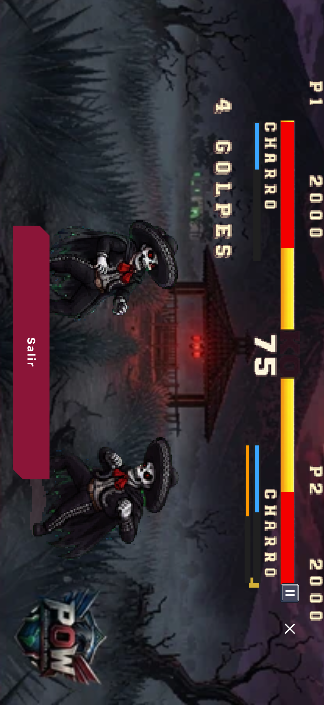

Both Charros are fully visible in combat with the localized 4 GOLPES counter. This extra AI-vs-AI screenshot is outside the 60-background matrix and does not establish the final match result by itself.

**Robot Estudiantx vs Alexis Syntaxis — Planetario IPN · Day**

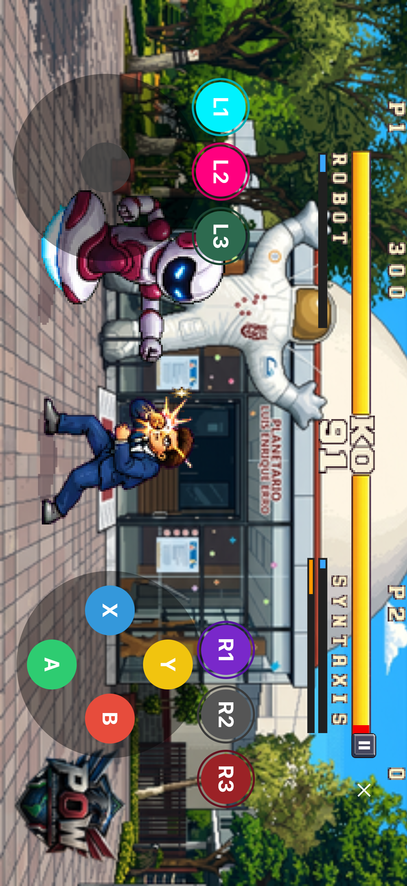

Robot Estudiantx extends an arm with an impact spark in front of Alexis Syntaxis’s face. Planetario IPN by day, the ROBOT/SYNTAXIS HUD and a P1 score of 300 are visible.

**Yoalli Ehécatl vs La Presidenta — Mictlán · Night**


Yoalli Ehécatl attacks while La Presidenta reacts with her hands beside her face. The 2 GOLPES counter is visible at Mictlán by night; P1 has 400 points.

</details>

<details>
<summary>📸 More action highlights — View 3 screenshots (4–6 of 61)</summary>

**Robot Estudiantx vs Alexis Syntaxis — Planetario IPN · Night 2**

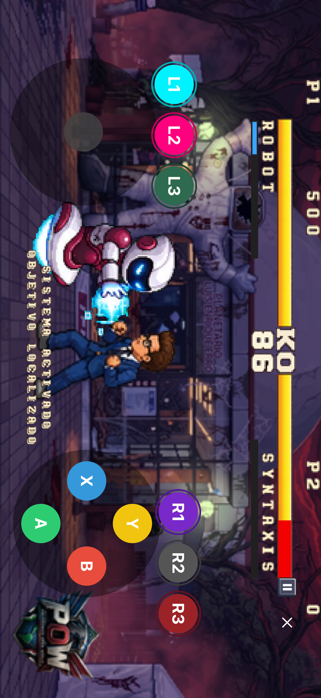

Robot Estudiantx has a bright cyan orb or discharge in front of its arms while Alexis Syntaxis remains legible on the Night 2 Planetario IPN stage. P1 has 500 points.

**La Tzitzimime vs Yoalli Ehécatl — UAM Azcapotzalco · Night 2**


La Tzitzimime is airborne while Yoalli Ehécatl remains fully visible on the ground, with recognizable faces, a red moon and a swirling effect on the Night 2 UAM Azcapotzalco stage. P1 has 500 points; the pose alone does not establish an impact.

**Policía CDMX vs La Presidenta — Ciudad Universitaria UNAM · Day**

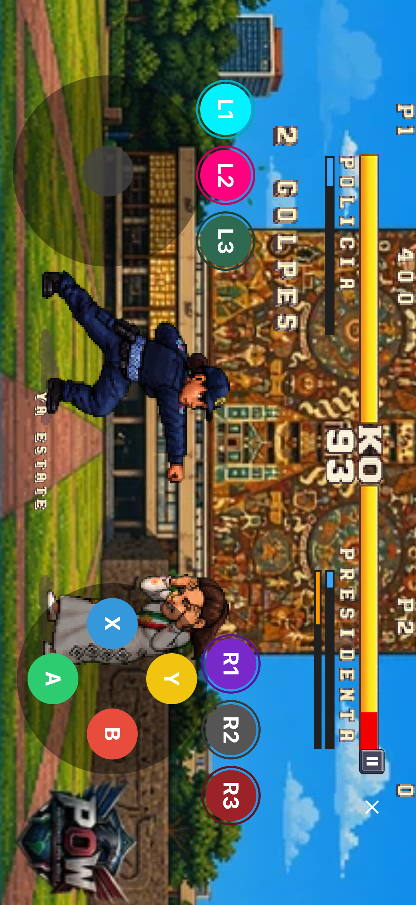

Policía CDMX extends a fist as La Presidenta raises her hands beside her face. The 2 GOLPES counter, P1 score of 400 and reduced P2 health bar are visible in front of the Ciudad Universitaria mural by day.

</details>

<details>
<summary>📸 More action highlights — View 3 screenshots (7–9 of 61)</summary>

**La Planchada vs La Llorona — ESM IPN · Night 2**


La Planchada is clearly airborne with an extended fist above La Llorona, with both faces legible on the Night 2 ESM stage. P1 has 700 points.

**Estudiante vs Estudianta — ESCOM · Night 2**


Estudiante crouches with a bright cyan effect in front of his hands while Estudianta remains fully visible. Fog covers the Night 2 ESCOM stage; P1 has 400 points and P2 has lost health.

**La Tzitzimime vs Estudianta — Pirámide del Sol · Night**


La Tzitzimime extends several arms toward Estudianta, with a visible 2 GOLPES counter and P1 score of 400 at Pirámide del Sol by night.

</details>

<details>
<summary>📸 View 3 screenshots (10–12 of 61)</summary>

**Estudiante vs Estudianta — ESCOM · Night**


The fighters are separated and clearly visible, with the localized 2 GOLPES counter, a P1 score of 700 and a reduced P2 health bar.

**El Señor de la Tienda vs Paparazzi 1 — Queso IPN · Night 2**


El Señor de la Tienda holds a broom with its straw head visible, facing Paparazzi 1 on the Night 2 Queso IPN stage. The HUD identifies TIENDA and PAPZ 1; this frame does not show a connected hit.

**Prankedy vs Rey Grupero — ESIME Azcapotzalco · Night 2**


The 2 GOLPES counter is clearly visible as Rey Grupero raises his hands toward his face in front of Prankedy. Fog and crows appear on the Night 2 ESIME stage; P1 has 400 points and P2 has lost health.

</details>

<details>
<summary>📸 View 3 screenshots (13–15 of 61)</summary>

**Robot Estudiantx vs Alexis Syntaxis — CECyT 9 · Day**


A cyan beam extends from Robot Estudiantx’s visor toward Alexis Syntaxis, whose blue suit and glasses are visible at CECyT 9 by day. Both scores are 100; the frame does not establish that the beam connected.

**Paparazzi 5 vs Policía CDMX (Hombre) — CECyT 2 · Night 2**


The 2 GOLPES counter is clearly visible above Paparazzi 5 and the officer, with yellow stars above the officer. Both bodies are legible on the Night 2 CECyT 2 stage; P1 has 400 points and P2 has lost health.

**Policía Granadero CDMX (Mujer) vs Policía Granadero CDMX (Hombre) — Biblioteca Nacional IPN · Day**


Granadera and Granadero H are separated, with recognizable helmets, visors and shields. A 2 GOLPES counter is visible at Biblioteca Nacional IPN by day; P1 has 700 points.

</details>

<details>
<summary>📸 View 3 screenshots (16–18 of 61)</summary>

**El Charro Negro vs La Planchada — FES Acatlán · Night**


El Charro Negro advances with one arm raised toward La Planchada. Their bodies remain separated and the 2 GOLPES counter is visible at FES Acatlán by night; P1 has 400 points.

**La Tzitzimime vs Yoalli Ehécatl — UAM Azcapotzalco · Night**


La Tzitzimime and Yoalli Ehécatl are separated, with a visible 2 GOLPES counter at UAM Azcapotzalco by night. P1 has 400 points.

**La Llorona vs El Charro Negro — Isla de las Muñecas · Day**


La Llorona leans toward El Charro Negro with a visible 2 GOLPES counter. Both characters are recognizable at Isla de las Muñecas by day; P1 has 400 points.

</details>

<details>
<summary>📸 View 3 screenshots (19–21 of 61)</summary>

**Estudiante vs Estudianta — ESCOM · Day**


Estudiante is airborne with an extended fist while Estudianta remains fully visible on the ground. Daytime ESCOM and the complete HUD are visible; this frame does not show an impact or health loss.

**El Señor de la Tienda vs Paparazzi 1 — Queso IPN · Day**


El Señor de la Tienda and Paparazzi 1 are separated, with recognizable faces and a visible 2 GOLPES counter at Queso IPN by day. P1 has 700 points.

**El Señor de la Tienda vs Paparazzi 1 — Queso IPN · Night**


El Señor de la Tienda attacks in front of Paparazzi 1, with both faces visible and a 2 GOLPES counter at Queso IPN by night. P1 has 400 points.

</details>

<details>
<summary>📸 View 3 screenshots (22–24 of 61)</summary>

**Prankedy vs Rey Grupero — ESIME Azcapotzalco · Day**


Prankedy extends a fist toward Rey Grupero. Both fighters are fully visible against the ESIME Azcapotzalco wall by day; P1 has 400 points and P2 has lost health. No combo counter is visible.

**Prankedy vs Rey Grupero — ESIME Azcapotzalco · Night**

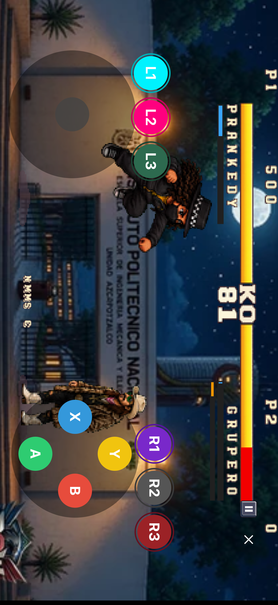

Prankedy is airborne with tucked legs and a fist forward while Rey Grupero remains on the ground. The moon, illuminated ESIME building and P1 score of 500 are visible; this frame does not establish an impact.

**Robot Estudiantx vs Alexis Syntaxis — CECyT 9 · Night**


Robot Estudiantx is airborne with one arm extended while Alexis Syntaxis is fully visible on the ground at CECyT 9 by night. P1 has 200 points; the pose alone does not establish an aerial hit.

</details>

<details>
<summary>📸 View 3 screenshots (25–27 of 61)</summary>

**Robot Estudiantx vs Alexis Syntaxis — CECyT 9 · Night 2**


Robot Estudiantx hovers with an arm raised beside a leaning Alexis Syntaxis on the Night 2 CECyT 9 stage. A cyan thruster effect is visible below the robot; P1 has 900 points and P2 has lost health. No combo counter is visible.

**Paparazzi 5 vs Policía CDMX (Hombre) — CECyT 2 · Day**


Paparazzi 5 is airborne with an arm extended while Policía CDMX (Hombre) is fully visible on the ground at CECyT 2 by day. P1 has 300 points; the pose alone does not establish a connected hit.

**Paparazzi 5 vs Policía CDMX (Hombre) — CECyT 2 · Night**


Paparazzi 5 extends a fist, with a small yellow flash in front of the officer’s cap. CECyT 2 by night, the PAPZ 5/POLICIA H HUD and a P1 score of 700 are visible; P2 has lost health. No combo counter is visible.

</details>

<details>
<summary>📸 View 3 screenshots (28–30 of 61)</summary>

**Policía Granadero CDMX (Mujer) vs Policía Granadero CDMX (Hombre) — Biblioteca Nacional IPN · Night**


Granadera extends an arm holding a baton-like object near Granadero H and his shield. Their identities and HUD remain recognizable at Biblioteca Nacional IPN by night; P1 has 0 points. The gesture or subtitle does not identify an audio clip.

**Policía Granadero CDMX (Mujer) vs Policía Granadero CDMX (Hombre) — Biblioteca Nacional IPN · Night 2**


Granadera and Granadero H are separated, with recognizable faces and visors and a visible 2 GOLPES counter on the Night 2 Biblioteca Nacional IPN stage. P1 has 400 points.

**Policía CDMX vs La Presidenta — Ciudad Universitaria UNAM · Night**


Policía CDMX and La Presidenta face each other with clearly visible bodies and faces in front of the illuminated Ciudad Universitaria mural by night. The HUD identifies POLICIA/PRESIDENTA and P1 has 300 points; no impact, combo or jump is shown.

</details>

<details>
<summary>📸 View 3 screenshots (31–33 of 61)</summary>

**Policía CDMX vs La Presidenta — Ciudad Universitaria UNAM · Night 2**

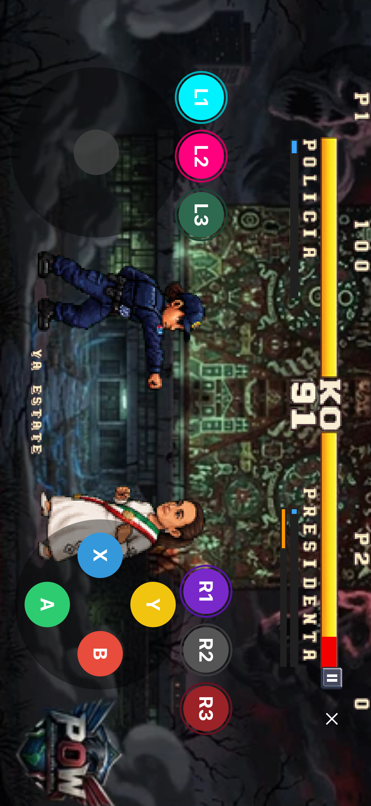

Policía CDMX extends a fist while La Presidenta stands apart, with both faces recognizable on the Night 2 CU UNAM stage. P1 has 100 points and P2 has lost health.

**El Charro Negro vs La Planchada — FES Acatlán · Day**


El Charro Negro and La Planchada are fully visible and separated at FES Acatlán by day, with both faces legible. P1 has 400 points.

**El Charro Negro vs La Planchada — FES Acatlán · Night 2**


El Charro Negro leans forward while La Planchada stands apart, with the 2 GOLPES counter visible on the Night 2 FES Acatlán stage. P1 has 400 points.

</details>

<details>
<summary>📸 View 3 screenshots (34–36 of 61)</summary>

**La Tzitzimime vs Yoalli Ehécatl — UAM Azcapotzalco · Day**


La Tzitzimime extends her arms toward Yoalli Ehécatl, with both bodies and faces recognizable among the jacarandas at UAM Azcapotzalco by day. P1 has 300 points.

**La Llorona vs El Charro Negro — Isla de las Muñecas · Night**


La Llorona and El Charro Negro are separated, with a clear 2 GOLPES counter, hanging dolls and nighttime reflections visible at Isla de las Muñecas. P1 has 400 points.

**La Llorona vs El Charro Negro — Isla de las Muñecas · Night 2**


La Llorona is airborne above El Charro Negro, with both faces and the complete HUD visible on the Night 2 Isla de las Muñecas stage. P1 has 400 points; the pose alone does not establish an impact.

</details>

<details>
<summary>📸 View 3 screenshots (37–39 of 61)</summary>

**Yoalli Ehécatl vs La Presidenta — Mictlán · Day**

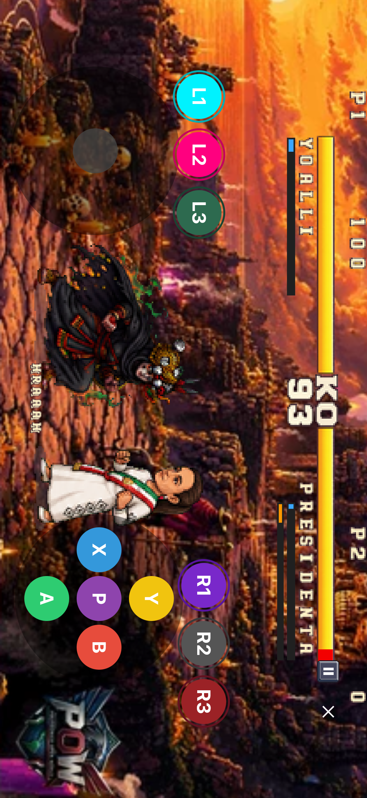

Yoalli Ehécatl leans forward while La Presidenta stands apart, with both faces recognizable against Mictlán’s orange landscape and candles. P1 has 100 points.

**Yoalli Ehécatl vs La Presidenta — Mictlán · Night 2**


Yoalli Ehécatl is airborne on the right while La Presidenta stands on the left, both recognizable under the red moon on the Night 2 Mictlán stage. P1 has 700 points; their screen positions do not change their P1/P2 HUD identities.

**El Charro Negro vs Rey Grupero — Campos de Agave Jalisco · Day**


El Charro Negro extends an arm with small green particles near his fist toward Rey Grupero, with both faces visible in the agave fields by day. P1 has 300 points; this frame does not establish a connected special attack.

</details>

<details>
<summary>📸 View 3 screenshots (40–42 of 61)</summary>

**El Charro Negro vs Rey Grupero — Campos de Agave Jalisco · Night**


El Charro Negro advances toward Rey Grupero with a visible 2 GOLPES counter, agave plants and an illuminated gazebo by night. P1 has 400 points.

**El Charro Negro vs Rey Grupero — Campos de Agave Jalisco · Night 2**


El Charro Negro stands on the left and Rey Grupero guards on the right, with separated faces and the complete HUD visible on the Night 2 Campos de Agave Jalisco stage. P1 has 500 points.

**Alexis Syntaxis vs Robot Estudiantx — Facultad de Medicina · Day**


Alexis Syntaxis and Robot Estudiantx are separated, with a 2 GOLPES counter at Facultad de Medicina by day. The face and visor are legible; P1 has 400 points.

</details>

<details>
<summary>📸 View 3 screenshots (43–45 of 61)</summary>

**Alexis Syntaxis vs Robot Estudiantx — Facultad de Medicina · Night**


Alexis Syntaxis extends a fist toward Robot Estudiantx, with the face and visor legible at Facultad de Medicina by night. P1 has 300 points.

**Alexis Syntaxis vs Robot Estudiantx — Facultad de Medicina · Night 2**

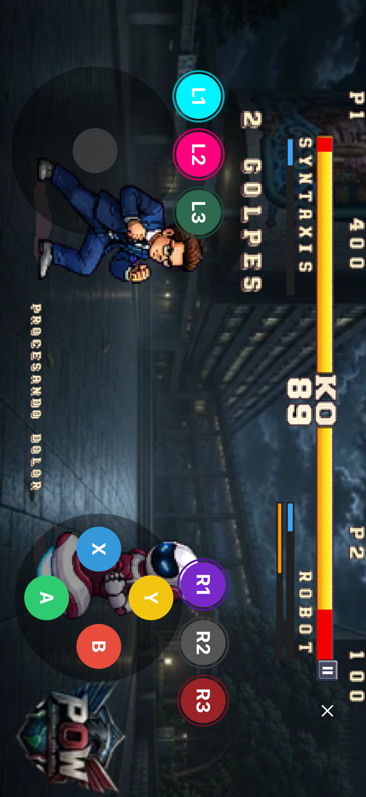

Alexis Syntaxis and Robot Estudiantx are separated, with a visible 2 GOLPES counter on the Night 2 Facultad de Medicina stage. P1 has 400 points.

**Rey Grupero vs Prankedy — FES Aragón · Day**


Rey Grupero and Prankedy are separated, with recognizable faces and a visible 2 GOLPES counter at FES Aragón by day. P1 has 400 points.

</details>

<details>
<summary>📸 View 3 screenshots (46–48 of 61)</summary>

**Rey Grupero vs Prankedy — FES Aragón · Night**


Rey Grupero and Prankedy are separated, with the GRUPERO/PRANKEDY HUD, a visible 2 GOLPES counter and a P1 score of 400 at FES Aragón by night.

**Rey Grupero vs Prankedy — FES Aragón · Night 2**

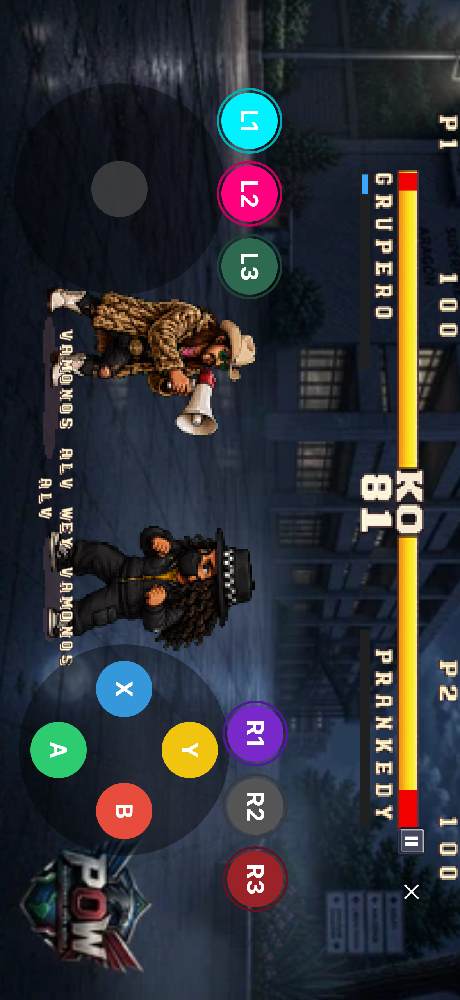

Rey Grupero holds a megaphone facing Prankedy, with both faces recognizable through the fog on the Night 2 FES Aragón stage. Both scores are 100.

**La Tzitzimime vs Estudianta — Pirámide del Sol · Day**


Estudianta stands on the left with one knee raised and La Tzitzimime on the right, both legible at Pirámide del Sol by day. The HUD identifies TZITZIMIME/ESCOMGIRL and P1 has 300 points; the left-hand fighter is not assumed to be P1.

</details>

<details>
<summary>📸 View 3 screenshots (49–51 of 61)</summary>

**La Tzitzimime vs Estudianta — Pirámide del Sol · Night 2**


La Tzitzimime is suspended in the air with a red dress and several arms while Estudianta guards on the Night 2 Pirámide del Sol stage beneath a red moon. P1 has 200 points.

**Policía CDMX vs Paparazzi 5 — UAM Cuajimalpa · Day**


Policía CDMX extends an arm with a small, bright cyan effect in front of his hand toward Paparazzi 5. Animated pedestrians appear in the UAM Cuajimalpa daytime background; P1 has 500 points.

**Policía CDMX vs Paparazzi 5 — UAM Cuajimalpa · Night**


Policía CDMX and Paparazzi 5 are separated, with recognizable faces and HUD and a visible 2 GOLPES counter at UAM Cuajimalpa by night. P1 has 700 points.

</details>

<details>
<summary>📸 View 3 screenshots (52–54 of 61)</summary>

**Policía CDMX vs Paparazzi 5 — UAM Cuajimalpa · Night 2**


Policía CDMX is airborne with a raised knee above Paparazzi 5. Purple effects belong to the Night 2 UAM Cuajimalpa background; P1 has 300 points.

**La Presidenta vs Policía Granadero CDMX (Hombre) — Zócalo · Day**

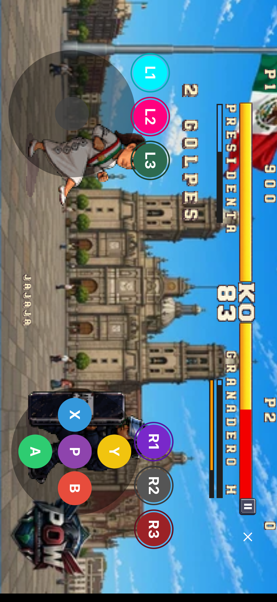

La Presidenta raises a leg toward Granadero H and his shield, with a visible 2 GOLPES counter, P1 score of 900 and the cathedral at Zócalo by day.

**La Presidenta vs Policía Granadero CDMX (Hombre) — Zócalo · Night**


La Presidenta extends an open hand toward Granadero H’s shield, with both faces legible in the illuminated Zócalo by night. P1 has 500 points and P2 has 100.

</details>

<details>
<summary>📸 View 3 screenshots (55–57 of 61)</summary>

**La Presidenta vs Policía Granadero CDMX (Hombre) — Zócalo · Night 2**

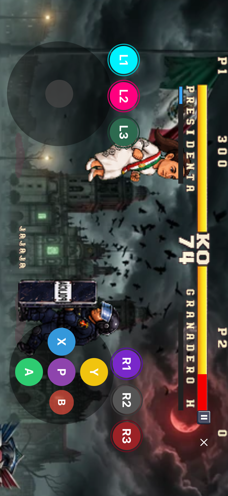

La Presidenta is suspended in the air facing Granadero H on the Night 2 Zócalo stage, with birds and a red moon. P1 has 300 points; the scene reaches both image edges.

**Robot Estudiantx vs Alexis Syntaxis — Planetario IPN · Night**


A short cyan beam extends from Robot Estudiantx’s visor toward Alexis Syntaxis, with the illuminated Planetario IPN nighttime background. P1 has 100 points.

**La Planchada vs La Llorona — ESM IPN · Day**


La Planchada and La Llorona are recognizable at Escuela Superior de Medicina by day, with a visible 2 GOLPES counter and P1 score of 500.

</details>

<details>
<summary>📸 View 3 screenshots (58–60 of 61)</summary>

**La Planchada vs La Llorona — ESM IPN · Night**


La Planchada holds a visible green glow between her hands facing La Llorona, with the illuminated ESM nighttime background. P1 has 300 points.

**Estudiante vs Robot Estudiantx — CET 1 · Day**

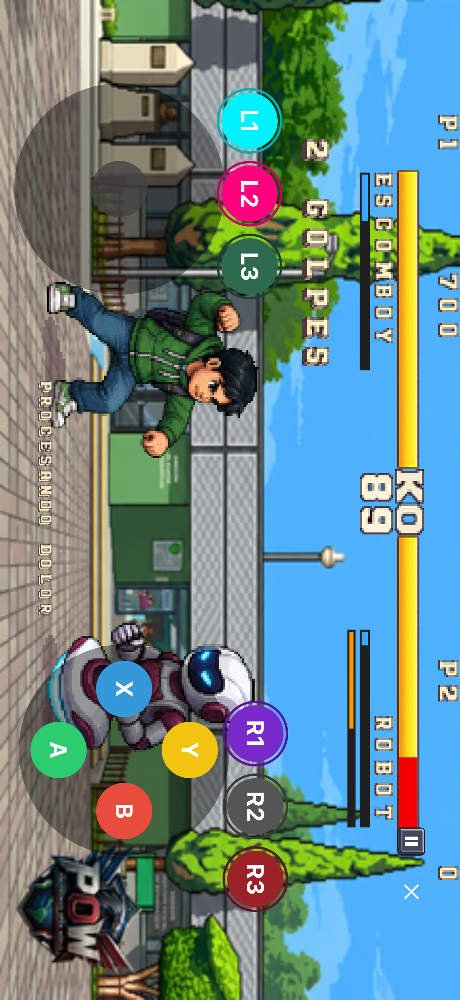

Estudiante strikes with an arm toward Robot Estudiantx, with a visible 2 GOLPES counter at CET 1 by day. P1 has 700 points.

**Estudiante vs Robot Estudiantx — CET 1 · Night**


Estudiante is clearly airborne with bent knees facing Robot Estudiantx at CET 1 by night, beneath a starry sky. P1 has 600 points.

</details>

<details>
<summary>📸 View 1 screenshot (61–61 of 61)</summary>

**Estudiante vs Robot Estudiantx — CET 1 · Night 2**


Estudiante has one arm raised and the other forward facing Robot Estudiantx, with a visible 2 GOLPES counter on the Night 2 CET 1 stage. P1 has 400 points.

</details>

<!-- POW_IPHONE_GALLERY_END -->

> 📚 **Detailed technical documentation:** the architecture, data layer, domain models,
> open-world map, zombie minigame, interiors/transit, servers, conventions and known pitfalls
> are documented in **[README for IAS](PolitecnicoOpenWorld/README%20for%20IAS/)**.
> Start with `00_INDEX.md`; these area guides provide signatures, state, pseudocode and
> project rules without requiring the entire codebase. This README provides the public overview.

---

## Android open world and shared architecture

The sections below describe the Android open-world implementation and its servers.
The fighting mode's Android/iOS availability is summarized above.


On Android, **Politécnico Open World (POW)** provides 2D top-down exploration built on real-world maps. The player navigates the actual streets of their surroundings (with initial focus on the ESCOM / Zacatenco area in Mexico City) using **OpenStreetMap** cartographic data, sharing the world with procedural NPCs (pedestrians and vehicles) and with other players connected to a real-time server. The ESCOM campus also hosts an embedded zombie survival minigame with interior buildings, melee/ranged combat and a power-up system — now backed by its own authoritative server.

The project is built entirely with **Kotlin + Jetpack Compose**, follows a strict **MVVM** pattern organized by *features*, and delegates persistent-world logic to **two standalone Node.js servers**: one for the open world and a new dedicated one for the zombie minigame.


**2026-11-05 · PR #158:** Alexis Syntaxis: corrected body scale during damage, aerial
attacks, knockdowns and KO; interrupted jumps keep falling. Maps default to OpenStreetMap
and fall back from unavailable web layers; credentialed services are excluded from the
key-free selector.

### 🔄 Recent Changes

- **iPhone combat orientation (2026-11-15)** — Graduation by Combat enters landscape automatically, including fighter and stage selection. Selector content respects the lateral safe area. [Real iPhone QA status](PolitecnicoOpenWorld/README%20for%20IAS/SF/QA_IPHONE_PR188_2026-11-15.md).

- **Unified Collectibles gallery** — Multimedia is now part of Collectibles, keeping its burgundy and gold design with exactly two tabs: Fighters and Maps. Fighters contains the Titulación por Combate roster, including source animation frames for fighters with runtime sheets. Maps contains combat stages and their day/night/apocalypse variants, interiors and transit maps. A separate image viewer supports pinch zoom, bounded panning, zoom buttons and fit-to-window, using the original asset instead of its thumbnail. No image files are duplicated.

- **CET 1: day, night and ominous-night stages (2026-11-05)** — three animated backgrounds of the Walter Cross Buchanan campus join the Titulación por Combate stage selector. They remain extra stages outside the Arcade ladder and are playable with Developer Mode enabled. Each variant has a WebP atlas, animation metadata and a separate selector thumbnail.
- **Alexis Syntaxis asset repair and fighter CI (2026-11-04)** — damage/stun sprites now follow the 100 px standing-height standard, with corrected feet anchors. Four talking poses and ten clipped action poses were regenerated. A reproducible asset workflow builds previews, checks geometry and compares committed assets with their sources. See the [fighter CI tutorial](PolitecnicoOpenWorld/README%20for%20IAS/SF/CI_CD_agregar_peleador.md).
- **Static CDMX streets (2026-11-04)** — integrates the static-cell approach from PR #182 ahead of Overpass, and rejects malformed/HTML responses so gateway errors are retried through the fallback instead of accepted as empty streets.

The latest integration work centers on the **multiplayer back end**, which now spans two servers, plus the previously bundled feature/performance PRs:

- **La Planchada and ESM (2026-11-06)** — adds a spectral IMSS nurse with original sprites in one standardized WebP combat atlas, derived free-roam animations, shared La Llorona audio, and the Escuela Superior de Medicina stage. Defeat her in Arcade on Medium or Hard to unlock the fighter.
- **TITULACIÓN POR COMBATE: the police fighters' special move gets its own sound (new, 2026-09-24)** — the **CDMX policewoman**, the **riot-squad Granadero** and the **Granadera** had no `power` voice line and no `special_<id>` clip, so their projectile fell back to the generic `hadouken`. They now share a short **siren + impact SFX** (`special_power_siren`, 1.5 s, original synthesized audio with no third-party samples) with a short `(Siren)` subtitle when voice subtitles are enabled, the same way Escomboy and Escomgirl share `special_power_electricity`. The CDMX policeman keeps his own clip. The arcade audit test now requires the new file for the three of them.
- **TITULACIÓN POR COMBATE: in-fight pause button (HUD asset) and full pause menu (new, 2026-09-30)** — players can now pause any fight manually via a dedicated **Button Pause** graphical pixel-art asset (`ic_button_pause.png`) placed at the top-right corner of the HUD (`Alignment.TopEnd`), immediately to the left of the exit `✕` button. The pause overlay features four options: **Continue**, **Move List** (opens the fighter's complete combo and command sheet without leaving the fight), **Restart Fight** (instantly restarts the current round/match), and **Exit to Menu**. Fully localized in Spanish and English, with system bar insets handled defensively through `systemBarsPadding` across Android and iOS.
- **HUELUM VS. GOYA: classic dizzy/stun, La Llorona crash shielded, smoother loading and smarter navigation (new, 2026-07-22b)** — taking too many hits without a break now **dazes your fighter**: a small orange bar fills as you get hit, and when it tops out the fighter freezes for ~2 seconds with **stars orbiting their head** (hitting a dazed rival wakes them up; works in every mode, multiplayer included). The **super meter now glows and pulses** when it's ready, and slowly drains if you stop landing hits (a full bar never drains). **La Presidenta's metamorphosis** now happens only in round 1, grants a **fresh full health bar** when she transforms, and she **stays** as Yoalli for the rest of the match. The **La Llorona crash path was shielded** (her fights load an extra placeholder atlas that could blow up the memory budget — it is now half-resolution and failure-proof) and all heavy fight assets now decode **under the LOADING screen** instead of freezing the game for a few seconds (transforming mid-fight no longer reloads anything). The policeman's intro line now **plays to the end**, leaving a mode now returns you to **that mode's own character select**, and the tutorial **highlights the exact button to press** (pulsing yellow ring), names the real controls (X/Y/B/A/P/G/T/S) and shows the button chips above the lesson text. *(Pending Rebuild + device test.)*
- **HUELUM VS. GOYA: voice subtitles are now ON + two new tutorial lessons (new, 2026-07-22)** — the 64 curated voice subtitles are finally displayed during fights, in Spanish or English following the device language (the English track was completed: every line that was still in Spanish got translated; shouts and onomatopoeia stay as recorded). Long phrases are no longer crammed into one block: each segment of the phrase gets its own line in the arcade HUD font, synced with how the voice line was written, and long segments still word-wrap. The tutorial also gains two lessons: the **crouching chain** (low punch into low kick) and the **super meter** (the golden bar fills as you land hits and as you take them; the Super Art and the FATALITY spend it entirely). *(Pending Rebuild + device test.)*
- **HUELUM VS. GOYA: step-by-step tutorial, recovered moves and low-end fixes (new, 2026-07-21)** — the tutorial now teaches **one move per lesson** (21 basics: walking, crouching, every punch and kick, blocking, dash, run, parry, throw, sweep, anti-air, overhead, air attacks, special and super) before moving on to combos. Each step is shown as a **chip in the colour of the actual button** you must press, ticked off as you get it right, and if you do the wrong move a red **"NOT THAT ONE"** card tells you exactly what you did versus what was asked. Three animations that were being sliced and thrown away are now in the game: **running** (hold forward out of a dash — you can jump and attack out of it), plus relaxed and talking idle poses. Each fighter's AI profile now **sharpens as you climb the ladder**, so zoners throw more powers and rushers press and combo harder the further you go. On the performance side, the new artwork had pushed fighter atlases to 73 MB of RAM each; they are now decoded at half resolution on low-end devices (~18 MB) without changing how large the sprites appear. *(Pending Rebuild + device test.)*
- **HUELUM VS. GOYA: combo sheet and interactive tutorial (new, 2026-07-21)** — a new **COMBOS & TUTORIAL** entry sits alongside Practice and AI vs AI. It opens a sheet listing **every combat control** and the fighter's combo routes with their step-by-step recipes, and a **TRY IT** button drops you into a **guided tutorial**: the screen asks for one move at a time, checks that you actually performed it, ticks off each step and only then moves on, with repeat/skip and lesson progress. You practise against an **inert dummy** — no clock, and the dummy never dies — so nothing interrupts your execution. Combos live in a data-driven catalogue (10 universal routes plus a signature one per fighter) that the **CPU reads too**, so the AI now chains complete combo routes instead of isolated hits, scaled to the difficulty. *(Pending Rebuild + device test.)*
- **Main menu: ALPHA/BETA badges no longer jump to their own line (fix, 2026-07-21)** — the status badges were pushed above each button with a negative vertical offset, so on devices with a large system font (reported on a Galaxy S24) they crept into the previous row and looked detached. They now only shift sideways into the margin that always exists, and no menu label can wrap onto a second line inside a fixed-height button.
- **HUELUM VS. GOYA: the full 3rd Strike-style moveset (new, 2026-07-21)** — every fighter gained **21 new playable moves**: forward/back **dashes** (double-tap), high and low **blocking** with real guard poses, the signature **parry** (a 260 ms window that nullifies the hit outright and leaves the attacker exposed), a full set of **crouching attacks** including an anti-air and a **sweep** that knocks down, **air attacks**, a long-reaching **roundhouse**, an **overhead** that beats low guard, a **throw** that goes straight through blocking, a taunt, and a **Super Art** fuelled by a new meter that fills as you deal and take damage. The CPU uses the new arsenal too — sweeping to punish, throwing turtling opponents, and parrying on the harder difficulties. Fighters still missing artwork for a move play it with a clearly-marked **ALPHA placeholder** silhouette instead of losing the move. *(Pending Rebuild + device test.)*
- **HUELUM VS. GOYA: 3rd Strike-style combos (new, 2026-07-20)** — normal attacks that **connect** can now be **chain-cancelled** into the next-stronger normal (light→medium→heavy, punch or kick) or **special-cancelled** into the character's special move (its cooldown still applies); whiffed attacks recover in full, like the arcade. A **combo counter** ("N HITS") appears on the attacker's side from 2 hits, and combo damage scales down 10% per chained hit (floor 50%) so chains aren't free kills. Offline modes only (online keeps remote HP authority). *(Pending Rebuild + device test.)*
- **HUELUM VS. GOYA: shared combat-AI recovery (fix, 2026-07-18)** — the CPU no longer remains internally airborne after its sprite has touched the floor: landing now accepts the exact clamped floor coordinate, which was the root cause of fighters gluing together, facing away and eventually winning by timeout. The same AI engine is used by solo, Arcade, AI vs AI and both Autoplay audits; difficulty controls reaction/defence/aggression while lightweight fighter profiles favour pressure or powers. Body/leg hit zones are checked correctly, the last three normal attacks are remembered, specials and bonus powers have separate cooldowns, reactive blocking was expanded, and a short escape window prevents one power from trapping a fighter in endless hit-stun. Autoplay now treats prolonged inactivity and every timeout round as explicit failures and reports KO/timeout totals.
- **POW 1.0.0.12: Play-size hotfix and release handoff (release, 2026-07-18)** — all **48 animated HUELUM VS. GOYA stages** now sample real motion across five seconds instead of a nearly static 1.25-second centre window. The complete 16-stage set keeps **day, night and dark-night** variants, with the POW logo baked into every frame; auxiliary stills live outside the Android Studio project. The final release AAB is **438.52 MiB** with a **459.16 MB compressed base module**, leaving **40.84 MB** below Play's 500 MB limit. Showcase now has separate **next animation**, **next fighter**, **1×/2×/4× speed** and **replay audio** controls, plus a 21-character audio-only showcase. La Llorona's fused double-body hurt frames were split and guarded by validation. CI uses current Node 24 actions, `tracks: alpha`, localized release notes and a downloadable signed-AAB artifact; PRs labelled `manual-play-upload` build the artifact without uploading it automatically.
- **HUELUM VS. GOYA: production audio rebuild + complete AI campaign audit (release, 2026-07-18)** — all **21 character specials** were rebuilt from the already-downloaded local sources, in Spanish only, with cut lengths chosen per clip instead of a common duration. Spoken clips were transcribed and checked against their real wording; non-verbal horror/band effects no longer display invented subtitles. La Presidenta now has an 8.3 s verified Claudia clip, Lázaro has his own voice, and all three Granadero variants keep the complete 27.5 s band performance. Long specials use `MediaPlayer`, so they play through instead of being truncated by `SoundPool`. The local-only reproducible pipeline writes source/output hashes and a 21/21 technical + Spanish-content audit. Art fixes add distinct La Llorona hurt poses and the reverse Yoalli → Presidenta metamorphosis. Finally, the QA bot now executes all **9 complete arcade campaigns** (3 starters × BASIC/NORMAL/ADVANCED, 135 fights) at accelerated simulation speed, while tests audit 600 randomized campaign configurations. Version bumped to **1.0.0.12** for Play Store alpha.
- **HUELUM VS. GOYA: police voice lines, subtitles and the Granadero's bugle (fix, 2026-07-18)** — the police fighters now say the right lines at the right moments — the male officer warns "you can't drink in public" at the start, calls you out on the attack and taunts on victory; the female officer has two attack lines and her own victory line — and the Granadero (male and female) win with a bugle "diana" call instead. The on-screen subtitles now wrap onto **up to three lines in a smaller font** so long phrases no longer run off the screen. *(Pending Rebuild + device test.)*
- **HUELUM VS. GOYA: police, riot-squad and Paparazzi 1 now have voices (new, 2026-07-18)** — the CDMX police officer and the Granadero (both male and female) now speak: an intro line when the fight starts, a shout on their special, pained grunts when they take hits, and a victory line when they win. Male and female share one voice set each, reused across the normal officer and the riot-squad version. **Paparazzi 1** also gained voice lines — battle cries when he strikes and dazed grunts when he's hit. The whole thing runs on a reusable per-fighter voice-pack system, so adding voices to more fighters is just dropping in named audio files. *(Pending Rebuild + device test.)*
- **HUELUM VS. GOYA: every stage is now panoramic + a double arrow for mirror picks (new, 2026-07-18)** — the panoramic floor-anchored framing (fighters on the ground, and jumping reveals more of the map above) now applies to **all 16 stages**, not just the five newest (per-map fine-tuning still to come). And on the character-select screen, if player 1 and player 2 both land on the **same fighter**, that card now shows **both arrows (P1 and P2)** and its highlight box blinks between blue and red so the mirror match is obvious. *(Pending Rebuild + device test.)*
- **HUELUM VS. GOYA: AI-vs-AI fights now actually end with a winner (fix, 2026-07-18)** — two max-difficulty CPUs would endlessly dodge each other and never land the finishing blow. Now each AI-vs-AI match randomly handicaps one of the two fighters (a notch or two below the other), so the stronger one connects and wins — and the handicap re-rolls every match, so the winner varies. Arcade's hidden, escalating difficulty (harder as you climb, calibrated to the difficulty you chose, à la Street Fighter III: 3rd Strike) is unchanged. *(Pending Rebuild + device test.)*
- **HUELUM VS. GOYA: jump reveals more of the stage + a colored rival box on the select screen (new, 2026-07-18)** — on the reframed stages, **jumping now pans the background up** so you see more of the map above you (using the panoramic zoom's headroom; the already-approved stages are unaffected). On the character-select screen, the P1/P2 arrows are now backed by a **translucent colored box and border** (blue for your fighter, red for the one you're highlighting as the rival) to make the matchup unmistakable. Note: online play still picks blind (you learn the rival's fighter once both have chosen), so the rival box applies to local Practice and AI-vs-AI; a multiplayer audit confirmed the new stages, jump camera and progression music all behave the same over Render, Bluetooth and LAN. *(Pending Rebuild + device test.)*
- **HUELUM VS. GOYA: clearer character select, difficulty-based unlocks and dev-only test tools (new + fix, 2026-07-18)** — the character-select screen now shows a **blue "P1" arrow** over the fighter you already picked and a **red "P2" arrow** over the one you're highlighting for player 2, so rival picks are unmistakable. Arcade unlocks are now tied to the chosen difficulty: winning on **MEDIUM unlocks the fighter** (plus their map), **EASY unlocks only the map**, and hard/apocalyptic unlocks nothing yet (animations and special powers coming later). The "Choose difficulty" screen no longer spoils the stage lighting — you just pick a difficulty. And the automated **Autoplay/Showcase test tools** (everyone-vs-everyone, the 9 accelerated campaigns, the animation/sound showcase and the audio showcase) are now **Developer-Mode only**, hidden from regular players. *(Pending Rebuild + device test.)*
- **HUELUM VS. GOYA: five stages regenerated + Prankedy's music now escalates with difficulty (new + fix, 2026-07-18)** — five stages (Faculty of Medicine, FES Aragón, Pyramid of the Sun, UAM Cuajimalpa and the Zócalo, all three day/night variants — 15 backgrounds) were rebuilt from fresh footage through the existing pipeline, with the **POW logo stamped over the Gemini watermark** and the panoramic floor-anchoring framing applied so fighters stand on the ground. Prankedy's battle theme also becomes a **progression soundtrack**: a lobby track plays in character select, and during fights the music **escalates with the level** (arcade ladder progress, CPU difficulty in practice, hardest for AI-vs-AI). *(Pending Rebuild + device check; the exact per-fight track rotation may be tuned further.)*
- **HUELUM VS. GOYA: Facultad de Medicina stage reframed (fix, 2026-07-18)** — the Faculty of Medicine background (all three day/night variants) looked square and left the fighters floating in the sky; it's now zoomed and anchored to the ground so they stand on the floor, via a per-stage framing knob (`SfBgFraming`) that changes only how the background is drawn — no asset regeneration. *(Pending device check + more stage tweaks to come.)*
- **HUELUM VS. GOYA: showcase at your own pace — skip button, home stages and proper audio (new + fix, 2026-07-18)** — the asset Showcase no longer drags: steps advance **automatically as soon as each animation finishes**, and a new **"Skip animation"** button jumps ahead instantly. Every fighter now performs **on their own home stage** (daytime; the AI-vs-AI autoplay bots rotate the apocalypse variants), so backgrounds get tested too. Forced showcase steps **play their proper sounds** (hurt impacts by strength, a KO thud, and the fighter's own voice on victory and metamorphosis), the **victory pose in real fights plays the fighter's voice**, and a lost jump step was fixed. The prototype audio mentioned in this older entry was replaced by the complete production rebuild above.
- **HUELUM VS. GOYA: varied AI fights + full asset showcase with a static audit (new + fix, 2026-07-18)** — AI vs AI (and the CPU in general) no longer freezes, glues itself to the rival or spams the same attack: the offense watchdog now tracks the fighter's **real state** (dropped inputs no longer count as "attacking", and after ~2 s of passivity at close range a hit is forced), clinches resolve with **asymmetric roles** (one fighter strikes while the other breaks away) and every attack pick remembers the last one so punches/kicks and strengths actually vary. The **Showcase** bot now runs each fighter through **every** animation — including hurt reactions, KO, victory, turns and La Presidenta's metamorphosis (its timer and mirrored damage are disabled so the script always finishes) — and adds a **static audit** per fighter: missing/empty animations, broken frame references and missing `.ogg` voices/SFX (theme sounds included) all land in the on-screen report and the `.txt` file. *(Pending Rebuild + device test.)*
- **HUELUM VS. GOYA: AI vs AI at NIGHTMARE for recording (new, 2026-07-18)** — a new **AI VS AI** entry in the fight-mode menu runs **CPU vs CPU** at maximum difficulty (PESADILLA + full intensity, same as the arcade final). Pick two fighters (full roster with Developer Mode), hide the touch controls, leave only an Exit button — ideal for screen recording. Solo/arcade/online behaviour is unchanged. *(Pending Rebuild + device test.)*
- **HUELUM VS. GOYA stages fixed for low-end GPUs (fix + perf, 2026-07-18)** — combat background atlases are regenerated with a hard **≤2048 px** texture cap (many low-end GPUs rejected larger atlases, so stages looked blank), uniform 16:9 crop-to-fill frames, embedded ping-pong loops, and **~256 px thumbnails** so the stage picker no longer decodes dozens of full atlases. *(Pending Rebuild + low-end device check.)*
- **Stage picker: animated preview only on the selected map (new, 2026-07-18)** — tapping a stage focuses it (gold border); only that card animates **one frame at a time** from the atlas (never the whole filmstrip), others stay static thumbs; confirm with **"Choose this stage"**. Logic lives in `SfStageSelectOverlay.kt`, separate from the fight draw loop.
- **La Presidenta gains 11 playable powers and a Yoalli Ehécatl metamorphosis (art, 2026-07-17)** — the purple `P` button cycles six animated cosmic/tricolor/economic attacks, four elemental powers and a complete Presidenta → Yoalli transformation. All are real fight states available to the player and CPU and synchronized online; the final metamorphosis hits at HEAVY strength. Her fight sheet now contains 178 frames/41 animations while her body remains fixed at the common 100 px standard (world sprites remain 512²/360 px).
- **Prankedy and the Shopkeeper rebuilt from chroma sheets for both modes (art, 2026-07-16)** — each now has 19 original sheets feeding one consistent design across HUELUM VS. GOYA and the open world: 82 packed frames/30 animations plus 512² world sets. Every dedicated fighter is forced to the same 100 px fight-body standard; chroma world art uses a shared 360 px body/feet baseline, while measured UI fractions keep actions visually equal. A generic KO continuity detector marks reversed ground frames (`flipX`), fixing both characters automatically and covering future fighters. *(Pending device visual test.)*
- **HUELUM VS. GOYA: choose the CPU difficulty — from beginner-friendly to nearly unbeatable (new, 2026-07-16)** — solo fights gain a **difficulty step** (fighter → rival → **difficulty** → stage) with three levels. **BASIC** is made for learning: the CPU reacts slowly, walks around, only throws occasional light hits and never blocks, jumps or uses powers. **NORMAL** is the classic fight as before. **ADVANCED** is a reactive AI designed to be almost impossible: it thinks ~4× faster, **blocks your attacks**, punishes your recovery, anti-airs your jumps, hops over (or counters) your incoming fireballs and **throws lots of powers** at every range. Rematches keep your chosen difficulty; online is unaffected (your rival is human). *(Pending Rebuild + device test.)*
- **HUELUM VS. GOYA multiplayer: smoother rivals, synced clock, fireball clashes and draining health bars (new + fix, 2026-07-16)** — four polish upgrades plus a critical server fix. **Server fix:** the online relay was returning the wrong message type for rival-state updates, so in online matches your rival would appear frozen (Bluetooth/LAN were unaffected — which is why local tests passed); one line fixed, ships with the first deploy. **Smoother rivals:** the opponent's position is now interpolated between network updates (and their projectiles keep flying between snapshots) instead of jumping 15 times a second. **Synced clock:** the host's 99-second round timer is now the authority — the guest's clock re-anchors if they drift apart. **Fireball clashes:** two crossing projectiles now cancel each other out in a burst, offline and online. **Draining health bars:** the HUD bars now drain smoothly toward the real HP instead of snapping, classic arcade style (and refill instantly on each new round). *(Pending Rebuild + 2-device online test.)*
- **HUELUM VS. GOYA: best-of-3 rounds + host your own LAN server (new, 2026-07-16)** — fights now follow the **classic arcade format**: up to 3 rounds, first to take 2 wins the match. Rounds end by KO or when the 99-second timer runs out (more health wins; an **exact tie is settled by chance** — online both phones "roll" the same shared dice, no desyncs). Between rounds you get the winner banner, a fresh reset and a **"ROUND N / FIGHT"** intro in the arcade font, with golden round markers under each name. And a third multiplayer option joins Render and Bluetooth: **LOCAL SERVER** — one player hosts the room right on their phone (their IP shows on screen) and the rival joins by typing it, LAN-party style, on the same Wi-Fi or hotspot; no internet server involved, and **zero new permissions** (nothing changes for the Play Store forms). *(Requires redeploying the SF relay for online rounds; pending 2-phone test.)*
- **Bluetooth versus: no more crashes, verified connections and a clear retry flow (fix, 2026-07-16)** — hosting a Bluetooth match crashed on Android 12+ with a permission error (even *cancelling* device discovery needs the scan permission — now handled defensively). The whole BT flow was also made foolproof: the guest's connection **retries up to 3 times** (the first attempt often dies behind the system pairing dialog), a **verification handshake** confirms data flows both ways before the room is considered real (half-open sockets no longer fake a match), the connecting screen tells you each step ("Connecting…" → "verifying the link…"), and if the connection fails you get a **blocking RETRY screen** — you'll never silently land back in the offline selector and end up fighting the CPU thinking it's your rival. Retry re-requests Bluetooth permissions if needed; Cancel is the only explicit way out. *(Pending 2-phone retest.)*
- **HUELUM VS. GOYA: Ryu & Ken no longer ship to Play Store (new, 2026-07-15)** — the classic clone fighters' art now lives in the **debug build only**: installing from Android Studio over USB keeps Ryu and Ken fully playable (Developer Mode), while the **Play Store bundle ships without their assets** (copyright care) — the store version plays with the 12 POW fighters. Safety nets included: the release build never preloads or references the missing files, and if an online/Bluetooth rival on a debug build picks Ryu/Ken, the store version renders them as Prankedy instead of crashing. *(HUD/sounds/stage from the clone remain listed for future replacement.)*
- **HUELUM VS. GOYA: the roster doubles to 14 AND the fighters now share the world's sprites (new, 2026-07-15)** — seven new fighters join: **Lázaro, the ESCOM student and studentess, the Robot, the CDMX police officer, the riot-squad Granadero (shield attacks!) and the Paramedic**, for a 14-fighter roster (12 without Developer Mode — Ryu and Ken stay dev-only), playable offline, online and over Bluetooth. Under the hood, 8 of the 14 fighters no longer ship their own sprite sheets: their fight poses are **built at runtime from the very same sprites the open world uses** — one set of assets feeds both game modes. Prankedy, the Shopkeeper, Paparazzi 1 and Rey Grupero now use dedicated chroma sheets. Shared fighters remain ALPHA (approximate poses). *(Pending device test.)*
- **HUELUM VS. GOYA is now open to everyone + a sturdier Bluetooth link (new, 2026-07-15)** — the fight mode's main-menu button is **no longer Developer Mode-only**: everyone can play. Developer Mode now unlocks only **Ryu and Ken** (the original clone fighters) in the character select — without it, the roster is the five POW fighters (your CPU rival defaults to a POW fighter too). The Bluetooth link also got tougher: a 10-second keepalive plus fast dead-link detection means a rival going out of range is declared the loser in seconds instead of hanging the fight, the host stays discoverable for 5 minutes (was 2), and after an abandoned match the host cleanly accepts a brand-new challenger. *(Pending Rebuild + 2-phone test.)*
- **HUELUM VS. GOYA: approval lobby + Bluetooth versus with no internet (new, 2026-07-15)** — two multiplayer upgrades. **AoE2-style lobby:** tapping a room in the public waiting list now sends a **join request** — the host sees an ACCEPT/REJECT dialog and decides who gets in (joining with a shared code stays instant, the code is the invitation; rejected players return to the waiting list with a notice). **Bluetooth versus:** a new "BLUETOOTH (no internet)" section in the multiplayer menu lets two phones fight **without any server or connection** — one hosts (discoverable) and the other finds them (paired + nearby devices); same rules, stage pick, rematches and abandon-win as online, over an RFCOMM link that lives and dies with the game screen. Bluetooth permissions are requested only when you tap the section (Android 12+), and scanning is declared as never-for-location. *(Pending Rebuild + 2-phone test.)*
- **HUELUM VS. GOYA online: a browsable room list + theme polish (new, 2026-07-15)** — the public waiting list now shows the **active rooms as tappable cards** (rooms waiting for a rival let you join them directly, no code needed) and refreshes the summary every 5 seconds; leaving the queue/room now tells the server before disconnecting, and the remaining stock-looking widgets (code field, cancel buttons, exit dialog) were restyled to the mode's wine/gold theme. The POW-style button is now a shared component other modes can reuse. *(Pending Rebuild + 2-device test.)*
- **The fight mode is now "HUELUM VS. GOYA" (new, 2026-07-11)** — renamed after the IPN/UNAM chants; plus **public rooms** (waiting list with auto-matchmaking), an active-matches summary, POW-styled buttons across the mode, and in solo play you now **pick your rival too** (fighter → rival → stage).
- **Fight mode: 1v1 ONLINE multiplayer (new, 2026-07-11)** — a third free-tier server (`MultiplayerSF/`, pure relay on Render) brings room-code matches: create a room, share the 4-letter code, both pick fighters, the host picks the stage, a server-synced 3-2-1 and fight — each phone simulates its own fighter, damage is applied by the receiver (who also decides blocking), rematches need both players, and quitting mid-fight gives the win to your rival. Includes free-tier wake-up handling (the app pings the sleeping server for up to a minute before connecting). *(Deploy steps in the audit doc; pending Rebuild + 2-device test.)*
- **Fight mode goes POW: Prankedy's music + random IPN/UNAM backgrounds (new, 2026-07-10)** — the SF clone's theme is gone: fights now play **"Persecución"**, the track Prankedy uses in his videos, and after picking your fighter you now **choose the stage** (with thumbnails and a 🎲 random card) from six full-screen scenes — **ESCOM, the IPN "Queso", ESIME Azcapotzalco, CECyT 9, CECyT 2 and UNAM's Central Library** — drawn with camera parallax (the classic dock stage remains only as a themable fallback).
- **Fight mode: blocking + the arcade HUD font for every fighter (new, 2026-07-10)** — walking backwards now **blocks** like in classic fighting games: chip damage (1/4, min 1), half knockback, no hit-stun — and chip KOs are possible. The HUD's built-in pixel alphabet is now a reusable font: name tags, P1/P2 scores and the **"<FIGHTER> WINS"** banner are rendered with it for all 7 fighters (no more fixed winner image). Plus width fixes so Rey Grupero no longer looks skinny in idle.
- **BUSTED in Mission 1 + ghosts that rise to heaven (new, 2026-07-10)** — getting caught by the police during Mission 1's escort/entry now shows a blue **"BUSTED"** (you're arrested, GTA-style) instead of "WASTED"; the mission-failed/retry flow is unchanged. And the ghost deaths got their full animation: a killed NPC first fades out in place, then turns into a translucent **👻 that floats up to the sky** while vanishing (OSM native: per-frame icon+rise; web: CSS opacity+translateY transition).
- **Online occlusion parity (fix, 2026-07-10)** — the interiors server now treats `'^'` occluder cells as solid, just like the client always did: server-authoritative zombies (and civilians, spawns, pathfinding and the `PLAYER_CORRECT` position check) can no longer walk through furniture/objects painted with the designer's blue OBJECT brush. One shared `isSolidCell` helper feeds both collision checks. *(Requires redeploying the interiors server.)*

- **STREET FIGHTER: the classic 1v1 minigame, faithfully ported (new, dev-only, 2026-07-09)** — Ryu (you) vs Ken (CPU) ported 1:1 from the sibling `StreetFighter-main/` JS clone, with the **original sprite sheets, Ken's harbor stage (parallax, animated flag and bobbing boat), the arcade HUD (health bars, 99 timer, KO icon, name tags, P1/P2 scores), shadows, hit splashes and all the original sounds** (attack/hit/land/hadouken + Ken's theme looping). All 30 fighter states with per-frame push/hurt/hit boxes and frame-delay animations were auto-converted from Ryu.js/Ken.js into JSON (`assets/STREETFIGHTER/`). Controls: POW's joystick (walk, ↑ jump, ↓ crouch — and ↓↘→ + punch throws a **hadouken**) plus the same Xbox diamond used everywhere in POW (X/Y/B = light/medium/heavy punch, A = kick whose strength follows the joystick). The engine is fully decoupled from the SF assets (theme layer + per-character JSON) — and the swap has begun: a **character-select screen** now opens the mode with a 7-fighter roster — Ryu, Ken and five original POW fighters marked **ALPHA** (approximate poses, art in progress): **Prankedy** (his special throws the signature gas-tank prank bursting into confetti), **El Señor de la Tienda, Paparazzi 1, Paparazzi 5 and Rey Grupero**, all auto-generated from their in-game NPC sprite sets. Launched from a main-menu button ~~visible only with Developer Mode~~ *(since 2026-07-15 the mode is public for everyone; Developer Mode now only unlocks Ryu & Ken in the roster)*. *(Pending a Rebuild Project + device test.)*

- **Mission 2 phase 1 moves INSIDE the lobby + a livelier ESCOM + smarter dev TP (new, 2026-07-08)** — three fixes from playtesting. **Hide-from-the-police, indoors:** Mission 2's first phase no longer plays at the campus entrance — right after taking refuge in the ESCOM, **four police officers walk into the lobby** and sweep the room looking for you; keep your distance for **35 seconds** (HUD countdown) until they give up and leave. Getting eyeballed up close for ~2.5 s = recognized = mission failed (retry restarts the phase). **A livelier ESCOM:** the lobby now holds **13 ambient students** (two pairs already chatting when you walk in), conversations follow **coherent scripts** (midterms, thesis advisors, cafeteria tacos, the ENCB rumor…) instead of random one-liners, and the **outdoor campus** gains ~10 wandering students who form chatting circles of three — so the school feels alive on both sides of the door. **Dev TP fixed:** "TP to objective" now **tracks the mission first** and teleports you to its *current* phase objective (before, it dropped you at a cold spot with no actors or 🎯); from interiors the button is disabled with a hint, since the TP moves you on the world map. *(Pending a Rebuild Project + device test.)*
- **A living open world: dynamic street events, side quests, money and a day/night cycle (new)** — four features aimed straight at making free roam more engaging. **Dynamic events:** every ~40–80 s an ambient scene spawns near you, anchored to the closest street — two pedestrians stop to chat (💬 bubbles), a police officer chases a suspect on foot, or a **mini-outbreak**: someone turns right on the street, attacks, two officers run in, subdue them and haul them away (more likely at night and once Mission 3 is done — the infection is escalating). **Side quests:** the mission log gains its first two SIDE QUEST entries — *Medical supplies* (pick up a first-aid kit and drive it to a waiting paramedic; unlocked after Mission 2) and *Containment in Zacatenco* (five real, attackable zombies loose near campus — take them all down; unlocked after Mission 3). **Money:** collectibles now pay $25 and every mission pays a reward on first completion ($150–$500, replays never pay twice); your cash shows as a 💵 chip and persists in the campaign save. **Day/night:** a full cycle every 24 real minutes (1 min = 1 in-game hour) with a renderer-agnostic night veil that darkens the world at dusk, plus a 🕐 clock chip. **Ghost deaths:** killed NPCs now fade out as a translucent little ghost instead of blinking away (OSM native per-frame fade, web CSS fade; Google native already dimmed them). *(Pending a Rebuild Project + device test.)*
- **Mission log everywhere + REPLAY completed missions (new)** — the **Missions** entry now also appears in the **interiors** Options menu (one shared dialog serves the world map and every interior), so you can pick or drop a mission without leaving the building — if you track an outdoor mission from inside, its 🎯 marker is waiting when you step out. Completed missions (✔) gained a **REPLAY** button: replaying **never touches your saved progress** — missions stay marked completed, the firearm and the unlocked inventory slots are kept, and abandoning the replay ("stop tracking") simply restores everything as it was. Also, **"Choose character" on the world map is now Developer Mode-only** (the interiors selector is unchanged), and with **Developer Mode** on, the mission log lets you select 🔒 locked missions directly and adds a per-mission **"TP to objective"** button that teleports you ~40 m from its target.
- **Witcher-style MISSION LOG + Mission 3 "Return to the ENCB" (new)** — the old "continue the story or free-roam?" dialog is gone: you're **always in free roam** and pick which mission to track from **Options → Missions** (locked/available/active/completed states, persisted in the save JSON; tracking sets the 🎯 marker and guide line, and you can stop tracking anytime — progress is kept). **Mission 3** is in: the ENCB is a quarantine zone — sneak past the **riot-police cordon** (get spotted too long = mission failed), fight the first **indoor zombies** in the ENCB room chain and recover the 🧪 **lab evidence**. Reward: your **first firearm** (unlocks RANGED mode in campaign interiors). Also: Prankedy's backpack now **unlocks all 4 inventory slots**, and the **parked cars in the ESCOM lobby** finally match the outdoor parking lot (the interior now resolves the same directional car frame as the world map instead of flat-rotating frame 0).
- **One controller for everything: Xbox-style buttons while driving too (new)** — the driving action diamond no longer switches to PlayStation symbols (△ ○ ✕ □); it's now the **same Xbox A/B/X/Y diamond** used on foot (same letters, colors, sizes and positions). While driving: **Y = exit** (hold 3 s → teleport menu), **A = gas**, **B = brake**, **X = handbrake**. One control language across the whole game.
- **University life indoors: student chats + anti-stuck NPCs (new)** — the ambient students/teachers inside the ESCOM now pair up to **meet, chat face-to-face with alternating speech bubbles** (translatable phrases, EN/ES), sometimes **walk away together**, and part ways with a "See you around". NPCs that get **stuck against walls now change direction** after ~1.6 s without moving (and the detector re-arms, so repeated stucks keep getting fixed). The Mission-2 stink can is now visible as a 🥫 on the floor (+💨 while the classroom empties) until a dedicated sprite exists.
- **Story Mode: MISSION 2 — "The rumor" (new)** — the campaign now continues after entering the ESCOM. Five phases on the ESCOM campus: (1) **hide from the police** searching for you and Prankedy at the entrance (staying too close = they recognize you = mission failed, with a retry checkpoint); (2) listen to the **whole zombie rumor** from two students (strange things at the ENCB / all over Zacatenco); (3) witness the **first public outbreak** — an NPC turns, attacks people, the police subdue him while the radio requests **all available personnel at the ENCB**, and they take him away; (4) **talk to Prankedy**, who confesses he was competing against **REY GRUPERO** for the title of true "Prank King" (the challenge: pull off a prank that same day) and that he hid his **backpack in a classroom**; (5) empty the in-session classroom with the **STINK CAN** and recover the backpack. Progress persists in the campaign save JSON (`mission2Phase`). Internally the old final-chase code was renamed `mission2*` → `mission1Chase*`; the new mission lives in `mission2/Mission2.kt` + `WorldMapMission2.kt`.
- **REY Grupero is now playable** — his chroma sprites are sliced into `SPRITES/NPC/ReyGrupero/` (`Idle=6`, `Walk=6`, `Run=8`, `Special=5`, `Talk=4`) and registered as `PlayerSkin.REY_GRUPERO`. He appears in the new-campaign character picker and the in-game character selector.
- **Depth layering indoors — you can now walk *behind* objects** — the interior collision matrix gained a third cell type, **"cover object"**, on top of *wall* and *free*. Where the old matrix only decided whether you could pass, it now also decides **draw order**: your character is drawn **behind** a tall object (columns, shelves, furniture, trees) when you stand north of it and **in front** when you step below it, so you no longer float on top of everything. Cover cells still block movement like a wall. You paint them in **Developer Mode → Designer** with the new **OBJECT** brush (blue), and they're saved in the same `collision_matrices.json`. Works in both interior engines (the room/zombie engine and the simple ESCOM interiors). *(Note: online zombies don't yet respect cover cells; the local player and offline rooms do.)*
- **Button feedback (visual + vibration + sound)** — every on-screen control now reacts when you press it: the button **dips and lightens** (the joystick thumb brightens while you drag), gives a short **haptic tap**, and plays a system **click**. The click volume follows your **Effects** slider (Settings → Audio) and the vibration follows your device's haptic setting, so you can tune or silence it without a new toggle. No extra permission is required.
- **More of the game is now translatable (English/Spanish)** — the campaign objective titles/descriptions and the metro/metrobús in-station messages (ticket reloaded, no balance, wait for the next train/bus, etc.) used to be hardcoded in Spanish; they are now proper string resources, so they appear in English when the app language is English. No change for players using Spanish.
- **Fix: returning from Settings (or the menu) no longer reloads the map** — the world's "ready" gate was local UI state that reset every time the map screen was recreated, so coming back from Settings replayed the loading screen even though the map, streets and NPCs were still in memory (the map ViewModel is Activity-scoped and the game loop never stops). The gate is now seeded from the persisted state, so returning is instant; teleporting or leaving a metro station still shows the loader, as it should.

- **Refactor: unified transit interiors (Metro ⇄ Metrobús)** — the metro and metrobús station interiors used to be near-identical twin ViewModels + states (≈1300 duplicated lines), so any transit logic change had to be made twice. They're now a single config-driven `TransitInteriorViewModel` + `TransitInteriorState`, parameterized by a `TransitSystemConfig` catalog (`TransitSystems.METRO` / `.METROBUS`) that holds everything that differs (assets, colors, strings, turnstile offset, animation axis, repository). Behavior is unchanged. Adding future systems (Suburbano, Mexibús…) is now mostly a new config entry. (Internal only; no player-facing change.)
- **Refactor: internal code-quality program (managers, Hilt DI, detekt gate)** — an internal-only pass with **no player-facing change** (gameplay is identical). The large world-map ViewModel was decomposed into **6 focused managers** (Designer, Collectibles, Combat, Wanted, TransitTeleport, Campaign-log), each owning its own state and unit-tested; the UI still sees one `WorldMapState` (composed via a `combine` facade). Dependency injection moved from hand-written factories to **Hilt** (KSP). A golden-master **test suite** was added for the routing/save/catalog logic, and **detekt** static analysis is now a blocking CI check (via a baseline). Purely maintainability/quality; behavior unchanged.
- **Fix: getting stuck after teleporting to a metro station** — metro stations come from Overpass and can sit on top of a building far from any road, so the snap-to-road guard (which avoids teleporting you to a random far street) left you frozen behind an "invisible wall." Now, if you're genuinely stranded off the road network, moving drags you toward the nearest street until you snap onto it. Normal on-road play is unaffected.
- **Story Mode key puzzle reworked + no comic skip** — In the ENCB chain you still **find a key in Lab 1**, but you now **carry it to Lab 2 and test it from your inventory** (hold Y → **Test**) right before the door that triggers the second comic. A wrong key no longer auto-clears: you **long-press the key in the inventory to discard it** and head back to Lab 1 for another; the Lab 2 exit door stays **locked until the correct key is tested**. You can discard a wrong key anytime, but the **correct** key can only be discarded **after** you've used it to open the door (not before). The inventory closes with an **✕ in the top-right corner**. Each inventory key is stored with its **mission id** (`mission1`) — saved with the game — so the key art can be reused in future missions. Player skins now render the **same size in interiors** (the female skin no longer looks bigger than the male/robot). Comics: the **"Skip" button is gone** — tap to advance frames; only the last panel shows **START**.
- **Edge-to-edge enabled (Android 15+ / Play Console)** — `MainActivity` now calls `enableEdgeToEdge()` so the app draws behind the system bars **consistently on every Android version** (not just where targetSdk 35+ forces it), clearing the Play Console "edge-to-edge may not display for all users" recommendation. Compose screens already inset their content with `systemBarsPadding()`.
- **Metro stations: bigger, visible interaction zone + teleport** — Metro/Metrobús stations come from Overpass and sometimes land on top of a building you can't reach by street, so with snap-to-road you could never step on the "M" logo to enter. The interaction zone is now **60 m** (4× the 15 m used for collectibles/doors) and is **drawn on the map** as a translucent orange circle around each logo (web/Leaflet + native OSM), so you can enter from any nearby street even if the logo itself is unreachable. The **Teleport Points menu** (Developer Mode) now lists every metro station with a search box, since walking there is awkward.
- **Interiors mode expandable per campus (ESCOM, FES, UAM…)** — entering interiors is generalized so any campus can have a lobby + buildings (`ZombieRoomCatalog.campusRooms(...)`; ESCOM keeps its bespoke ring, new campuses are one `addAll`). The ViewModel is campus-agnostic (`lobbyForBuilding` + `pendingLobbyTarget`). **FES Aragón**: the **"Entrada FES Aragón"** door → `interiores_zombies?startRoom=fes_interior` → FES lobby (safe zone) **with a door to its building `fes_edificio`** ("Edificio Principal", temporarily reusing ESCOM's interior, zombies online). Both servers support the transition (`MultiplayerInteriores/server.js` gets the FES rooms; open-world `Multiplayer/server.js` unchanged — the Activity-scoped VM + back stack preserve your connection and coordinates). The FES door sits next to the FES teleport point.
- **Story Mode (campaign) + main-menu rename** — the main menu's first button is now **"FREE ROAM"** (the open world, formerly "Start Game") and the second is **"STORY MODE"** (formerly the disabled "Load Game"), which opens a new campaign screen (`story_mode`). It shows the **prologue** (Politécnico outbreak: at the ENCB, Prankedy accidentally creates a corrosive, latex-piercing substance) and a **school picker** — only **ESCOM** is playable for now; **FES Aragón** and **UAM** appear but are disabled (in development). **"START"** goes through a **"Ready to Start"** intro (`story_intro`, narrative placeholder); pressing START there **saves the campaign** (`CampaignRepository`) and enters the world via `setStorySpawn(...)`. **"LOAD GAME"** is enabled once a save exists and resumes at the saved school. School data in `domain/models/SchoolCatalog.kt`.
- **Fix: invisible pedestrians that could still hit you** — after teleporting (or under memory pressure) a pedestrian's sprite could fail to load and the NPC rendered as a fully transparent marker — so you'd get punched by an "invisible man" (e.g. the driver you just carjacked). Now no NPC is ever invisible: native OSM falls back to a 🧍 emoji and retries the real sprite (instead of caching a transparent placeholder), and the web renderer shows a 🧍/🚗 placeholder until the sprite is ready and then swaps it in. (Google native already showed a default pin.)
- **Prankedy un-sticks, ESCOM zombie hand removed, interior-paths debug** — (1) **Prankedy no longer gets stuck on the roads** (it was snapping to a road node and freezing, so it "stopped doing anything"): it now steps directly when road-snapping doesn't make progress, and relocates next to you if it stays stuck (without healing). (2) **The "Mano del Apocalipsis" (zombie hand) in ESCOM was removed** — global zombie mode is now toggled only from Options → "Activar/Desactivar Apocalipsis". (3) **"Debug Interiores" now shows ESCOM's walkable paths AND no-walk zones**: it draws the landmark nav-graph (green = on-foot paths, orange = car paths) plus the collision areas from `exterior_collisions.json` (translucent **red polygons** = where you can't walk, e.g. the ESCOM building; **red lines** = walls), on top of the building dots/bbox, on native OSM and web.
- **Prankedy stays close + stolen patrols keep their skin** — (1) **Prankedy now always stays near you**: it no longer chases police cops (which dragged it away when the police arrived) and has a ~33 m leash — if it ends up too far it returns to your side instead of wandering off. (2) **A stolen patrol you abandon now stays a patrol**: the dropped car keeps the police look (new `Npc.isPoliceSkin` flag; it stays a `CAR` so traffic AI keeps driving it instead of despawning it, and all 3 renderers draw it as a patrol). You can re-board it and keep driving with the police skin.
- **Metro station icons on the map (all 3 renderers)** — every station in `res/raw/metro.json` now shows the **CDMX Metro "M" icon** (`assets/metroCDMX/icon.webp`) at its location. Native OSM already did; now the **web (Leaflet)** renderer draws it via a new `updateMetro` function (sent once per change + heartbeat) and **Google Maps (Native)** draws a per-station marker. Fixed on-screen size (~24 dp), matching the existing native metro markers.
- **Traffic AI, NPC density/fog & boarding patrols** — (1) **Car NPCs now overtake you** instead of circling: while dodging the player a car chased a local carrot and never advanced its road node, so when the dodge ended the base node was *behind* it and the car U-turned back toward you (orbit/loop, "rarely overtake"); it now advances the node as soon as it passes it (`avoidingPlayer` + dot-product in `moveNpc`). (2) **Fewer NPCs**: base non-zombie caps lowered 26/55 → **18/38** (still scaled by `popFactor`). (3) **No more NPCs outside the fog**: the NPC cull margin was +15 m over the 70 m fog (civilians drew up to 85 m); `NPC_CULL_MARGIN_M` is now **0**, so sprites are culled exactly at the fog edge. **Police and Prankedy stay always visible** (patrols show a 🚓 waypoint outside the fog; Prankedy has its own render). (4) **You can now board patrol cars** (POLICE_CAR): boarding steals the patrol, sets the wanted level to **5★**, and you drive it with the **police skin** (`isDrivingPoliceCar` → `PlayerCharacter` renders the patrol asset across all 3 renderers).
- **Driving rotation black-corners fixed + walking FPS (web)** — the dynamic map-container resize used `vmax`/`calc` units, which are unreliable on old Android 7–9 WebViews, so the container didn't enlarge while driving and the rotated map showed **black corners**; it is now sized in **pixels** (the screen diagonal). Also, the **fog of war stopped re-rasterizing every frame**: `drawFog` repainted a full-screen radial gradient on every map `move`, but while following the player the gradient is identical — it's now cached and only repainted when it actually changes (walking-FPS win).
- **Web map container shrunk from ~9× to 1× screen on foot (big FPS win while moving)** — the Leaflet `#map-wrapper` was a fixed `300vw × 300vh` (~9× the screen area) **at all times**, so the WebView rendered and re-composited ~9× the tiles — the real reason FPS cratered while walking/driving (re-compositing that huge layer on every move). It is now **screen-sized (`100vw × 100vh`) on foot** and only grows to a centered, **pixel-diagonal-sized** square **while driving** (where the map rotates and needs the margin), via `setMapOversize`. Roughly **~8× fewer tiles** on foot.
- **Web follow-camera no longer tanks FPS while moving** — the web map followed the player with `setView` every frame (a full Leaflet `_resetView` that repositions every tile + marker); it now uses `panBy` (a cheap CSS-transform pan) for same-zoom follow, falling back to `setView` only on zoom change or teleport. The tile layer also keeps more surrounding tiles loaded and loads them *while moving* (`keepBuffer: 3`, `updateWhenIdle: false`), so panning shows fewer gray tiles. (Per-pixel car tinting on spawn is still a known cost — future work is asset-based car variants.)
- **Web police parity + teleport-menu cleanup** — in the web renderer, **cops now render as the 👮 emoji** (they were falling back to a generic green SVG), and **approaching patrols show their 🚓 waypoint + dashed route line** from the player while outside the fog (a new Leaflet `updatePolice` function), matching native OSM. **Menu**: the redundant **"Ir a…" submenu was removed** ("Ir a ESCOM" already lives in *Teletransportarse…*), and **"Ir a tu Ubicación (GPS)"** is now the **first entry of the Teleport Points list**.
- **Default provider → OpenStreetMap (Web); Google/web render tuned (low-end)** — the app now starts on **OSM Web** instead of native OSMDroid, sidestepping the native over-zoom (z19→z22 tile up-scaling) that tanked FPS on weak devices; the provider isn't persisted, so this is purely the new default (still switchable in Settings). **Google Maps (Native)** now `move()`s the follow-camera instead of `animate()`-ing it on every ~30 Hz location update (no more camera-animation thrash). **OSM Web**: landmark layers are re-serialized/re-sent to the WebView **only when they change** (plus a periodic heartbeat), instead of `gson.toJson` + `evaluateJavascript` every frame.
- **Render perf + web patrol fix (low-end follow-up)** — **Native OSM**: trimmed the per-frame osmdroid overlay work — static landmark `GroundOverlay`s no longer re-`setPosition`/`setImage` every frame (only when their transform signature changes; animated doors still refresh), the ~160 metro-station markers are **viewport-culled** (off-screen ones disabled so osmdroid skips drawing them), and the **fog of war** no longer fills a rect ~10× the screen area every frame while on foot (the screen-diagonal oversize is kept only while driving, when the map rotates). **Web**: police **patrols now render their real sprite** instead of a placeholder SVG — `POLICE_CAR` was falling through to the generic drawable branch; it is now generated via `PoliceSpriteManager`, cached as a base64 image and sent like a car. *(Note: at very high over-zoom on ≤2 GB devices the tile up-scaling + sprite/fog fill rate is still the dominant cost — see the zoom/quality tradeoff.)*
- **Low-end optimization pass (≤2 GB RAM / Android 7–9, behavior-preserving)** — pure internal GC/memory wins, **no gameplay change** (same NPC counts, effects, zoom and numbers): the native marker drawable cache (`nativeDrawableCache`) is now an **access-order LRU** instead of an unbounded map — its keys embed health/zoom/frame, so long sessions used to grow it until an **OOM** on low-RAM devices. The **door-glow effect reuses one bitmap/canvas/paints per source** instead of allocating a fresh `Bitmap` every frame, and the **police bullet / 🔫 / 📞 marker icons are cached by size** instead of rebuilt each frame during chases — both eliminate per-frame bitmap garbage. `NpcAiManager` now **caches the nav-graph-filtered landmark list once** (`cachedNavLandmarks`, computed in `setLandmarks`) instead of re-filtering it per NPC per tick. Finally, `MainActivity.onTrimMemory` **frees the sprite caches** (Character/Vehicle/Police/Zombie) under memory pressure (`clearCaches()` added to the three managers that lacked it).
- **Wanted level / Police (GTA-style)** — punching civilians raises a **0–5 star wanted level** (HUD). **Patrol cars** (`PoliceManager` + `PoliceSpriteManager`, no-repaint `POLICE_TOPDOWN` asset) spawn far (more per star) and chase you **on the roads** (each step snaps to the network); outside the fog they show a **🚓 waypoint + route line**, inside the fog the real asset. Patrols drop **2–3 cops** (👮 emoji) that punch and **shoot at 2★+**. In a car the cops chase by patrol and can **pull you out** if you stop (no damage while driving); on death the police **retreat** instead of vanishing. The wanted player **owns/simulates** the police and broadcasts `POLICE_BATCH_UPDATE` / `POLICE_DESTROY` (relayed by `server.js`, not stored in the roster). Aggressive NPCs were toned down (lower `aggressiveRatio`, slower chase, relentless needs 6 hits) and **can't melee you through a car**.
- **NPC combat — retaliation, relentless mode, HUD & death** — NPCs only react when provoked: hit one and **aggressive** NPCs hit back (a guaranteed counter ~450 ms after your punch, plus a chase), while **cowards flee** and aggressive ones are **fear-immune**. The aggressive share is **configurable** (`NpcAiManager.aggressiveRatio`, default half). Land **3+ consecutive hits** on an NPC and it becomes **relentless** — it won't stop hitting you until you (or it) dies. Added a **persistent HUD health bar** (zombie-style), a **red damage-flash** on every hit, the WASTED screen now **freezes movement + ghost-fades** the player, and **respawn happens inside the already-downloaded zone** (~80 m from death, snapped to road) instead of teleporting to ESCOM — saving resources. Multiplayer: NPC `health`/`isDying`/`aggroUntil` are replicated (`server.js` relays them).
- **GTA-lite NPC AI — multiplayer + polish** — the AI now **replicates to multiplayer**: NPC `health`/`isDying` are sent in `NPC_BATCH_UPDATE` so every client sees health bars and run-over/hit deaths (`Multiplayer/server.js` relays them and clamps health, v3.1). Added a **"💥" collision/impact effect** so getting hit or running someone over is noticeable, made **two-way traffic lanes more visible** (larger right-side offset), and fixed the **player vehicle/avatar sizing** to match NPCs exactly (both now use the same zoom source). Contact damage from aggressive NPCs is tuned to be reliable.
- **GTA-lite NPC AI (low-end optimized, host-only)** — NPCs now have a **personality trait** (`PASSIVE`/`COWARD`/`AGGRESSIVE`, weighted at spawn). You can **run over pedestrians** while driving (speed-scaled damage; witnesses panic). **Carjacking an occupied car** makes the ousted driver react by trait: cowards flee, aggressive ones **chase and punch you**. **Aggressive NPCs hit back** for a few seconds when you melee them and they survive. **Two-way traffic** is enabled (randomized spawn direction + existing right-side lane offset). All checks are cull-radius-bound with early-outs and the AI fields aren't serialized. *(Car-vs-car collisions are intentionally left as future work.)*
- **Map UX & rendering parity pass** — (1) **player-anchored fog of war**: the fog now follows the player's real position during scroll/zoom instead of staying screen-centered — native uses an osmdroid overlay (rect oversized to the screen diagonal so it stays correct under driving rotation), web uses a `#fog` div redrawn on each Leaflet `move`/`zoom`; the Compose fog is kept only for Google native. (2) **Native over-zoom to z22** scaled from z19 via a `MapTileApproximater`, with loading screens prefetching **z19 + z17** tiles and OSM defaulting to **max zoom**. (3) **Web pinch-zoom no longer drags the player** (only user pinch enters exploration). (4) **Unified real-meter sizing** for NPCs and the player across renderers (pedestrians ≈ 1.3 m, vehicles ≈ 4.0 m), **larger NPC health bars**. (5) **Landscape-safe Options menu** (height-capped + scrollable; right-side control slides aside while open). (6) **"Centrar en jugador"** evolves into a sub-menu with **"Hacer zoom en el jugador"** when zoomed; with the map off-center the left movement controls recenter (no zoom). (7) **Ousted driver** spawns next to the jacked car (~2 m). (8) **Main-menu version** bound to `BuildConfig.VERSION_NAME` with an auto-shrinking title that never wraps.
- **Teleport now gates on map download** — teleporting (Go to ESCOM / Go to your GPS location) no longer drops you instantly: it re-arms the load gate (`isMapReady=false`) and downloads the new area's tiles for the active provider before unlocking free movement (native OSM stores real tiles to Room for offline; web warms the CDN so the WebView+cache fill in; Google native shows a brief gate). Runs in parallel with the street reload — `worldReady = streets ready && map ready`.
- **Map controls cleanup** — removed osmdroid's duplicate native zoom buttons (zoom now lives only in the nested *Mapa* menu); **"Center on player" is always available**; **"Go to…" nested submenu** with *Go to ESCOM* and *Go to your GPS location* (teleports the avatar to the device's real GPS position — e.g. back home — not to the avatar's current spot). `OptionsMenu` now supports arbitrarily nested groups.
- **Native OSM map fixed + unified offline cache** — the native osmdroid map now reads/writes the **same Room tile cache** as the Web providers (`RoomTileModuleProvider`, bucket `osm`), downloading with a browser User-Agent. osmdroid's built-in downloader (UA = package name) was being throttled by the public OSM server, which is why the native map *failed to load new zones* while Web worked. A `TilePrefetchManager` now proactively downloads the current ~2 km zone (zooms 16-18) to the local DB so it plays **fully offline** after visiting (non-blocking, warns if incomplete). **Fog of war is now always rendered** (previously hidden while panning).
- **Dedicated zombie-minigame server** (`MultiplayerZombie/`) — zombies are now **authoritative on the server** (Phase 1). Their AI uses a **shared Dijkstra flow-field** (one distance-to-player map per target cell, reused by every zombie chasing that player and cached ~250 ms), **line-of-sight** straight-line pursuit when no walls block the path, and **separation steering** so the horde never stacks on a single pixel; a **wander fallback** keeps disconnected zombies from freezing. The `ZOMBIE_STATE` wire format is unchanged (all AI lives in non-serialized internal fields).
- **Open-world server hardened to v2** (`Multiplayer/`) — **Area of Interest (AOI)** relay so `NPC_SPAWN/UPDATE/BATCH` only reach clients near the emitting Host (global messages like `PLAYER_UPDATE`, `PLAYER_DAMAGE`, `NPC_DESTROY`, `DISCONNECT` and sync stay global), **throttled Host election** (re-evaluated at most every 200 ms per client), **per-socket rate limiting** (sliding 1 s window, anti-flood), **input sanitization** (finite coordinates, bounded damage, max message size) and **ghost-player GC** (not only on socket close).
- **Atomic tile-cache writes** — tile persistence counts, evicts (LRU) and inserts inside a single Room `@Transaction`, preventing corruption if the process dies mid-write.
- **Zombie minigame balance** — shorter zombie contact-attack range and gradual **health regeneration in the lobby** (safe zone) up to 100 HP.
- **Damage feedback FX** — screen shake on hit, a red damage vignette/flash whose intensity **scales with lost HP**, a low-HP pulse, **zombie knockback** (melee + projectiles, collision-aware) and **player recoil** on firing with per-axis position correction.
- **Staged control settings** — control changes (type/scale/swap) are held in a temporary state and only affect gameplay after pressing **SAVE**.
- **Map rotation fixes** — dark OSMDroid background and an oversized, centered Leaflet wrapper so no "gaps" appear when the map rotates in driving mode.
- **Performance** — per-*way* bounding-box pre-filter in the NPC spawner and `Pair`-based routing keys (no per-step string allocations).

### ⚙️ Architecture

The repository contains three complementary projects:

```text
.
├── PolitecnicoOpenWorld/   # Android client (Kotlin + Compose)
├── Multiplayer/            # Open-world game server (Node.js + WebSocket, v2, dockerized)
└── MultiplayerZombie/      # Zombie-minigame server (authoritative zombies, dockerized)
```

#### MVVM at a glance

Every feature in the client follows the same three-layer split:

- **Model** (`domain/models/`): immutable data classes (`Npc`, `MapWay`, `Landmark`, `ZombieEntity`, `CharacterVisualConfig`...) and pure-logic helpers like `NpcAiManager`. No Android dependencies, no UI.
- **ViewModel** (`features/<name>/viewmodel/`): holds a single `MutableStateFlow<State>` exposed as a read-only `StateFlow`, drives game loops with coroutines and orchestrates repositories. Examples: `WorldMapViewModel`, `ZombieGameViewModel`, `InteriorViewModel`, `SettingsViewModel`, `CollectiblesViewModel`, `MainMenuViewModel`.
- **View** (`features/<name>/ui/`): pure Compose screens that observe state via `collectAsState()` and only emit user intents back to the ViewModel. Screens never access repositories or DAOs directly.

All cross-cutting concerns (Room, network, preferences) live in `data/` and are injected into ViewModels through `ViewModelProvider.Factory` instances co-located with each ViewModel. Top-level ViewModels (`WorldMapViewModel`, `SettingsViewModel`, `CollectiblesViewModel`) are scoped to the Activity so they survive navigation; interior and zombie ViewModels are scoped to their `NavBackStackEntry` so they reset when the player leaves.

#### Android client — feature-based organization

```text
app/src/main/java/ovh/gabrielhuav/pow/
│
├── data/                                    # ─── Data layer ───
│   ├── cache/
│   │   ├── RoadNetworkCache.kt              # LRU of OSM road zones (~2km cells, 7-day TTL)
│   │   └── TileCache.kt                     # LRU of map tiles (per provider, 8K max, atomic writes)
│   ├── local/room/
│   │   ├── PowDatabase.kt                   # @Database v8, 6 entities, MIGRATION_7_8
│   │   ├── dao/
│   │   │   ├── RoadNetworkDao.kt            # Atomic insertZoneWithData() transaction
│   │   │   ├── MapTileDao.kt                # Tile cache CRUD + atomic putTileAtomic() (count/evict/insert)
│   │   │   ├── LandmarkDao.kt               # User-editable buildings (designer mode)
│   │   │   └── CollectibleDao.kt            # 6 lore collectibles with Flow observation
│   │   └── entity/...                       # RoadEntities, TileEntities, LandmarkEntity, CollectibleEntity
│   ├── network/
│   │   └── WebSocketManager.kt              # OkHttp WS (no timeouts, 25s ping) — shared by both servers
│   └── repository/
│       ├── OverpassRepository.kt            # Overpass API (2km radius, 45s timeout)
│       ├── SettingsRepository.kt            # SharedPreferences for controls
│       ├── CollectibleRepository.kt         # Seeds 6 default items, exposes Flow
│       └── CollisionMatrixRepository.kt     # Zombie collision matrices JSON (designer mode)
│
├── domain/                                  # ─── Model layer (pure Kotlin) ───
│   └── models/
│       ├── CharacterVisualConfig.kt         # Hair/shirt/pants config for assembled NPCs
│       ├── EscomBuildings.kt                # InteriorBuilding enum (6 ESCOM buildings)
│       ├── Landmark.kt / LandmarkAssetCatalog.kt
│       ├── MapNode.kt / MapWay.kt           # OSM primitives
│       ├── Npc.kt / NpcType.kt              # NPC + CarModel enum (6 models)
│       ├── ai/NpcAiManager.kt              # 40-NPC population, bbox-prefiltered spawn, adoption
│       └── zombie/
│           ├── ZombieModels.kt              # ZombieEntity, SkillEffect, Projectile, ZombieRoom, ZoneDoor
│           └── ZombieRoomCatalog.kt         # Lobby + 7 building rooms with door layout
│
├── features/                                # ─── Feature modules (View + ViewModel) ───
│   ├── main_menu/                           # menu + multiplayer dialog + warm-up
│   ├── map_exterior/                        # core open world (WorldMapScreen/ViewModel/State)
│   ├── interior/                            # 6 ESCOM building interiors
│   ├── zombie_minigame/                     # embedded survival minigame (offline + online)
│   ├── shinecto/                            # ShineCTO easter-egg interior
│   └── settings/                            # Map / Controls / Gameplay / Interface tabs
│
├── ui/theme/                                # Material 3 theme
└── MainActivity.kt                          # Single-Activity with Compose NavHost
```

The client follows a **Single-Activity** architecture with Compose-based navigation (`NavHost`). Destinations include `main_menu`, `world_map`, `settings`, `collectibles`, the six interior routes, the `zombie_minigame` route and the `shinecto_interior` route.

### 🗺️ Map System

POW supports **eight map providers** that can be hot-swapped from the Settings screen:

| Provider | Mode | Notes |
|---|---|---|
| OSMDroid (Native) | Native render | Highest zoom (up to 21); dark background to avoid rotation gaps |
| Google Maps (Native) | Google Maps SDK | Uses `MAPS_API_KEY` from manifest |
| OpenStreetMap (Web) | WebView + Leaflet | |
| Google Maps (Web) | WebView + Leaflet | |
| CartoDB Dark / Light | WebView + Leaflet | Video-game aesthetic |
| Esri World Street | WebView + Leaflet | |
| Esri Satellite | WebView + Leaflet | Real aerial view |
| OpenTopoMap | WebView + Leaflet | Terrain and contour lines |

Web modes render through **Leaflet** inside a `WebView` and are intercepted by a `CachingWebViewClient` that caches each tile in Room (`MapTileEntity`) using the normalized URL as key (stripping load-balancing subdomains and volatile parameters before hashing with SHA-256). This allows offline play in any previously visited area. The Leaflet `#map-wrapper` is intentionally oversized (`300vw × 300vh`, centered) so its inscribed circle covers the screen diagonal at any rotation angle — no "gaps"/artifacts appear when the map rotates in driving mode.

#### Tile & road-network caching

- **Tiles:** per-provider LRU (~8k max). Writes are **atomic**: a single Room `@Transaction` counts the provider's tiles, evicts the oldest (LRU) if over the limit, and inserts the new tile — preventing corrupt states if the process dies mid-write.
- **Road network (Overpass):** ~2 km cells, **7-day TTL**, **LRU of 20 cells**, atomic zone+ways+nodes insert (`@Transaction`), and a 5-minute re-fetch cooldown.

The player cannot step off the road network: every movement is validated against a **spatial grid index** (`Seg` + `HashMap<cell, segments>`) that runs *snap-to-road* in O(nearby candidates).

### 🏛️ Landmarks and Designer Mode

The map is populated with editable buildings: a JSON asset catalog (`buildings_catalog.json`), persisted placements in `LandmarkEntity` (position, rotation 0-360°, scale 0.05-3.0×), and a **Designer Mode** panel with fine movement, rotation/scale sliders and JSON export/import. `assets/default_landmarks.json` seeds the ESCOM layout on first launch.

### 🎁 Collectibles System

The `collectibles` destination hosts the Fighters/Maps gallery. Its catalog and UI live under `shared/src/commonMain/kotlin/ovh/gabrielhuav/pow/features/main_menu/` (`gallery/`, `ui/CollectiblesGallery.kt` and `ui/GalleryZoomViewer.kt`); there is no separate Multimedia menu or route. Browsing does not unlock playable fighters or modify collected objects. The previous Objects tab, general world-character gallery and Designs tab are not displayed. Images load off the UI thread with bounded thumbnails and a screen-scoped cache; the viewer keeps one higher-resolution image outside that cache. Only resources packaged with each platform are discoverable.

Six lore-themed collectibles are seeded into Room. The game loop spawns one uncollected item every ~1 s within 300–600 m of the player, snapped to roads. Approaching within 15 m shows a pickup prompt; pressing X collects it and shows a themed dialog. The inventory reads from a `Flow<List<CollectibleEntity>>`. A special **Zombie Hand** item only spawns inside the ESCOM bounding box and triggers a cutscene into the zombie minigame.

### 🚶 NPCs and Vehicles

`NpcAiManager` maintains up to **40 NPCs** around the player: **pedestrians** (assembled at runtime with per-pixel tinting) and **vehicles** (6 models, 48 rotation frames each). Behavior includes proximity spawning, distance despawn, node-to-node navigation and an **adoption** system for server-inherited NPCs. The spawner now precomputes a **per-way bounding box** and uses an O(1) bbox pre-filter before the expensive per-node distance check, reducing CPU. Pressing **B** triggers a special attack (~17 m, 15 dmg/punch); pressing **X** near a vehicle boards it for free 360° driving.

> Note: this open-world NPC AI runs **client-side** (on the Zone Host) — the open-world server only arbitrates host roles and relays messages. The zombie minigame, by contrast, now runs its zombie AI **server-side** (see below).

### 🚓 Wanted Level / Police (GTA-style)

Punching civilians raises a **wanted level** (0–5 stars, HUD). While wanted, **patrol cars** (`PoliceManager` + `PoliceSpriteManager`, using the no-repaint `VEHICLES/POLICE_TOPDOWN` asset) spawn far away — more cars per star — and chase you, **respecting the streets** (each step snaps to the road network). Outside the fog they're shown as a 🚓 waypoint with a route line; inside the fog the real patrol asset is drawn. On arrival a patrol drops **2–3 cops** (rendered as 👮 emoji, no person asset) that chase and punch, and **shoot at 2★+**. Board a car and the cops chase by patrol and can **pull you out** if you stop (no damage while driving); on death the police **retreat** instead of vanishing. The wanted player **simulates and owns** their police and broadcasts `POLICE_BATCH_UPDATE` / `POLICE_DESTROY`; other clients only render them.

### 🧭 Navigation and Waypoints

The player can drop a destination marker; the ViewModel runs a greedy road-graph search (`calculateRouteOnNetwork`) over a spatial grid of unique nodes and renders a dashed blue polyline. Routing uses `Pair<Double, Double>` keys for visited/distinct nodes (no per-step string allocations). The marker auto-clears within 20 m.

### 🧟 Zombie Minigame

A circular **ring of rooms**: a lobby with doors to each ESCOM building. Inside a building, EXIT doors connect to neighbors and a central door returns to the lobby.

- **Camera** (`CameraTransform`): zoom-aware, clamps to bounds, uses `max(viewW/worldW, viewH/worldH)` (ContentScale.Crop equivalent).
- **Online vs offline:** the `ZombieGameViewModel` runs a single game loop that branches into `tickOffline` (full local simulation) or `tickOnline`. **In multiplayer, zombies and items are authoritative on the dedicated server** (`MultiplayerZombie/`): the client renders `ZOMBIE_STATE` snapshots, sends `ZOMBIE_DAMAGE` / `ITEM_PICKUP` requests, and keeps only local concerns (its own HP, projectiles, contact-damage cooldown). Offline, the client simulates zombies locally with collision-aware axis-slide pathfinding.
- **Contact-attack range was reduced** for fairer melee.
- **Lobby regeneration:** while in the lobby below 100 HP, the player heals gradually each tick up to 100.
- **Dual combat:** hold **Y** (500 ms) to toggle MELEE/RANGED; **B** attacks.
- **Damage feedback:** screen shake on hit, a red **damage vignette/flash that scales with lost HP**, a **low-HP pulse**, **zombie knockback** on melee/projectile hits (collision-aware), and **player recoil** on firing with per-axis position correction so the player never clips through walls.
- **SkillEffect drops:** six effects (45% chance) drawn as pure Canvas icons.
- **Ambient NPCs react to combat (open-world parity):** interior students/teachers can now be punched or shot — they take damage, flee scared (nearby ones too), and collapse at 0 HP. Mission NPCs (M2 rumor students / search cops) are immune so story missions can't be broken.
- **Collision Designer Mode:** an in-game editor paints the per-room collision matrix on top of the room art, persists it to `collision_matrices.json`, and can export/import the same JSON the server reads.
- **Dynamic lighting** in dark interiors; **WASTED/Victory** screens.

### 🌐 Real-Time Multiplayer

POW now ships **two independent Node.js + Express + ws servers**, both dockerized and hosted on Render, sharing the same `WebSocketManager` on the client.

#### Open-world server — `Multiplayer/server.js` (v2)

Distributes authority via the **Zone Host** pattern: each client is Host within ~400 m, the lower `sessionId` yields on overlap, and only the Host runs NPC AI and emits `NPC_BATCH_UPDATE`; orphaned NPCs are adopted, not destroyed. The v2 hardening adds:

- **Area of Interest (AOI):** `NPC_SPAWN/UPDATE/BATCH` are relayed only to clients near the emitting Host (~2 km radius), drastically cutting bandwidth and serialization work when players are dispersed. Messages that must always arrive (`PLAYER_UPDATE`, `PLAYER_DAMAGE`, `NPC_DESTROY`, `DISCONNECT`, sync) stay global to avoid ghost entities.
- **Throttled Host election:** the Host role is re-evaluated at most every 200 ms per client, not on every `PLAYER_UPDATE`.
- **Per-socket rate limiting:** messages are dropped if a client floods (sliding 1 s window), plus a max accepted message size.
- **Input sanitization:** finite coordinates, finite and bounded damage, sanitized re-broadcast.
- **Ghost-player GC:** stale players are reaped periodically (not only on socket close), alongside heartbeats, orphan-NPC GC and periodic master sync. Colors are serialized as ARGB Int.
- **Police relay (v3.2):** `POLICE_BATCH_UPDATE` (AOI) and `POLICE_DESTROY` (global) are relayed but **not** stored in the persistent NPC roster — the police are transient and per-player (owned by the wanted client), so each client purges them by staleness.

#### Zombie-minigame server — `MultiplayerZombie/server.js` (Phase 1)

Runs the **zombie simulation authoritatively** per room and broadcasts `ZOMBIE_STATE`. Its AI v2:

- **Shared flow-field (Dijkstra map):** instead of an A* per zombie, the server computes **one** distance-to-player field over the whole matrix (per target cell) and every zombie chasing that player follows the gradient downhill. Cost is O(number of players) fields per room, each cached ~250 ms.
- **Line-of-sight (LOS):** if a zombie can see the player with no walls between, it moves in a straight line (smoother, no field lookup); the field is used only when an obstacle is in the way.
- **Separation steering:** zombies gently push each other apart for a more natural horde.
- **Fallback wander:** zombies in a disconnected region (no finite field distance, no LOS) wander instead of freezing.

Coordinates on the wire are fractional `[0,1]` (the client converts to pixels). Collision matrices come from `collision_matrices.json` (the same format the Designer Mode exports), with neutral border-only defaults that must stay identical (rows/cols) to the client's matrices until replaced.

#### Render free-tier warm-up

`ServerWarmupManager` polls `<server>/status` over HTTPS the moment the user taps **MULTIJUGADOR** — before the name dialog — blocking with a cancellable spinner until the server replies `200 OK` (with a retry on timeout). Successful pings are cached for 60 s.

### 🎮 Controls and UI

- **Two movement styles:** D-Pad or virtual joystick (360°), switchable from Settings.
- **Adaptive scaling** (60%–140%, capped at 100% in portrait), **left-handed swap**, gamepad-style A/B/X/Y buttons.
- **Staged control settings:** changes to control type, scale and swap are held in a temporary state and only affect gameplay after pressing **SAVE** (then committed, persisted and pushed to the map). Leaving Settings discards unsaved changes.
- **Optional controls tutorial:** offered once the first time you enter the open world and the first time you enter an interior (you can decline); paginated overlay explaining every button (open world includes driving/teleport, interiors include combat mode/inventory). Replayable anytime from **Settings → Controls → Reference & tutorial**.
- **Optional diagnostic HUD:** cache widget and FPS widget. Preferences persist via `SettingsRepository` (SharedPreferences).

### 🚀 Tech Stack

| Layer | Technology |
|---|---|
| UI | Jetpack Compose, Material 3, Navigation Compose |
| Native map | osmdroid + Google Maps Compose |
| Web map | WebView + Leaflet 1.9.4 |
| Persistence | Room (v8, MIGRATION_7_8 + `fallbackToDestructiveMigration`) |
| Network | OkHttp (WebSocket), HttpURLConnection (Overpass + tiles) |
| Geolocation | Google Play Services — Fused Location Provider |
| Concurrency | Coroutines + Flow / SharedFlow / StateFlow |
| Serialization | Gson |
| Servers | Node.js 18, Express, ws, Docker (open world + zombie minigame) |
| Hosting | [Render](https://render.com/) (auto-deploy from Dockerfile) |

### 🐳 Deploying the multiplayer servers

```bash
# Open-world server (port 8080)
cd Multiplayer
docker compose up -d

# Zombie-minigame server (host port 8081 → container 8080)
cd MultiplayerZombie
docker compose up -d
```

Production runs two Render Web Services, each auto-built from its own `Dockerfile`. Both listen on container port **8080** (`GET /status`, `WS /`). The open-world URL is injected at compile time via `BuildConfig.MULTIPLAYER_SERVER_URL`; the zombie-minigame URL via `BuildConfig.ZOMBIE_SERVER_URL`.

### 📍 Current Status

**Works today:** OSM/Google/Web navigation with snap-to-road, persistent street and tile caching (atomic writes), native over-zoom to z22 (scaled from z19, with z19/z17 loading-screen prefetch and max-zoom default), player-anchored fog of war on native + web (driving-rotation safe), real-meter NPC/player sizing unified across renderers, landscape-safe scrollable Options menu, procedural NPCs (bbox-prefiltered spawn) with personality traits, run-over-while-driving, aggressive retaliation/carjack reactions and two-way traffic, melee combat vs NPCs and remote players, zone-delegated open-world multiplayer (v2: AOI + host throttle + rate-limit + sanitization), vehicle driving, staged configurable controls, 8 map providers, editable landmarks with JSON import/export, 6 lore collectibles, waypoint routing, 6 ESCOM interiors, a full zombie survival minigame (lobby + 7 buildings, dual combat, 6 power-ups, dynamic lighting, damage-feedback FX, lobby regen, WASTED/Victory screens) with a **dedicated authoritative zombie server** (flow-field + LOS + separation AI), collision Designer Mode, and a ShineCTO easter-egg interior. A behavior-preserving **low-end (≤2 GB / Android 7–9) GC & memory pass** keeps long sessions stable on weak devices: an LRU-bounded native drawable cache, a reused door-glow bitmap, size-cached police bullet/🔫/📞 icons, once-filtered nav landmarks, and sprite caches freed on `onTrimMemory`.

**Not yet implemented:** A*-based pathfinding for the open-world router (still a greedy graph walk; note the zombie server already uses a Dijkstra flow-field), local Bluetooth multiplayer, content-rich interior collision matrices, floating damage numbers / hit particles, lobby door coordinate re-tuning, and car-vs-car collisions (planned: cull-radius circle-overlap + speed reduction, no physics engine).

### 🔁 Keeping This Documentation Current

`README.md` and `plan.artifact.md` are the **single source of truth** we hand to any assistant (human or AI) *instead of* the whole codebase — so we never have to re-explain the project. They are only trustworthy if they are updated **in the same change** that touches the code, never afterwards.

The detailed checklist lives in **`plan.artifact.md` §11**. In short, on every change that alters behavior:

- Update **both** files. This public README is maintained in **English**; keep its screenshots, captions and feature descriptions aligned with the documented behavior.
- Add the change to the top of **Recent Changes**; prune entries older than ~2–3 releases.
- Move finished items from **Not yet implemented** into **Works today** (and the mirror lists in `plan.artifact.md` §7/§8).
- A fact that lives in both files must be changed in both — a contradiction between them is a bug.

**Definition of done:** code compiles/validates *and* both files describe the new reality. If the docs aren't updated, the task isn't finished.
