# Politécnico Open World (POW)

<p align="center"><b>🥊 Titulación por Combate</b><br>
A 1v1 arcade fighting game where Mexican legends, students and city icons settle the score on real campuses and landmarks.</p>

**Titulación por Combate** is the star of POW. Play and unlock **20 fighters** — La Llorona, El Charro Negro, La Tzitzimime, Yoalli Ehécatl, La Presidenta, ESCOM students, CDMX police and more — and fight across **18 stages** from IPN, UNAM, UAM and Mexico City, each in day, night and Night 2 versions.

| Platform | Status | What you can play |
|---|---|---|
| 🍏 **iPhone** | Coming soon to the App Store | Titulación por Combate, plus Collectibles and Settings |
| 🤖 **Android** | [Available on Google Play](https://play.google.com/store/apps/details?id=ovh.gabrielhuav.pow) | Titulación por Combate with online, Bluetooth and LAN versus, plus the Android-exclusive open world, story campaign and zombie minigame |

POW is one **Kotlin Multiplatform** project: the fighting mode lives in the shared module and runs on both platforms, while the open world stays exclusive to Android.

<!-- POW_IPHONE_GALLERY_START -->
<!-- Keep all 61 original PNGs. The always-visible featured block shows the owner's three matchups in every lighting variant: La Llorona vs El Charro Negro (28/29/30), Policía CDMX vs La Presidenta (19/20/21) and La Tzitzimime vs Yoalli Ehécatl (25/26/27). -->
<a id="pow-iphone-gallery-complete"></a>
<a id="pow-iphone-gallery-featured"></a>
## 📸 Real iPhone 15 screenshots

**Four-hit combos, impact flashes and dramatic stages — captured in real matches.**

<!-- Featured matchups: always visible -->
<p align="center">
  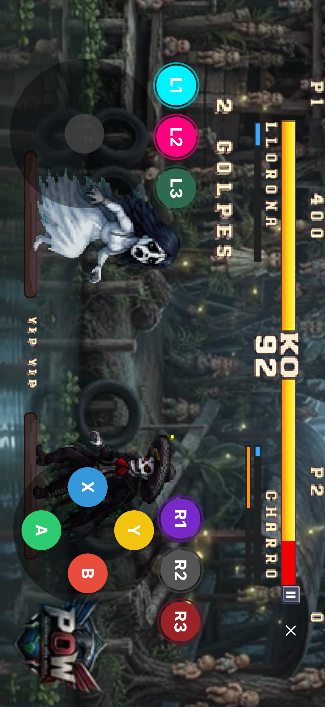
</p>
<p align="center"><b>La Llorona vs El Charro Negro — Isla de las Muñecas · Night</b></p>

<p align="center">
  
  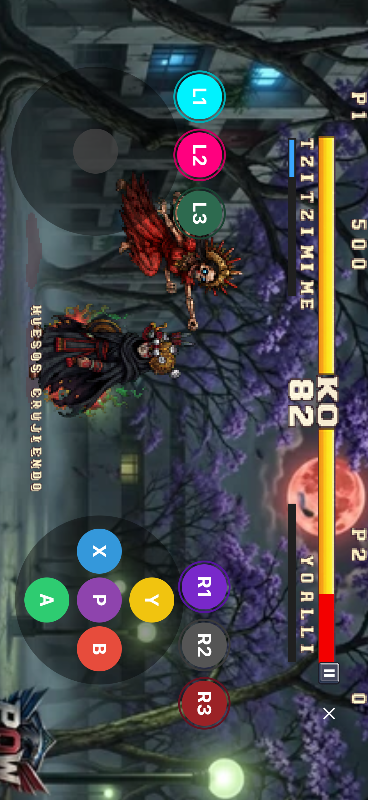
</p>
<p align="center"><b>Policía CDMX vs La Presidenta — Ciudad Universitaria UNAM · Day</b> · <b>La Tzitzimime vs Yoalli Ehécatl — UAM Azcapotzalco · Night 2</b></p>

<p align="center">
  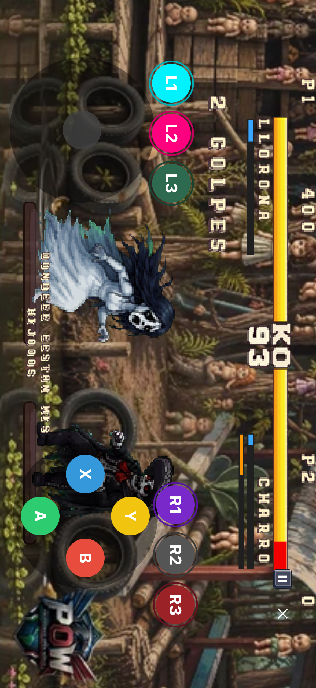
  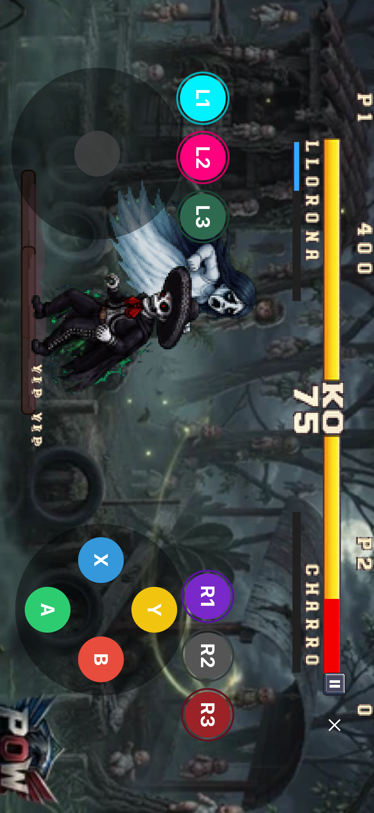
</p>
<p align="center"><b>La Llorona vs El Charro Negro — Isla de las Muñecas</b> · Day · Night 2</p>

<p align="center">
  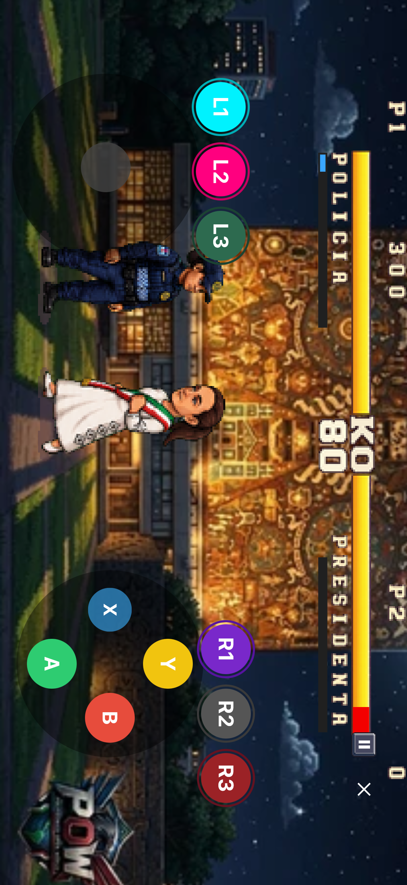
  
</p>
<p align="center"><b>Policía CDMX vs La Presidenta — Ciudad Universitaria UNAM</b> · Night · Night 2</p>

<p align="center">
  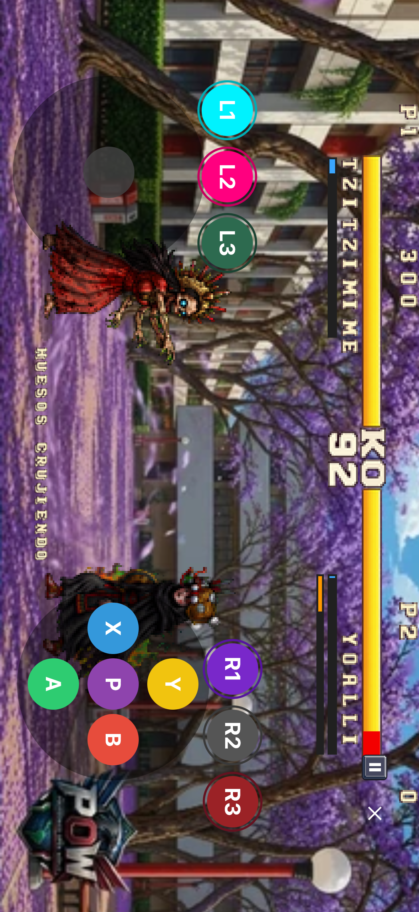
  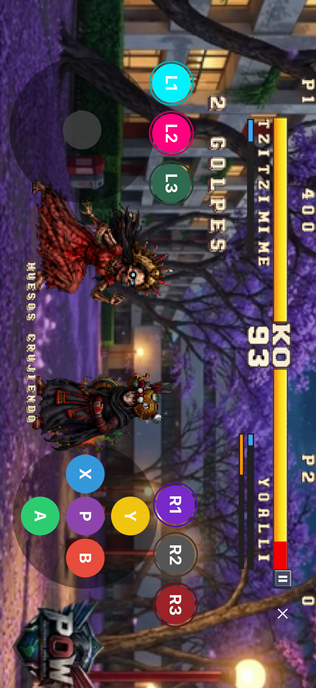
</p>
<p align="center"><b>La Tzitzimime vs Yoalli Ehécatl — UAM Azcapotzalco</b> · Day · Night</p>

Explore **61 original screenshots**: 60 stage-and-lighting combinations, 19 fighters excluding Paramédico, and an extra four-hit Charro combo.
The nine screenshots above show the three featured matchups in every lighting variant; open a group below to view the rest, up to three images at a time.

Images inside the groups keep `loading="lazy"` and their natural aspect ratio. GitHub may still preload images while a group is closed.

[Full gallery and capture provenance](pr-screenshots/iphone15-pr188/README.md) · [Physical iPhone QA report](PolitecnicoOpenWorld/README%20for%20IAS/SF/QA_IPHONE_PR188_2026-11-15.md)

<details>
<summary>📸 More action highlights — View 3 screenshots (10–12 of 61)</summary>

**Robot Estudiantx vs Alexis Syntaxis — Planetario IPN · Night 2**


Robot Estudiantx has a bright cyan orb or discharge in front of its arms while Alexis Syntaxis remains legible on the Night 2 Planetario IPN stage. P1 has 500 points.

**Yoalli Ehécatl vs La Presidenta — Mictlán · Night**

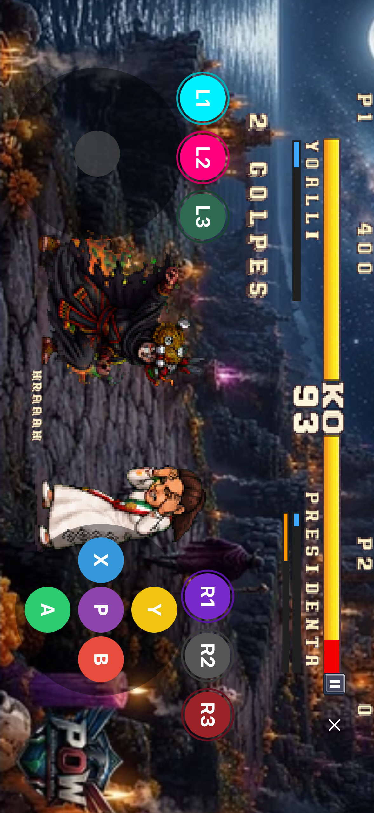

Yoalli Ehécatl attacks while La Presidenta reacts with her hands beside her face. The 2 GOLPES counter is visible at Mictlán by night; P1 has 400 points.

**Robot Estudiantx vs Alexis Syntaxis — Planetario IPN · Day**


Robot Estudiantx extends an arm with an impact spark in front of Alexis Syntaxis’s face. Planetario IPN by day, the ROBOT/SYNTAXIS HUD and a P1 score of 300 are visible.

</details>

<details>
<summary>📸 More action highlights — View 3 screenshots (13–15 of 61)</summary>

**La Planchada vs La Llorona — ESM IPN · Night 2**

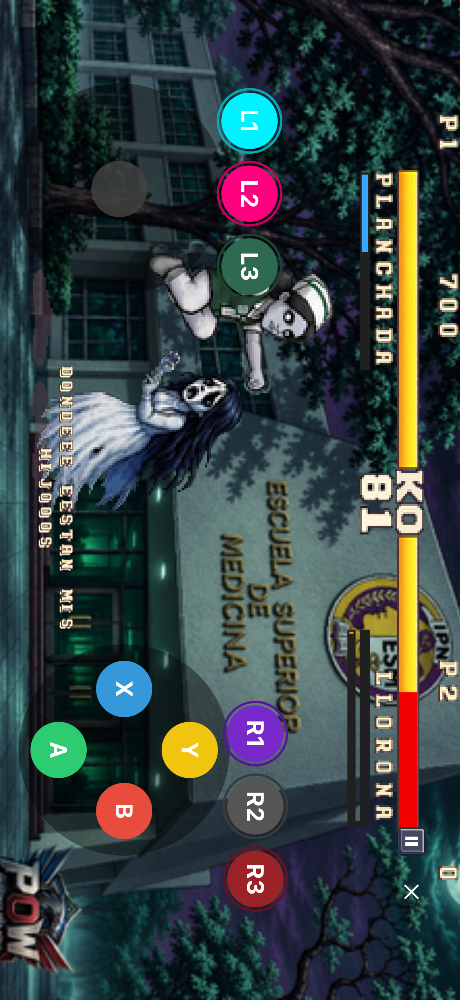

La Planchada is clearly airborne with an extended fist above La Llorona, with both faces legible on the Night 2 ESM stage. P1 has 700 points.

**Estudiante vs Estudianta — ESCOM · Night 2**

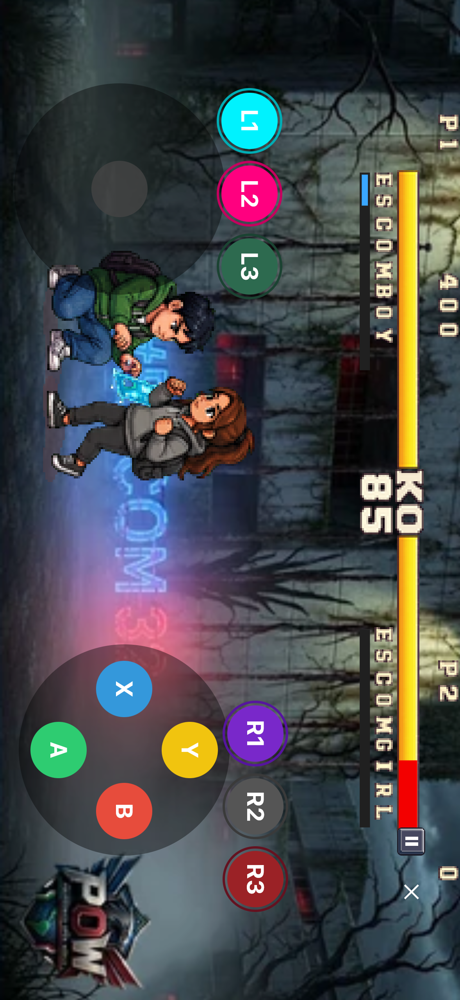

Estudiante crouches with a bright cyan effect in front of his hands while Estudianta remains fully visible. Fog covers the Night 2 ESCOM stage; P1 has 400 points and P2 has lost health.

**La Tzitzimime vs Estudianta — Pirámide del Sol · Night**

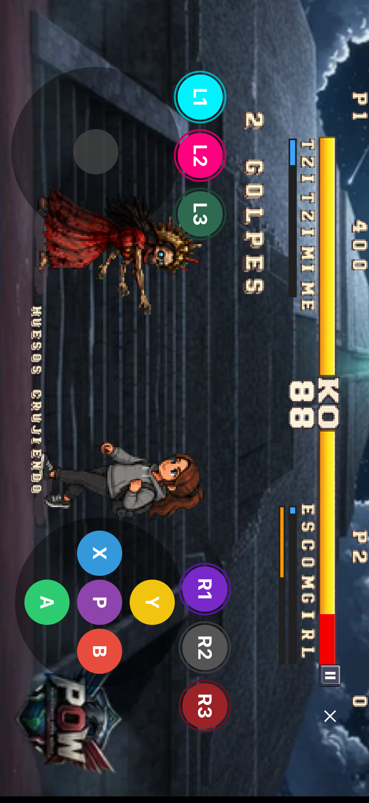

La Tzitzimime extends several arms toward Estudianta, with a visible 2 GOLPES counter and P1 score of 400 at Pirámide del Sol by night.

</details>

<details>
<summary>📸 View 3 screenshots (16–18 of 61)</summary>

**Estudiante vs Estudianta — ESCOM · Night**

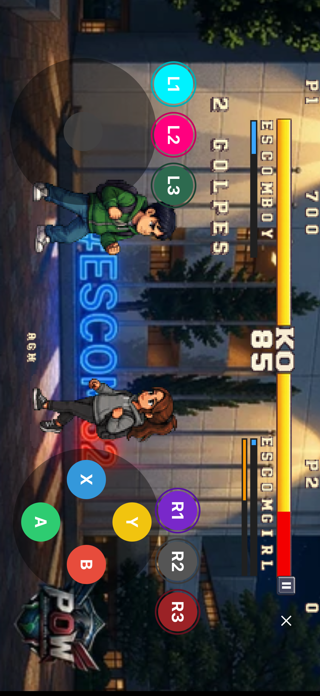

The fighters are separated and clearly visible, with the localized 2 GOLPES counter, a P1 score of 700 and a reduced P2 health bar.

**El Señor de la Tienda vs Paparazzi 1 — Queso IPN · Night 2**

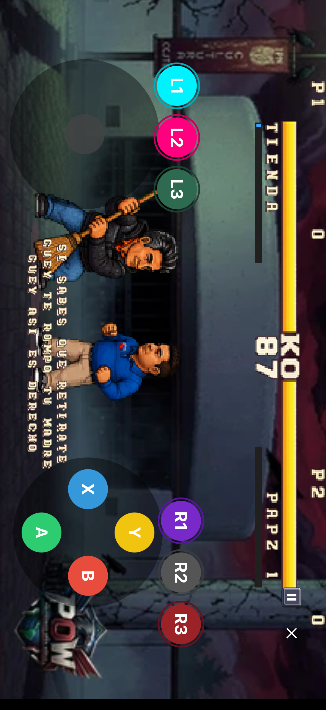

El Señor de la Tienda holds a broom with its straw head visible, facing Paparazzi 1 on the Night 2 Queso IPN stage. The HUD identifies TIENDA and PAPZ 1; this frame does not show a connected hit.

**Prankedy vs Rey Grupero — ESIME Azcapotzalco · Night 2**

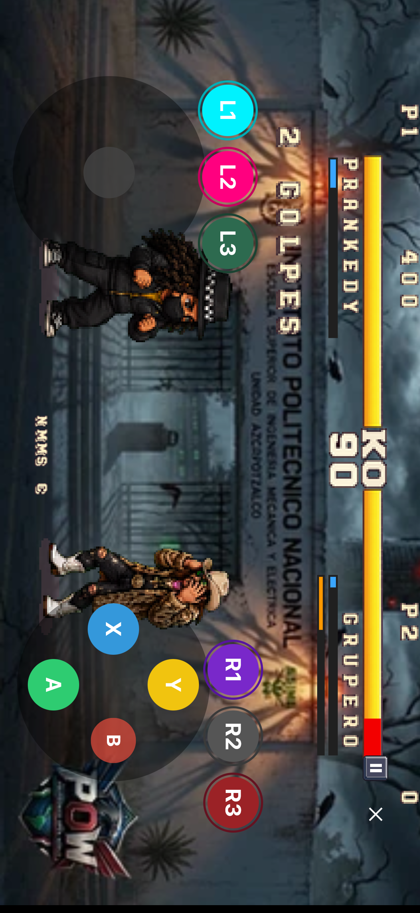

The 2 GOLPES counter is clearly visible as Rey Grupero raises his hands toward his face in front of Prankedy. Fog and crows appear on the Night 2 ESIME stage; P1 has 400 points and P2 has lost health.

</details>

<details>
<summary>📸 View 3 screenshots (19–21 of 61)</summary>

**Robot Estudiantx vs Alexis Syntaxis — CECyT 9 · Day**

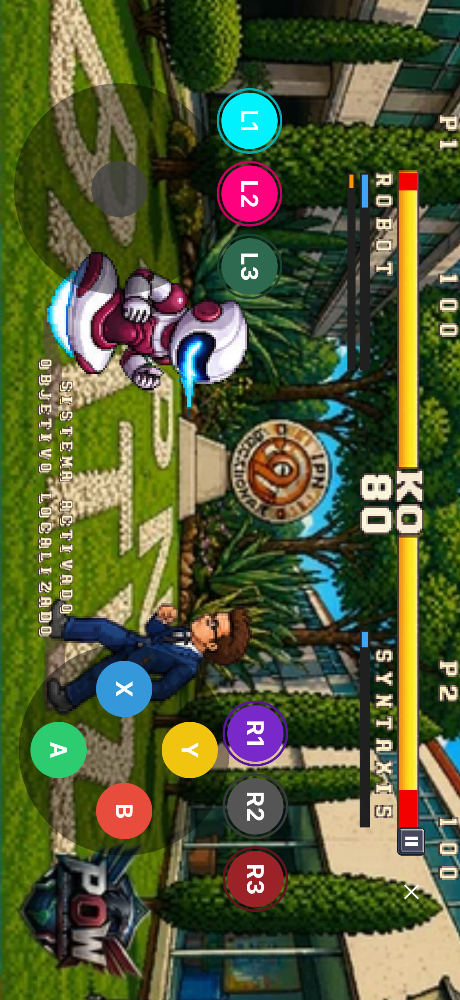

A cyan beam extends from Robot Estudiantx’s visor toward Alexis Syntaxis, whose blue suit and glasses are visible at CECyT 9 by day. Both scores are 100; the frame does not establish that the beam connected.

**Paparazzi 5 vs Policía CDMX (Hombre) — CECyT 2 · Night 2**

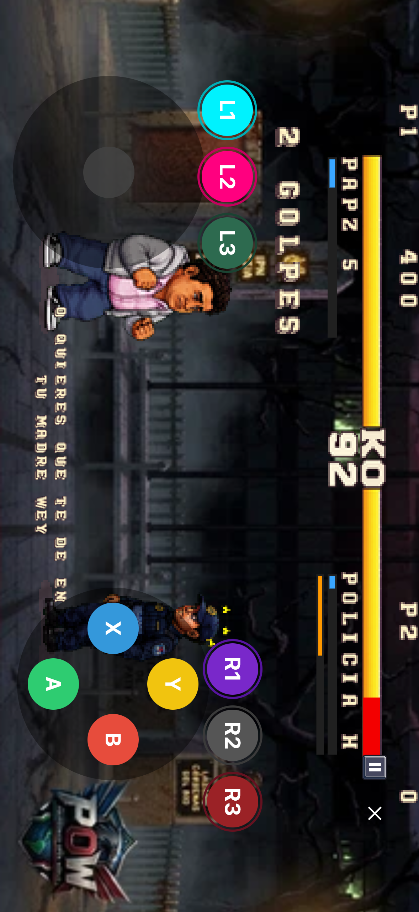

The 2 GOLPES counter is clearly visible above Paparazzi 5 and the officer, with yellow stars above the officer. Both bodies are legible on the Night 2 CECyT 2 stage; P1 has 400 points and P2 has lost health.

**Policía Granadero CDMX (Mujer) vs Policía Granadero CDMX (Hombre) — Biblioteca Nacional IPN · Day**

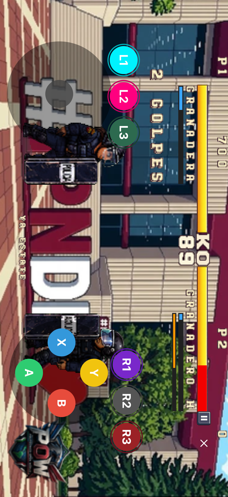

Granadera and Granadero H are separated, with recognizable helmets, visors and shields. A 2 GOLPES counter is visible at Biblioteca Nacional IPN by day; P1 has 700 points.

</details>

<details>
<summary>📸 View 3 screenshots (22–24 of 61)</summary>

**El Charro Negro vs La Planchada — FES Acatlán · Night**

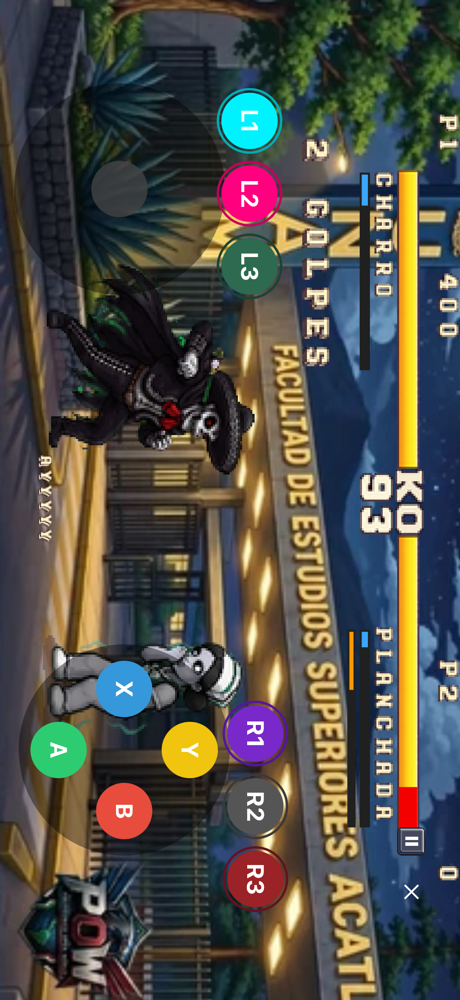

El Charro Negro advances with one arm raised toward La Planchada. Their bodies remain separated and the 2 GOLPES counter is visible at FES Acatlán by night; P1 has 400 points.

**Estudiante vs Estudianta — ESCOM · Day**

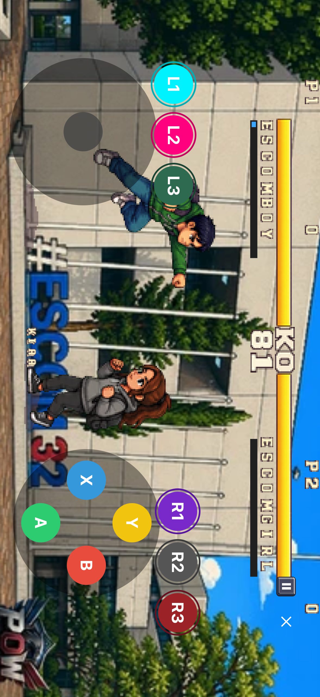

Estudiante is airborne with an extended fist while Estudianta remains fully visible on the ground. Daytime ESCOM and the complete HUD are visible; this frame does not show an impact or health loss.

**El Señor de la Tienda vs Paparazzi 1 — Queso IPN · Day**

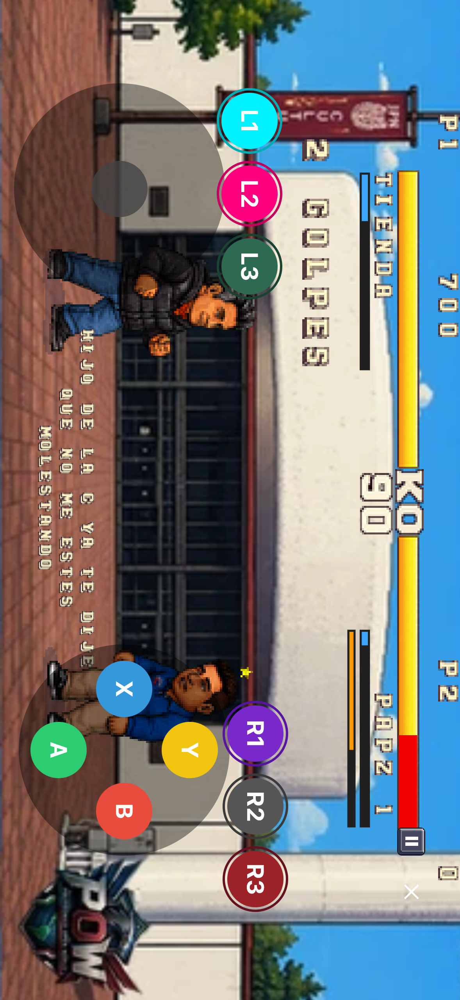

El Señor de la Tienda and Paparazzi 1 are separated, with recognizable faces and a visible 2 GOLPES counter at Queso IPN by day. P1 has 700 points.

</details>

<details>
<summary>📸 View 3 screenshots (25–27 of 61)</summary>

**El Señor de la Tienda vs Paparazzi 1 — Queso IPN · Night**

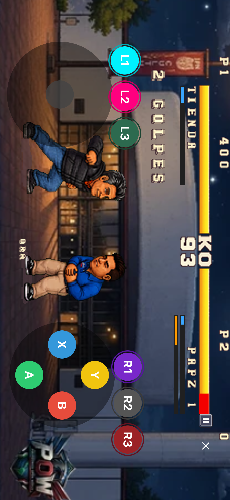

El Señor de la Tienda attacks in front of Paparazzi 1, with both faces visible and a 2 GOLPES counter at Queso IPN by night. P1 has 400 points.

**Prankedy vs Rey Grupero — ESIME Azcapotzalco · Day**

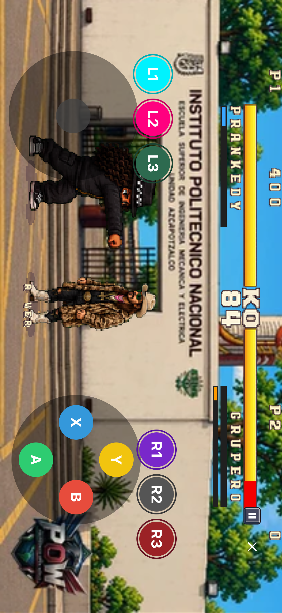

Prankedy extends a fist toward Rey Grupero. Both fighters are fully visible against the ESIME Azcapotzalco wall by day; P1 has 400 points and P2 has lost health. No combo counter is visible.

**Prankedy vs Rey Grupero — ESIME Azcapotzalco · Night**


Prankedy is airborne with tucked legs and a fist forward while Rey Grupero remains on the ground. The moon, illuminated ESIME building and P1 score of 500 are visible; this frame does not establish an impact.

</details>

<details>
<summary>📸 View 3 screenshots (28–30 of 61)</summary>

**Robot Estudiantx vs Alexis Syntaxis — CECyT 9 · Night**

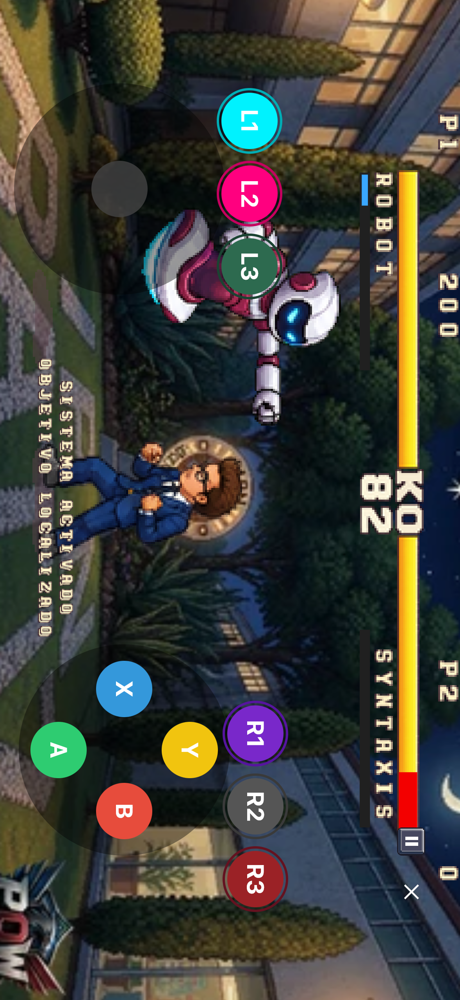

Robot Estudiantx is airborne with one arm extended while Alexis Syntaxis is fully visible on the ground at CECyT 9 by night. P1 has 200 points; the pose alone does not establish an aerial hit.

**Robot Estudiantx vs Alexis Syntaxis — CECyT 9 · Night 2**

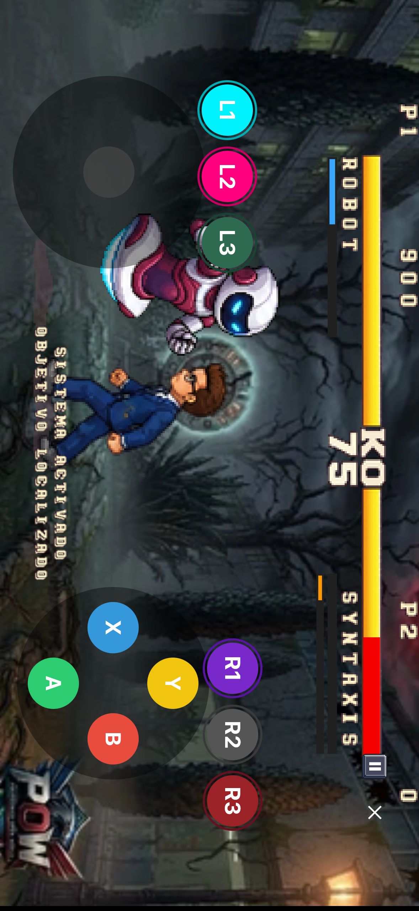

Robot Estudiantx hovers with an arm raised beside a leaning Alexis Syntaxis on the Night 2 CECyT 9 stage. A cyan thruster effect is visible below the robot; P1 has 900 points and P2 has lost health. No combo counter is visible.

**Paparazzi 5 vs Policía CDMX (Hombre) — CECyT 2 · Day**

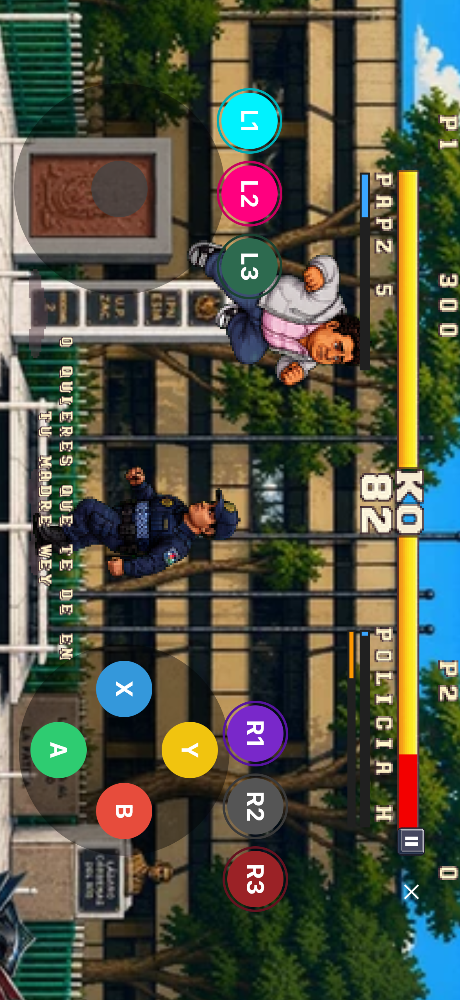

Paparazzi 5 is airborne with an arm extended while Policía CDMX (Hombre) is fully visible on the ground at CECyT 2 by day. P1 has 300 points; the pose alone does not establish a connected hit.

</details>

<details>
<summary>📸 View 3 screenshots (31–33 of 61)</summary>

**Paparazzi 5 vs Policía CDMX (Hombre) — CECyT 2 · Night**

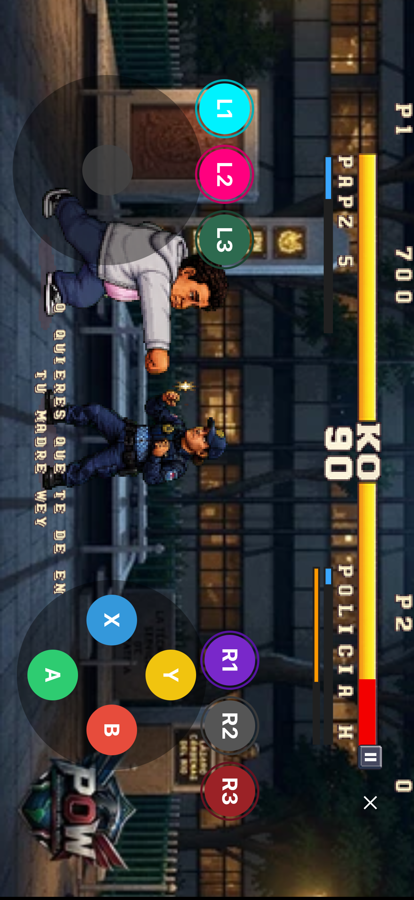

Paparazzi 5 extends a fist, with a small yellow flash in front of the officer’s cap. CECyT 2 by night, the PAPZ 5/POLICIA H HUD and a P1 score of 700 are visible; P2 has lost health. No combo counter is visible.

**Policía Granadero CDMX (Mujer) vs Policía Granadero CDMX (Hombre) — Biblioteca Nacional IPN · Night**

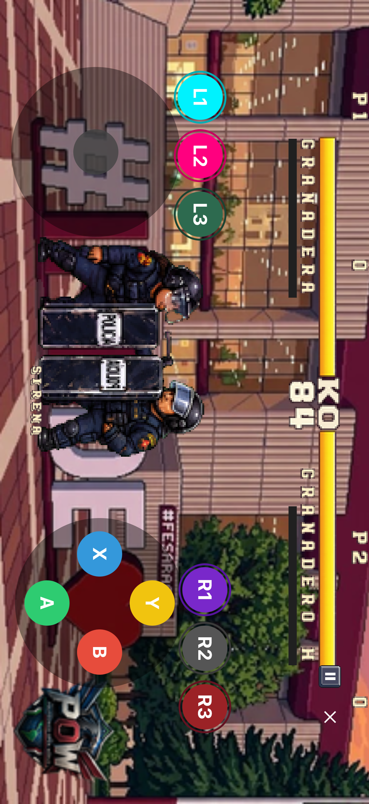

Granadera extends an arm holding a baton-like object near Granadero H and his shield. Their identities and HUD remain recognizable at Biblioteca Nacional IPN by night; P1 has 0 points. The gesture or subtitle does not identify an audio clip.

**Policía Granadero CDMX (Mujer) vs Policía Granadero CDMX (Hombre) — Biblioteca Nacional IPN · Night 2**

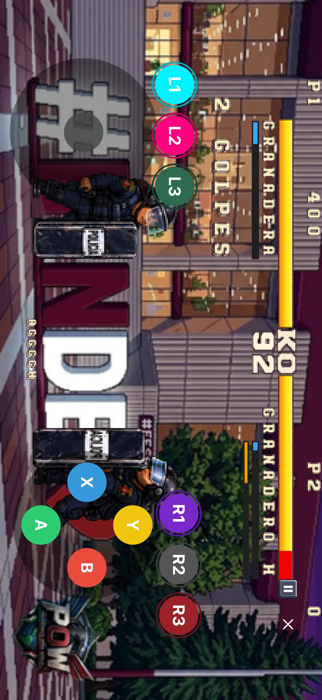

Granadera and Granadero H are separated, with recognizable faces and visors and a visible 2 GOLPES counter on the Night 2 Biblioteca Nacional IPN stage. P1 has 400 points.

</details>

<details>
<summary>📸 View 3 screenshots (34–36 of 61)</summary>

**El Charro Negro vs La Planchada — FES Acatlán · Day**

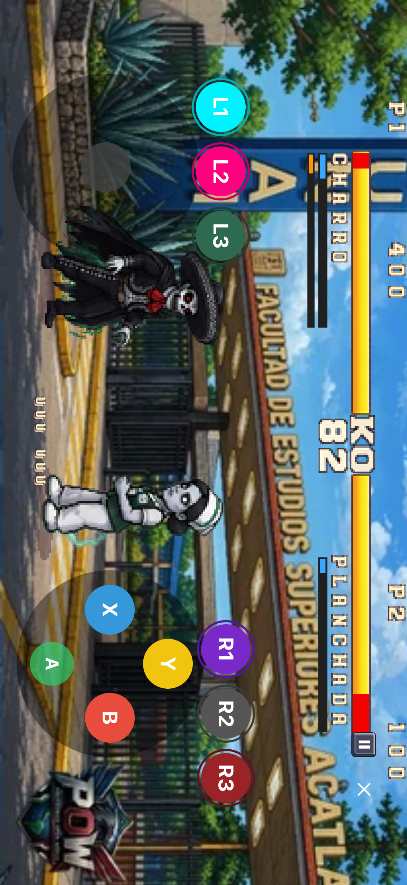

El Charro Negro and La Planchada are fully visible and separated at FES Acatlán by day, with both faces legible. P1 has 400 points.

**El Charro Negro vs La Planchada — FES Acatlán · Night 2**

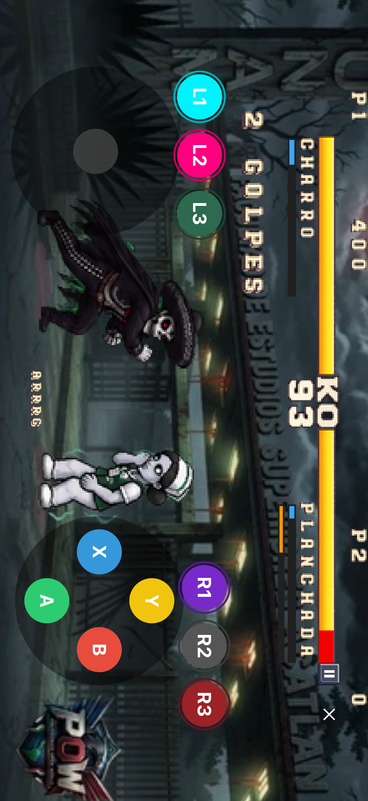

El Charro Negro leans forward while La Planchada stands apart, with the 2 GOLPES counter visible on the Night 2 FES Acatlán stage. P1 has 400 points.

**El Charro Negro vs El Charro Negro — Four-hit combo**


Both Charros are fully visible in combat with the localized 4 GOLPES counter. This extra AI-vs-AI screenshot is outside the 60-background matrix and does not establish the final match result by itself.

</details>

<details>
<summary>📸 View 3 screenshots (37–39 of 61)</summary>

**Yoalli Ehécatl vs La Presidenta — Mictlán · Day**


Yoalli Ehécatl leans forward while La Presidenta stands apart, with both faces recognizable against Mictlán’s orange landscape and candles. P1 has 100 points.

**Yoalli Ehécatl vs La Presidenta — Mictlán · Night 2**

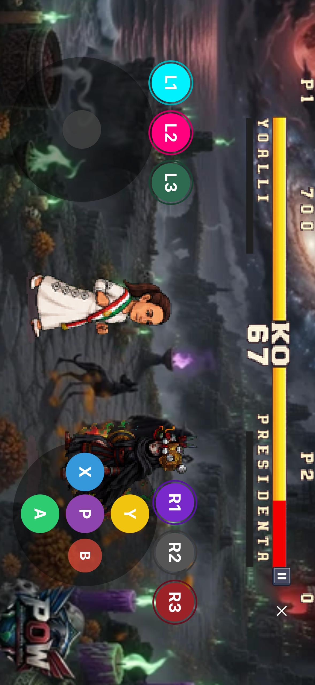

Yoalli Ehécatl is airborne on the right while La Presidenta stands on the left, both recognizable under the red moon on the Night 2 Mictlán stage. P1 has 700 points; their screen positions do not change their P1/P2 HUD identities.

**El Charro Negro vs Rey Grupero — Campos de Agave Jalisco · Day**

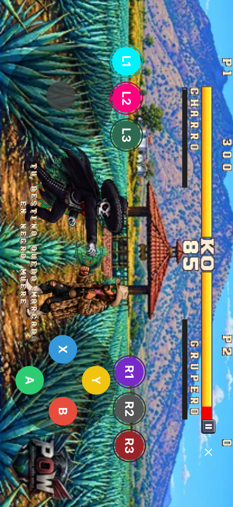

El Charro Negro extends an arm with small green particles near his fist toward Rey Grupero, with both faces visible in the agave fields by day. P1 has 300 points; this frame does not establish a connected special attack.

</details>

<details>
<summary>📸 View 3 screenshots (40–42 of 61)</summary>

**El Charro Negro vs Rey Grupero — Campos de Agave Jalisco · Night**

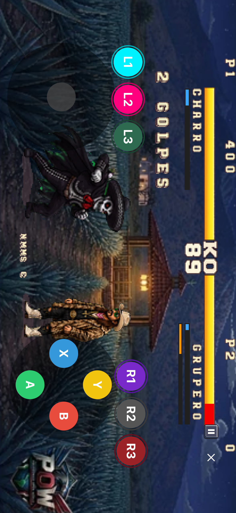

El Charro Negro advances toward Rey Grupero with a visible 2 GOLPES counter, agave plants and an illuminated gazebo by night. P1 has 400 points.

**El Charro Negro vs Rey Grupero — Campos de Agave Jalisco · Night 2**

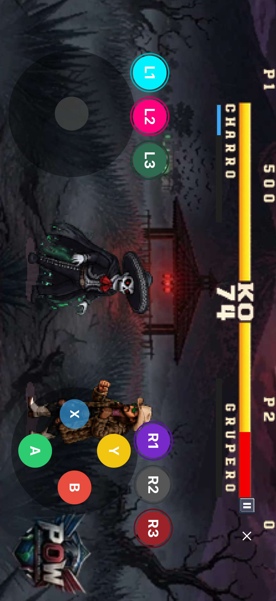

El Charro Negro stands on the left and Rey Grupero guards on the right, with separated faces and the complete HUD visible on the Night 2 Campos de Agave Jalisco stage. P1 has 500 points.

**Alexis Syntaxis vs Robot Estudiantx — Facultad de Medicina · Day**

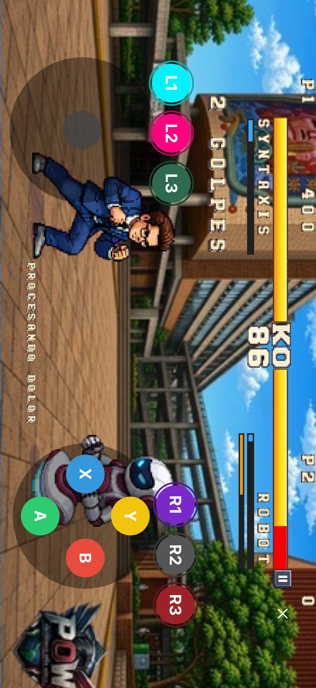

Alexis Syntaxis and Robot Estudiantx are separated, with a 2 GOLPES counter at Facultad de Medicina by day. The face and visor are legible; P1 has 400 points.

</details>

<details>
<summary>📸 View 3 screenshots (43–45 of 61)</summary>

**Alexis Syntaxis vs Robot Estudiantx — Facultad de Medicina · Night**

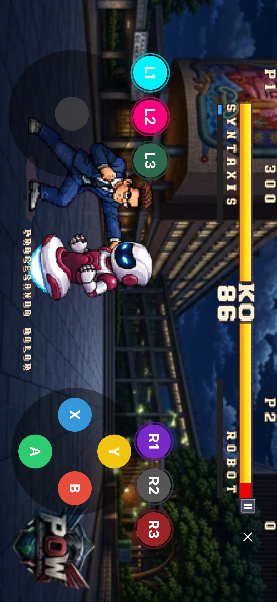

Alexis Syntaxis extends a fist toward Robot Estudiantx, with the face and visor legible at Facultad de Medicina by night. P1 has 300 points.

**Alexis Syntaxis vs Robot Estudiantx — Facultad de Medicina · Night 2**


Alexis Syntaxis and Robot Estudiantx are separated, with a visible 2 GOLPES counter on the Night 2 Facultad de Medicina stage. P1 has 400 points.

**Rey Grupero vs Prankedy — FES Aragón · Day**

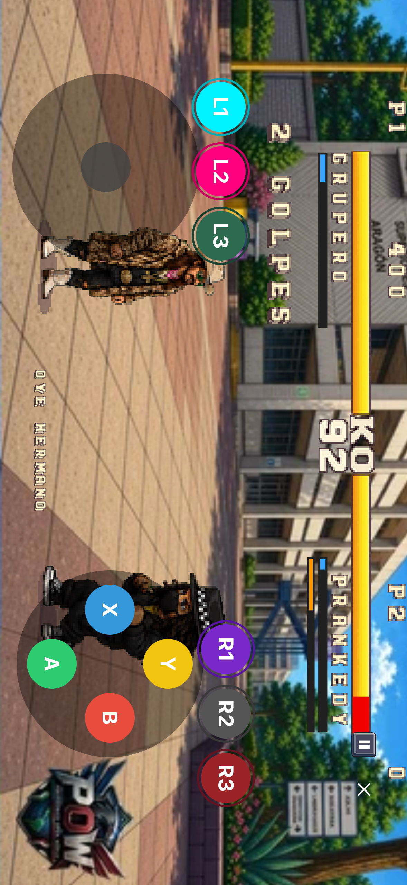

Rey Grupero and Prankedy are separated, with recognizable faces and a visible 2 GOLPES counter at FES Aragón by day. P1 has 400 points.

</details>

<details>
<summary>📸 View 3 screenshots (46–48 of 61)</summary>

**Rey Grupero vs Prankedy — FES Aragón · Night**

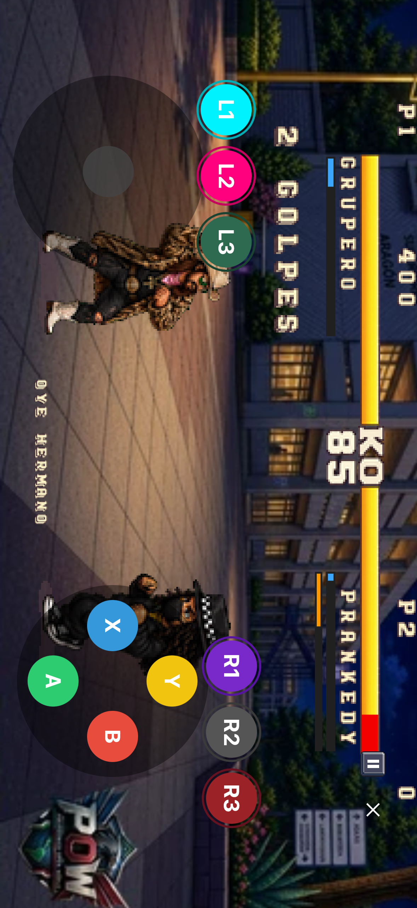

Rey Grupero and Prankedy are separated, with the GRUPERO/PRANKEDY HUD, a visible 2 GOLPES counter and a P1 score of 400 at FES Aragón by night.

**Rey Grupero vs Prankedy — FES Aragón · Night 2**


Rey Grupero holds a megaphone facing Prankedy, with both faces recognizable through the fog on the Night 2 FES Aragón stage. Both scores are 100.

**La Tzitzimime vs Estudianta — Pirámide del Sol · Day**

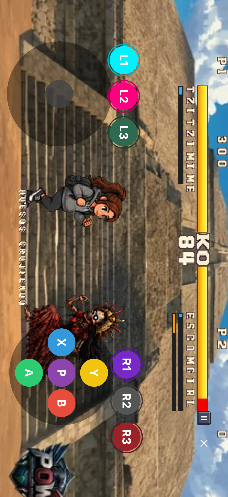

Estudianta stands on the left with one knee raised and La Tzitzimime on the right, both legible at Pirámide del Sol by day. The HUD identifies TZITZIMIME/ESCOMGIRL and P1 has 300 points; the left-hand fighter is not assumed to be P1.

</details>

<details>
<summary>📸 View 3 screenshots (49–51 of 61)</summary>

**La Tzitzimime vs Estudianta — Pirámide del Sol · Night 2**

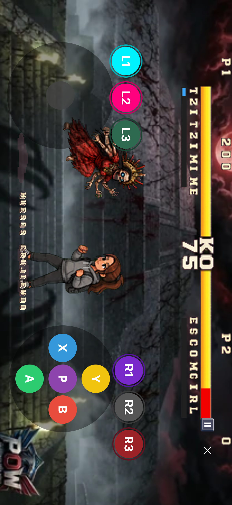

La Tzitzimime is suspended in the air with a red dress and several arms while Estudianta guards on the Night 2 Pirámide del Sol stage beneath a red moon. P1 has 200 points.

**Policía CDMX vs Paparazzi 5 — UAM Cuajimalpa · Day**

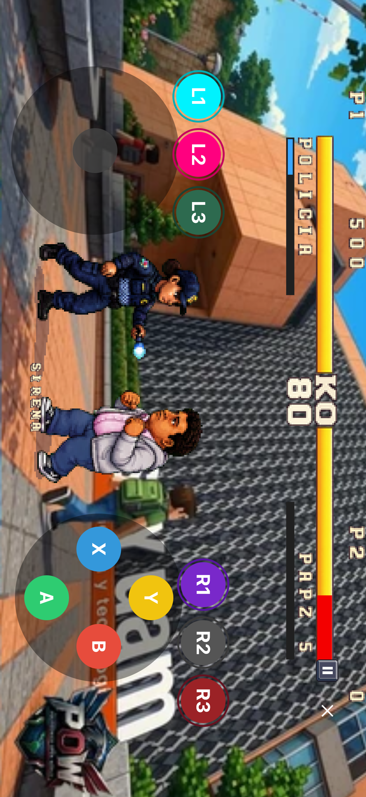

Policía CDMX extends an arm with a small, bright cyan effect in front of his hand toward Paparazzi 5. Animated pedestrians appear in the UAM Cuajimalpa daytime background; P1 has 500 points.

**Policía CDMX vs Paparazzi 5 — UAM Cuajimalpa · Night**

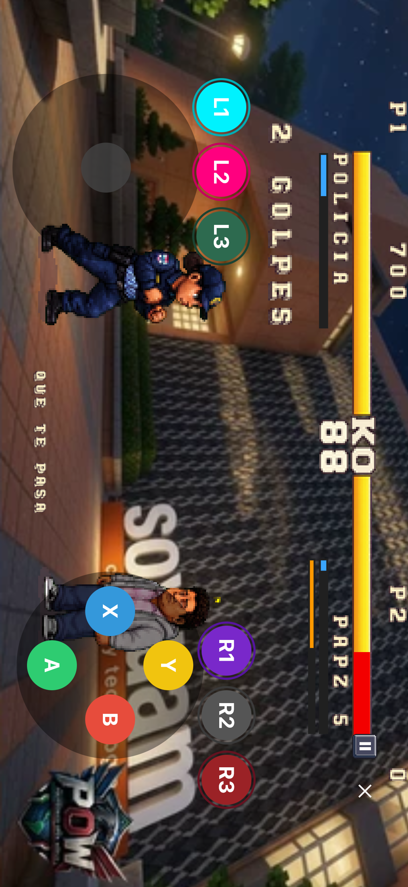

Policía CDMX and Paparazzi 5 are separated, with recognizable faces and HUD and a visible 2 GOLPES counter at UAM Cuajimalpa by night. P1 has 700 points.

</details>

<details>
<summary>📸 View 3 screenshots (52–54 of 61)</summary>

**Policía CDMX vs Paparazzi 5 — UAM Cuajimalpa · Night 2**

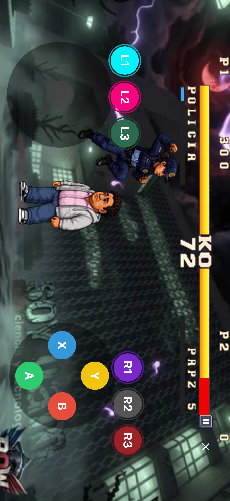

Policía CDMX is airborne with a raised knee above Paparazzi 5. Purple effects belong to the Night 2 UAM Cuajimalpa background; P1 has 300 points.

**La Presidenta vs Policía Granadero CDMX (Hombre) — Zócalo · Day**


La Presidenta raises a leg toward Granadero H and his shield, with a visible 2 GOLPES counter, P1 score of 900 and the cathedral at Zócalo by day.

**La Presidenta vs Policía Granadero CDMX (Hombre) — Zócalo · Night**

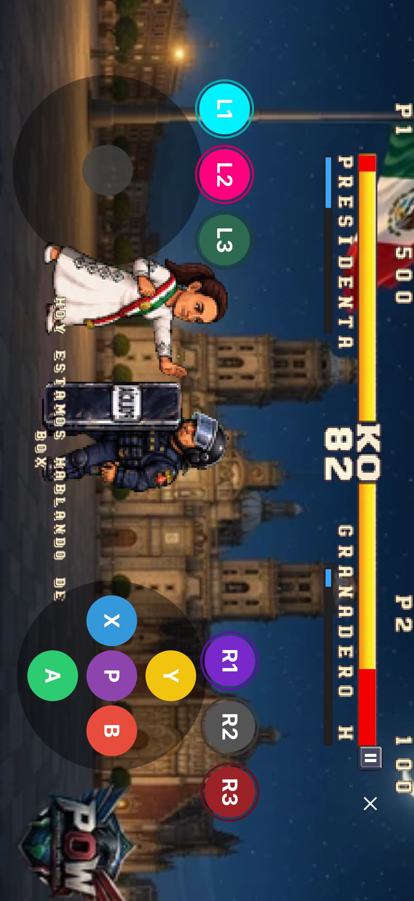

La Presidenta extends an open hand toward Granadero H’s shield, with both faces legible in the illuminated Zócalo by night. P1 has 500 points and P2 has 100.

</details>

<details>
<summary>📸 View 3 screenshots (55–57 of 61)</summary>

**La Presidenta vs Policía Granadero CDMX (Hombre) — Zócalo · Night 2**


La Presidenta is suspended in the air facing Granadero H on the Night 2 Zócalo stage, with birds and a red moon. P1 has 300 points; the scene reaches both image edges.

**Robot Estudiantx vs Alexis Syntaxis — Planetario IPN · Night**

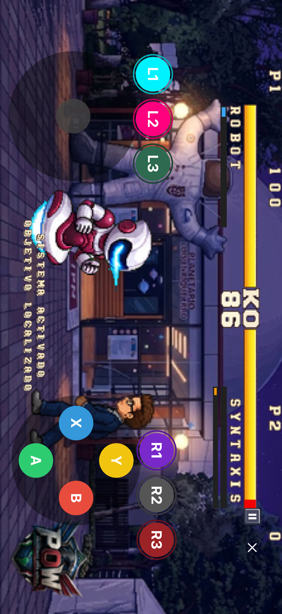

A short cyan beam extends from Robot Estudiantx’s visor toward Alexis Syntaxis, with the illuminated Planetario IPN nighttime background. P1 has 100 points.

**La Planchada vs La Llorona — ESM IPN · Day**

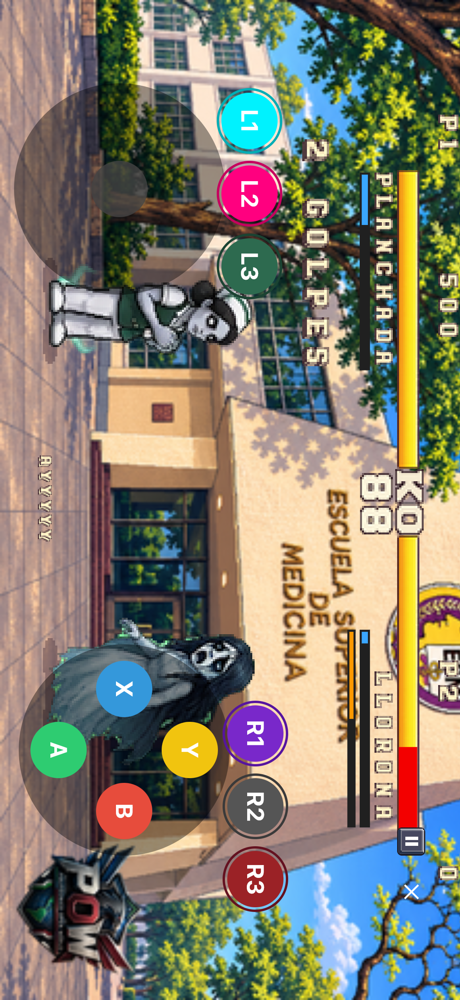

La Planchada and La Llorona are recognizable at Escuela Superior de Medicina by day, with a visible 2 GOLPES counter and P1 score of 500.

</details>

<details>
<summary>📸 View 3 screenshots (58–60 of 61)</summary>

**La Planchada vs La Llorona — ESM IPN · Night**

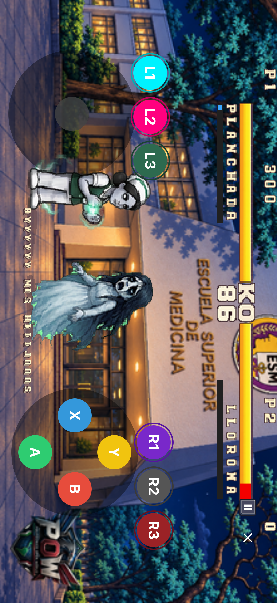

La Planchada holds a visible green glow between her hands facing La Llorona, with the illuminated ESM nighttime background. P1 has 300 points.

**Estudiante vs Robot Estudiantx — CET 1 · Day**


Estudiante strikes with an arm toward Robot Estudiantx, with a visible 2 GOLPES counter at CET 1 by day. P1 has 700 points.

**Estudiante vs Robot Estudiantx — CET 1 · Night**

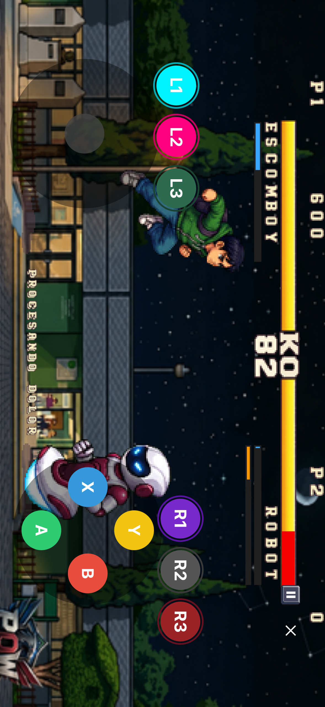

Estudiante is clearly airborne with bent knees facing Robot Estudiantx at CET 1 by night, beneath a starry sky. P1 has 600 points.

</details>

<details>
<summary>📸 View 1 screenshot (61–61 of 61)</summary>

**Estudiante vs Robot Estudiantx — CET 1 · Night 2**

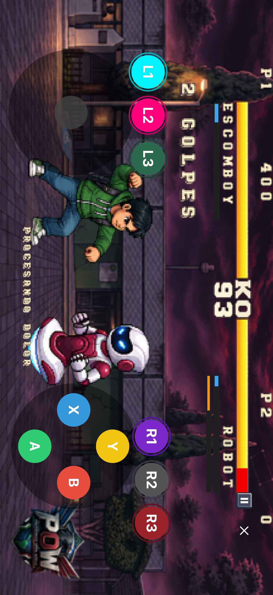

Estudiante has one arm raised and the other forward facing Robot Estudiantx, with a visible 2 GOLPES counter on the Night 2 CET 1 stage. P1 has 400 points.

</details>

<!-- POW_IPHONE_GALLERY_END -->

## 🥊 Titulación por Combate

Titulación por Combate is a 2D 1v1 fighter with best-of-three rounds, an on-screen joystick and arcade buttons, and a deep moveset: chain combos, dashes, parries, throws, counters, taunts and super arts. Fighters speak recorded voice lines with optional subtitles, and the whole game is available in Spanish and English.

### Modes

| Mode | What it is | iPhone | Android |
|---|---|:---:|:---:|
| **Arcade** | Climb a ladder of up to 16 fights as one of the three ESCOM students, beat the bosses — La Tzitzimime, La Presidenta and Yoalli Ehécatl — and unlock fighters. Easy, Medium and Hard set the lighting (day, night, Night 2). | ✅ | ✅ |
| **Practice** | Pick your fighter, rival, CPU difficulty and stage. | ✅ | ✅ |
| **Combos & Tutorial** | Step-by-step lessons for every control and combo, then free practice. | ✅ | ✅ |
| **Examen Extraordinario** | Practice the finishing moves ("Extraordinarios") with no time limit. | ✅ | ✅ |
| **AI vs AI** | Watch two CPUs fight at Nightmare difficulty — made for recording. | ✅ | ✅ |
| **Records** | Wins and losses for every fighter. | ✅ | ✅ |
| **Multiplayer** | 1v1 versus online (room codes, public rooms, quick match), over Bluetooth or on your local network. | — | ✅ |

### Fighters

Estudiante · Estudianta · Robot Estudiantx · Alexis Syntaxis · Prankedy · El Señor de la Tienda · Paparazzi 1 · Paparazzi 5 · Rey Grupero · Policía CDMX · Policía CDMX (Hombre) · Granadera · Granadero · Paramédico Cruz Roja · El Charro Negro · La Llorona · La Planchada · La Tzitzimime · La Presidenta · Yoalli Ehécatl

### Stages

ESCOM · Queso IPN · ESIME Azcapotzalco · CECyT 9 · CECyT 2 · Biblioteca Nacional IPN · Ciudad Universitaria UNAM · FES Acatlán · UAM Azcapotzalco · Isla de las Muñecas · Mictlán · Campos de Agave Jalisco · Facultad de Medicina · FES Aragón · Pirámide del Sol · UAM Cuajimalpa · Zócalo · Escuela Superior de Medicina — each in day, night and Night 2 versions, unlocked by beating each rival in Arcade.

Two extra stages, **Planetario IPN** and **CET 1**, are available with Developer Mode (Settings).

### 🍏 iPhone and Android, one codebase

The fighting engine, menus, assets and rules live in the shared Kotlin Multiplatform module (`PolitecnicoOpenWorld/shared`), so iPhone and Android run the same game. The iOS app is a thin SwiftUI host around a single Compose Multiplatform view controller (`PolitecnicoOpenWorld/iosApp`).

Which modes each platform shows is decided in one place, `PowModos.kt`, and covered by unit tests that run on Android:

- iPhone shows only **Titulación por Combate**, **Collectibles** and **Settings**. The open world, story campaign and multiplayer are not shown there; their code stays in the repository for Android.
- The App Store switch `MODOS_EN_OBRAS_VISIBLES` is **off**, so iPhone never shows under-construction buttons.
- The fighting mode's multiplayer is Android-only (`sfMultijugadorDisponible()`), because its online, Bluetooth and LAN transports live in the Android app.

Install and sign the iPhone build step by step: [`14_INSTALAR_EN_IPHONE_Y_SIMULADOR.md`](PolitecnicoOpenWorld/README%20for%20IAS/14_INSTALAR_EN_IPHONE_Y_SIMULADOR.md). Xcode project notes: [`iosApp/README.md`](PolitecnicoOpenWorld/iosApp/README.md).

> 📚 **Detailed technical documentation** for contributors and AI assistants lives in **[README for IAS](PolitecnicoOpenWorld/README%20for%20IAS/)** — start with `00_INDEX.md`. The fighting mode has its own index in `SF/00_SF_INDEX.md`.

### 🔄 Recent Changes

- **Open world: north-up camera and solid collisions (2026-11-20)** — on Android the map now stays north-up while driving on web, Google and native OSM, and vehicle sprites rotate on their own. Characters collide as circles and cars as oriented rectangles, with a static sweep at high speed: buildings and fences (`BARRIER`) block, while the 48 `CARRIL_*` lanes are `NAV_GUIDE` and no longer create invisible walls. On foot you can no longer overlap car bodies (joystick and buttons alike), forced vehicle exits look for a walkable spot, traffic uses the same resolver against static shapes, and ESCOM's exterior collisions load again, so its roof polygon blocks walking, driving and traffic. The debug overlay draws physical shapes in red and guides in blue.
- **iPhone App Store build: Titulación por Combate only (2026-11-21)** — the iPhone menu now shows only Titulación por Combate, Collectibles and Settings. Under-construction buttons are switched off, and the fighting mode's multiplayer button is hidden on iOS, where it had no function. Android is unchanged.
- **iPhone combat orientation (2026-11-15)** — Titulación por Combate enters landscape automatically, including fighter and stage selection. Selector content respects the lateral safe area. [Real iPhone QA status](PolitecnicoOpenWorld/README%20for%20IAS/SF/QA_IPHONE_PR188_2026-11-15.md).
- **Unified Collectibles gallery** — Multimedia is now part of Collectibles, keeping its burgundy and gold design with exactly two tabs: Fighters and Maps. Fighters contains the Titulación por Combate roster, including source animation frames for fighters with runtime sheets. Maps contains combat stages and their day/night/apocalypse variants, interiors and transit maps. A separate image viewer supports pinch zoom, bounded panning, zoom buttons and fit-to-window, using the original asset instead of its thumbnail. No image files are duplicated.
- **El Charro Negro's wolf voice (2026-11-06)** — three new voice lines blend real wolf howls and growls into his speech. [Sources and licenses](newSFAssets/CharroNegro/audio_sources/README.md) · [how the voice was built](docs/audio/charro_voz_lobo.md).
- **La Planchada and ESM (2026-11-06)** — adds a spectral IMSS nurse with original sprites in one standardized WebP combat atlas, derived free-roam animations, shared La Llorona audio, and the Escuela Superior de Medicina stage. Defeat her in Arcade on Medium or Hard to unlock the fighter.
- **CET 1: day, night and ominous-night stages (2026-11-05)** — three animated backgrounds of the Walter Cross Buchanan campus join the Titulación por Combate stage selector. They remain extra stages outside the Arcade ladder and are playable with Developer Mode enabled. Each variant has a WebP atlas, animation metadata and a separate selector thumbnail.
- **Alexis Syntaxis asset repair and fighter CI (2026-11-04)** — damage/stun sprites now follow the 100 px standing-height standard, with corrected feet anchors. Four talking poses and ten clipped action poses were regenerated. A reproducible asset workflow builds previews, checks geometry and compares committed assets with their sources. See the [fighter CI tutorial](PolitecnicoOpenWorld/README%20for%20IAS/SF/CI_CD_agregar_peleador.md).
- **Static CDMX streets (2026-11-04)** — integrates the static-cell approach from PR #182 ahead of Overpass, and rejects malformed/HTML responses so gateway errors are retried through the fallback instead of accepted as empty streets.

Older entries live in the git history.

---

## 🤖 Android exclusive: open world, story campaign and zombie minigame

These modes ship only in the Android app. Their code stays in this repository; the iPhone build simply doesn't show them.

On Android, **Politécnico Open World (POW)** provides 2D top-down exploration built on real-world maps. The player navigates the actual streets of their surroundings (with initial focus on the ESCOM / Zacatenco area in Mexico City) using **OpenStreetMap** cartographic data, sharing the world with procedural NPCs (pedestrians and vehicles) and with other players connected to a real-time server. The ESCOM campus also hosts an embedded zombie survival minigame with interior buildings, melee/ranged combat and a power-up system — now backed by its own authoritative server.

### 🗺️ Map System

POW supports **eight map providers** that can be hot-swapped from the Settings screen:

| Provider | Mode | Notes |
|---|---|---|
| OSMDroid (Native) | Native render | Highest zoom (up to 21); dark background to avoid rotation gaps |
| Google Maps (Native) | Google Maps SDK | Uses `MAPS_API_KEY` from manifest |
| OpenStreetMap (Web) | WebView + Leaflet | |
| Google Maps (Web) | WebView + Leaflet | |
| CartoDB Dark / Light | WebView + Leaflet | Video-game aesthetic |
| Esri World Street | WebView + Leaflet | |
| Esri Satellite | WebView + Leaflet | Real aerial view |
| OpenTopoMap | WebView + Leaflet | Terrain and contour lines |

Web modes render through **Leaflet** inside a `WebView` and are intercepted by a `CachingWebViewClient` that caches each tile in Room (`MapTileEntity`) using the normalized URL as key (stripping load-balancing subdomains and volatile parameters before hashing with SHA-256). This allows offline play in any previously visited area. Since 2026-11-10 the camera stays **north-up** on web, Google and native OSM (the map no longer rotates while driving; vehicle sprites rotate on their own), so the Leaflet `#map-wrapper` is always screen-sized (`100vw × 100vh`) and `setMapOversize` was removed — roughly **~8× fewer tiles** than the old fixed `300vw × 300vh` wrapper.

#### Tile & road-network caching

- **Tiles:** per-provider LRU (~8k max). Writes are **atomic**: a single Room `@Transaction` counts the provider's tiles, evicts the oldest (LRU) if over the limit, and inserts the new tile — preventing corrupt states if the process dies mid-write.
- **Road network (Overpass):** ~2 km cells, **7-day TTL**, **LRU of 20 cells**, atomic zone+ways+nodes insert (`@Transaction`), and a 5-minute re-fetch cooldown.

The player cannot step off the road network: every movement is validated against a **spatial grid index** (`Seg` + `HashMap<cell, segments>`) that runs *snap-to-road* in O(nearby candidates).

### 🏛️ Landmarks and Designer Mode

The map is populated with editable buildings: a JSON asset catalog (`buildings_catalog.json`), persisted placements in `LandmarkEntity` (position, rotation 0-360°, scale 0.05-3.0×), and a **Designer Mode** panel with fine movement, rotation/scale sliders and JSON export/import. `assets/default_landmarks.json` seeds the ESCOM layout on first launch.

### 🎁 Collectibles System

The Fighters/Maps gallery is available on iPhone and Android; the lore items described further below are found in the Android open world.

The `collectibles` destination hosts the Fighters/Maps gallery. Its catalog and UI live under `shared/src/commonMain/kotlin/ovh/gabrielhuav/pow/features/main_menu/` (`gallery/`, `ui/CollectiblesGallery.kt` and `ui/GalleryZoomViewer.kt`); there is no separate Multimedia menu or route. Browsing does not unlock playable fighters or modify collected objects. The previous Objects tab, general world-character gallery and Designs tab are not displayed. Images load off the UI thread with bounded thumbnails and a screen-scoped cache; the viewer keeps one higher-resolution image outside that cache. Only resources packaged with each platform are discoverable.

Six lore-themed collectibles are seeded into Room. The game loop spawns one uncollected item every ~1 s within 300–600 m of the player, snapped to roads. Approaching within 15 m shows a pickup prompt; pressing X collects it and shows a themed dialog. The inventory reads from a `Flow<List<CollectibleEntity>>`. A special **Zombie Hand** item only spawns inside the ESCOM bounding box and triggers a cutscene into the zombie minigame.

### 🚶 NPCs and Vehicles

`NpcAiManager` maintains up to **40 NPCs** around the player: **pedestrians** (assembled at runtime with per-pixel tinting) and **vehicles** (6 models, 48 rotation frames each). Behavior includes proximity spawning, distance despawn, node-to-node navigation and an **adoption** system for server-inherited NPCs. The spawner now precomputes a **per-way bounding box** and uses an O(1) bbox pre-filter before the expensive per-node distance check, reducing CPU. Pressing **B** triggers a special attack (~17 m, 15 dmg/punch); pressing **X** near a vehicle boards it for free 360° driving.

> Note: this open-world NPC AI runs **client-side** (on the Zone Host) — the open-world server only arbitrates host roles and relays messages. The zombie minigame, by contrast, now runs its zombie AI **server-side** (see below).

### 🚓 Wanted Level / Police (GTA-style)

Punching civilians raises a **wanted level** (0–5 stars, HUD). While wanted, **patrol cars** (`PoliceManager` + `PoliceSpriteManager`, using the no-repaint `VEHICLES/POLICE_TOPDOWN` asset) spawn far away — more cars per star — and chase you, **respecting the streets** (each step snaps to the road network). Outside the fog they're shown as a 🚓 waypoint with a route line; inside the fog the real patrol asset is drawn. On arrival a patrol drops **2–3 cops** (rendered as 👮 emoji, no person asset) that chase and punch, and **shoot at 2★+**. Board a car and the cops chase by patrol and can **pull you out** if you stop (no damage while driving); on death the police **retreat** instead of vanishing. The wanted player **simulates and owns** their police and broadcasts `POLICE_BATCH_UPDATE` / `POLICE_DESTROY`; other clients only render them.

### 🧭 Navigation and Waypoints

The player can drop a destination marker; the ViewModel runs a greedy road-graph search (`calculateRouteOnNetwork`) over a spatial grid of unique nodes and renders a dashed blue polyline. Routing uses `Pair<Double, Double>` keys for visited/distinct nodes (no per-step string allocations). The marker auto-clears within 20 m.

### 🧟 Zombie Minigame

A circular **ring of rooms**: a lobby with doors to each ESCOM building. Inside a building, EXIT doors connect to neighbors and a central door returns to the lobby.

- **Camera** (`CameraTransform`): zoom-aware, clamps to bounds, uses `max(viewW/worldW, viewH/worldH)` (ContentScale.Crop equivalent).
- **Online vs offline:** the `ZombieGameViewModel` runs a single game loop that branches into `tickOffline` (full local simulation) or `tickOnline`. **In multiplayer, zombies and items are authoritative on the dedicated server** (`MultiplayerZombie/`): the client renders `ZOMBIE_STATE` snapshots, sends `ZOMBIE_DAMAGE` / `ITEM_PICKUP` requests, and keeps only local concerns (its own HP, projectiles, contact-damage cooldown). Offline, the client simulates zombies locally with collision-aware axis-slide pathfinding.
- **Contact-attack range was reduced** for fairer melee.
- **Lobby regeneration:** while in the lobby below 100 HP, the player heals gradually each tick up to 100.
- **Dual combat:** hold **Y** (500 ms) to toggle MELEE/RANGED; **B** attacks.
- **Damage feedback:** screen shake on hit, a red **damage vignette/flash that scales with lost HP**, a **low-HP pulse**, **zombie knockback** on melee/projectile hits (collision-aware), and **player recoil** on firing with per-axis position correction so the player never clips through walls.
- **SkillEffect drops:** six effects (45% chance) drawn as pure Canvas icons.
- **Ambient NPCs react to combat (open-world parity):** interior students/teachers can now be punched or shot — they take damage, flee scared (nearby ones too), and collapse at 0 HP. Mission NPCs (M2 rumor students / search cops) are immune so story missions can't be broken.
- **Collision Designer Mode:** an in-game editor paints the per-room collision matrix on top of the room art, persists it to `collision_matrices.json`, and can export/import the same JSON the server reads.
- **Dynamic lighting** in dark interiors; **WASTED/Victory** screens.

### 🎮 Open-world controls and UI

- **Two movement styles:** D-Pad or virtual joystick (360°), switchable from Settings.
- **Adaptive scaling** (60%–140%, capped at 100% in portrait), **left-handed swap**, gamepad-style A/B/X/Y buttons.
- **Staged control settings:** changes to control type, scale and swap are held in a temporary state and only affect gameplay after pressing **SAVE** (then committed, persisted and pushed to the map). Leaving Settings discards unsaved changes.
- **Optional controls tutorial:** offered once the first time you enter the open world and the first time you enter an interior (you can decline); paginated overlay explaining every button (open world includes driving/teleport, interiors include combat mode/inventory). Replayable anytime from **Settings → Controls → Reference & tutorial**.
- **Optional diagnostic HUD:** cache widget and FPS widget. Preferences persist via `SettingsRepository` (SharedPreferences).

---

## ⚙️ Architecture

The repository holds one Kotlin Multiplatform game and three small Node.js servers:

```text
.
├── PolitecnicoOpenWorld/      # Gradle project (Kotlin Multiplatform)
│   ├── shared/                # :shared — Titulación por Combate, menus, settings, collectibles, data (Android + iOS)
│   ├── app/                   # :app — Android app: open world, campaign, interiors, zombie minigame, online play
│   ├── iosApp/                # Xcode project: SwiftUI host for the shared Compose UI
│   ├── tools/                 # asset pipelines, fighter recipes and audits
│   └── README for IAS/        # detailed technical docs (start with 00_INDEX.md)
├── Multiplayer/               # open-world server (Node.js + ws, Docker)
├── MultiplayerInteriores/     # zombie-minigame server (authoritative zombies, Docker)
├── MultiplayerSF/             # Titulación por Combate 1v1 relay (Android online versus, Docker)
├── newSFAssets/               # source art and audio for fighters (not packaged as-is)
└── pr-screenshots/            # QA screenshots referenced by docs and pull requests
```

Shared code is written once in `shared/src/commonMain`; `androidMain` and `iosMain` hold only platform glue such as assets, audio, storage and orientation. The file-by-file map lives in [`01_ARCHITECTURE.md`](PolitecnicoOpenWorld/README%20for%20IAS/01_ARCHITECTURE.md), [`10_ARQUITECTURA_SEPARACION.md`](PolitecnicoOpenWorld/README%20for%20IAS/10_ARQUITECTURA_SEPARACION.md) and [`11_SEPARACION_IOS_ANDROID.md`](PolitecnicoOpenWorld/README%20for%20IAS/11_SEPARACION_IOS_ANDROID.md).

### MVVM at a glance

Every feature in the client follows the same three-layer split:

- **Model** (`domain/models/`): immutable data classes (`Npc`, `MapWay`, `Landmark`, `ZombieEntity`, `CharacterVisualConfig`...) and pure-logic helpers like `NpcAiManager`. No Android dependencies, no UI.
- **ViewModel** (`features/<name>/viewmodel/`): holds a single `MutableStateFlow<State>` exposed as a read-only `StateFlow`, drives game loops with coroutines and orchestrates repositories. Examples: `WorldMapViewModel`, `ZombieGameViewModel`, `InteriorViewModel`, `SettingsViewModel`, `CollectiblesViewModel`, `MainMenuViewModel`.
- **View** (`features/<name>/ui/`): pure Compose screens that observe state via `collectAsState()` and only emit user intents back to the ViewModel. Screens never access repositories or DAOs directly.

All cross-cutting concerns (Room, network, preferences) live in `data/` and are injected into ViewModels — with Hilt on Android and by hand in the iOS entry point (`PowAppIos.kt`). Top-level ViewModels (`WorldMapViewModel`, `SettingsViewModel`, `CollectiblesViewModel`) are scoped to the Activity so they survive navigation; interior and zombie ViewModels are scoped to their `NavBackStackEntry` so they reset when the player leaves.

The Android client follows a **Single-Activity** architecture with Compose-based navigation (`NavHost`). Destinations include `main_menu`, `world_map`, `settings`, `collectibles`, the six interior routes, the `zombie_minigame` route and the `shinecto_interior` route.

### 🌐 Real-Time Multiplayer servers

POW uses **three independent Node.js + Express + ws servers**, all dockerized and hosted on Render. Online play is Android-only.

#### Open-world server — `Multiplayer/server.js` (v2)

Distributes authority via the **Zone Host** pattern: each client is Host within ~400 m, the lower `sessionId` yields on overlap, and only the Host runs NPC AI and emits `NPC_BATCH_UPDATE`; orphaned NPCs are adopted, not destroyed. The v2 hardening adds:

- **Area of Interest (AOI):** `NPC_SPAWN/UPDATE/BATCH` are relayed only to clients near the emitting Host (~2 km radius), drastically cutting bandwidth and serialization work when players are dispersed. Messages that must always arrive (`PLAYER_UPDATE`, `PLAYER_DAMAGE`, `NPC_DESTROY`, `DISCONNECT`, sync) stay global to avoid ghost entities.
- **Throttled Host election:** the Host role is re-evaluated at most every 200 ms per client, not on every `PLAYER_UPDATE`.
- **Per-socket rate limiting:** messages are dropped if a client floods (sliding 1 s window), plus a max accepted message size.
- **Input sanitization:** finite coordinates, finite and bounded damage, sanitized re-broadcast.
- **Ghost-player GC:** stale players are reaped periodically (not only on socket close), alongside heartbeats, orphan-NPC GC and periodic master sync. Colors are serialized as ARGB Int.
- **Police relay (v3.2):** `POLICE_BATCH_UPDATE` (AOI) and `POLICE_DESTROY` (global) are relayed but **not** stored in the persistent NPC roster — the police are transient and per-player (owned by the wanted client), so each client purges them by staleness.

#### Zombie-minigame server — `MultiplayerInteriores/server.js` (Phase 1)

Runs the **zombie simulation authoritatively** per room and broadcasts `ZOMBIE_STATE`. Its AI v2:

- **Shared flow-field (Dijkstra map):** instead of an A* per zombie, the server computes **one** distance-to-player field over the whole matrix (per target cell) and every zombie chasing that player follows the gradient downhill. Cost is O(number of players) fields per room, each cached ~250 ms.
- **Line-of-sight (LOS):** if a zombie can see the player with no walls between, it moves in a straight line (smoother, no field lookup); the field is used only when an obstacle is in the way.
- **Separation steering:** zombies gently push each other apart for a more natural horde.
- **Fallback wander:** zombies in a disconnected region (no finite field distance, no LOS) wander instead of freezing.

Coordinates on the wire are fractional `[0,1]` (the client converts to pixels). Collision matrices come from `collision_matrices.json` (the same format the Designer Mode exports), with neutral border-only defaults that must stay identical (rows/cols) to the client's matrices until replaced.

#### Titulación por Combate relay — `MultiplayerSF/server.js`

A pure relay for 1v1 online fights on Android. Each client simulates its own fighter and sends its state (~10 Hz), and damage is applied by the client that receives it. The server only syncs character and stage selection, the 3-2-1 countdown, the end of the fight, rematches and wins by disconnection. Bluetooth and LAN versus use the same message protocol without the server.

#### Render free-tier warm-up

`ServerWarmupManager` polls `<server>/status` over HTTPS the moment the user taps **MULTIJUGADOR** — before the name dialog — blocking with a cancellable spinner until the server replies `200 OK` (with a retry on timeout). Successful pings are cached for 60 s.

### 🚀 Tech Stack

| Layer | Technology |
|---|---|
| Shared code | Kotlin Multiplatform (Kotlin 2.3), Compose Multiplatform 1.11 |
| UI | Compose Multiplatform + Jetpack Compose, Material 3, Navigation Compose (Android) |
| iOS host | SwiftUI wrapping one `ComposeUIViewController` |
| Native map (Android) | osmdroid + Google Maps Compose |
| Web map (Android) | WebView + Leaflet 1.9.4 |
| Persistence | Room 2.8 (Android and iOS) |
| Network (Android) | OkHttp (WebSocket), HttpURLConnection (Overpass + tiles) |
| Geolocation (Android) | Google Play Services — Fused Location Provider |
| Concurrency | Coroutines + Flow / SharedFlow / StateFlow |
| Serialization | kotlinx.serialization, Gson |
| Servers | Node.js 18, Express, ws, Docker (open world, zombie minigame, fighting relay) |
| Hosting | [Render](https://render.com/) (auto-deploy from Dockerfile) |

### 🐳 Deploying the multiplayer servers

```bash
# Open-world server (port 8080)
cd Multiplayer
docker compose up -d

# Zombie-minigame server (host port 8081 → container 8080)
cd MultiplayerInteriores
docker compose up -d

# Titulación por Combate relay (host port 8082 → container 8080)
cd MultiplayerSF
docker compose up -d
```

Production runs three Render Web Services, each auto-built from its own `Dockerfile`. All listen on container port **8080** (`GET /status`, `WS /`). The Android app receives their URLs at compile time through `BuildConfig.MULTIPLAYER_SERVER_URL`, `BuildConfig.INTERIORS_SERVER_URL` and `BuildConfig.SF_SERVER_URL`.

## 📍 Current Status

**Titulación por Combate — works today on Android and iPhone:** Arcade, Practice, Combos & Tutorial, Examen Extraordinario, AI vs AI and Records, with 20 fighters and 18 stages (plus 2 extra stages) in three lighting variants, verified on a real iPhone 15 (iOS 26.7.1) in November 2026. Online, Bluetooth and LAN versus run on Android. **Next:** submit the iPhone build to the App Store.

**Android open world — works today:** OSM/Google/Web navigation with snap-to-road, persistent street and tile caching (atomic writes), native over-zoom to z22 (scaled from z19, with z19/z17 loading-screen prefetch and max-zoom default), player-anchored fog of war on native + web (driving-rotation safe), real-meter NPC/player sizing unified across renderers, landscape-safe scrollable Options menu, procedural NPCs (bbox-prefiltered spawn) with personality traits, run-over-while-driving, **oriented-rectangle vehicle collisions and safe vehicle exits**, aggressive retaliation/carjack reactions and two-way traffic, melee combat vs NPCs and remote players, zone-delegated open-world multiplayer (v2: AOI + host throttle + rate-limit + sanitization), vehicle driving, staged configurable controls, 8 map providers, editable landmarks with JSON import/export, 6 lore collectibles, waypoint routing, 6 ESCOM interiors, a full zombie survival minigame (lobby + 7 buildings, dual combat, 6 power-ups, dynamic lighting, damage-feedback FX, lobby regen, WASTED/Victory screens) with a **dedicated authoritative zombie server** (flow-field + LOS + separation AI), collision Designer Mode, and a ShineCTO easter-egg interior. A behavior-preserving **low-end (≤2 GB / Android 7–9) GC & memory pass** keeps long sessions stable on weak devices: an LRU-bounded native drawable cache, a reused door-glow bitmap, size-cached police bullet/🔫/📞 icons, once-filtered nav landmarks, and sprite caches freed on `onTrimMemory`.

**Not yet implemented:** A*-based pathfinding for the open-world router (still a greedy graph walk; note the zombie server already uses a Dijkstra flow-field), open-world Bluetooth multiplayer (the fighting mode already has Bluetooth versus), content-rich interior collision matrices, floating damage numbers / hit particles, and lobby door coordinate re-tuning. On iPhone, the open world, story campaign and multiplayer are intentionally not offered; they remain Android-exclusive.

## 🔁 Keeping This Documentation Current

This README is the public overview, kept in **English**. The detailed source of truth for contributors and AI assistants is **[README for IAS](PolitecnicoOpenWorld/README%20for%20IAS/)**; its mandatory update protocol is in `09_CONVENTIONS_GOTCHAS.md` §13. On every change that alters behavior:

- Update the matching README for IAS docs and, when players notice the change, this README.
- Add the change to the top of **Recent Changes** and prune entries older than ~2–3 releases.
- Move finished items from **Not yet implemented** into **Works today**.
- A fact that lives in several files must change in all of them — a contradiction between them is a bug.

**Definition of done:** the code compiles and its tests pass, *and* the docs describe the new reality. If the docs aren't updated, the task isn't finished.
