# Titulación por Combate — iPhone 15 — PR #188

**Completa / Complete: 60/60 fondos revisados; 19/19 peleadores cubiertos.**

Capturas reales de iPhone 15 con iOS 26.7.1. Parejas en Práctica (P1 contra CPU),
20 lugares ×3 luces y 19 peleadores, excluyendo Paramédico. No comprende todos los cruces posibles.

Real iPhone 15 screenshots, iOS 26.7.1. Practice pairs (P1 vs CPU), 20 stages ×3 lighting
variants and 19 fighters, excluding Paramédico; this is not every possible matchup.

## Capturas de tres en tres / Three-image groups

Todos los grupos empiezan cerrados. Pulsa un encabezado para ver sus imágenes; no se muestran otras capturas automáticamente.
Each group starts closed and contains at most three images.

Las etiquetas conservan loading="lazy" y proporción natural, sin altura fija. GitHub filtra ese atributo y los desplegables no garantizan ahorro de red.

📸 Ver capturas 1–3 de 61 / View images 1–3

**Charro contra Charro — 4 GOLPES / Four-hit combo**

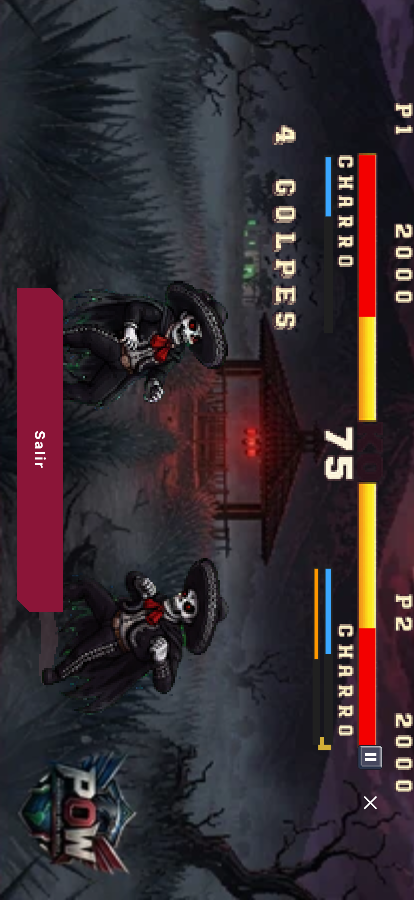

Dos Charros completos en combate con contador 4 GOLPES; sin notificaciones.

**Estudiante / Estudianta — ESCOM (Noche)**

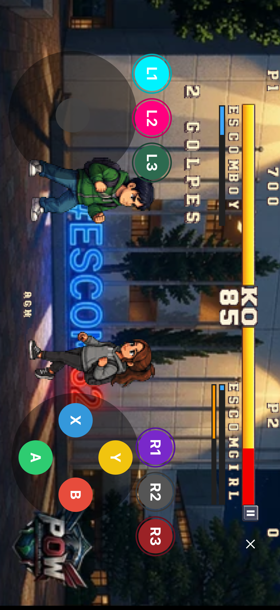

Peleadores separados y legibles con el contador localizado 2 GOLPES claramente visible, P1 700 y reducción de la barra P2.

**El Señor de la Tienda / Paparazzi 1 — Queso IPN (Noche 2)**

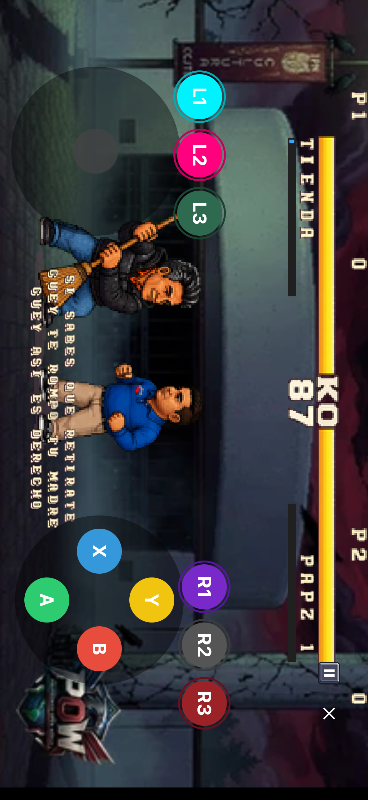

El Señor de la Tienda sostiene una escoba con la cabeza de paja visible, frente a Paparazzi 1; Queso IPN apocalíptico y HUD TIENDA/PAPZ 1. No se observa golpe conectado en esta imagen.

📸 Ver capturas 4–6 de 61 / View images 4–6

**Prankedy / Rey Grupero — ESIME Azcapotzalco (Noche 2)**

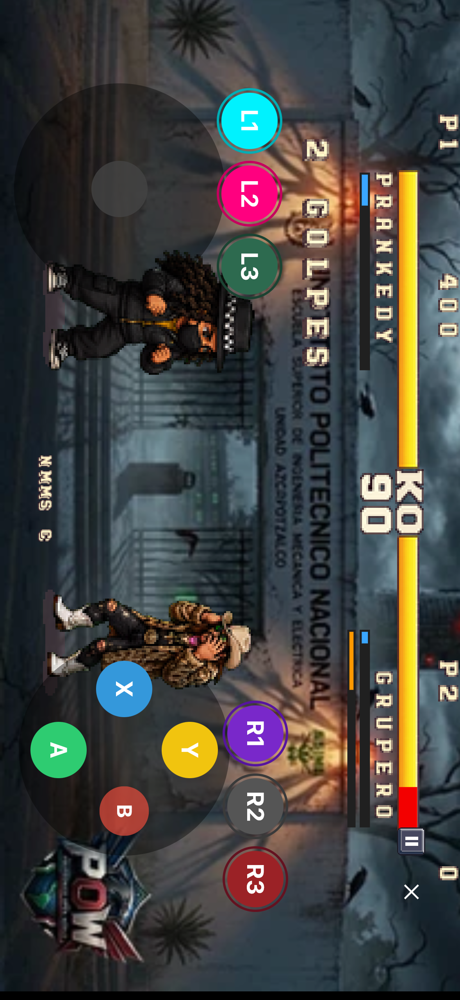

Contador 2 GOLPES claramente visible; Rey Grupero lleva las manos a la cara frente a Prankedy. ESIME apocalíptico con niebla y cuervos, P1=400 y barra P2 reducida.

**Robot Estudiantx / Alexis Syntaxis — CECyT 9**

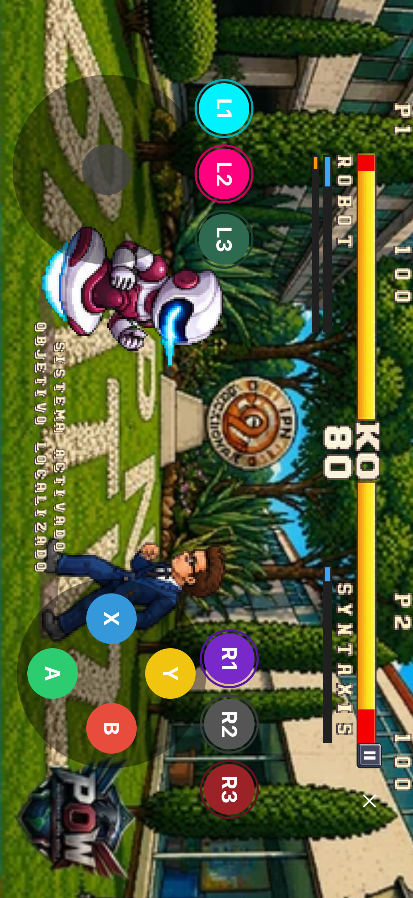

Robot muestra un haz cian saliendo del visor, frente a Alexis con traje azul y gafas, sobre CECyT 9 de día. P1=100 y P2=100; la foto no demuestra que el haz conecte.

**Paparazzi 5 / Policía CDMX (Hombre) — CECyT 2 (Noche 2)**

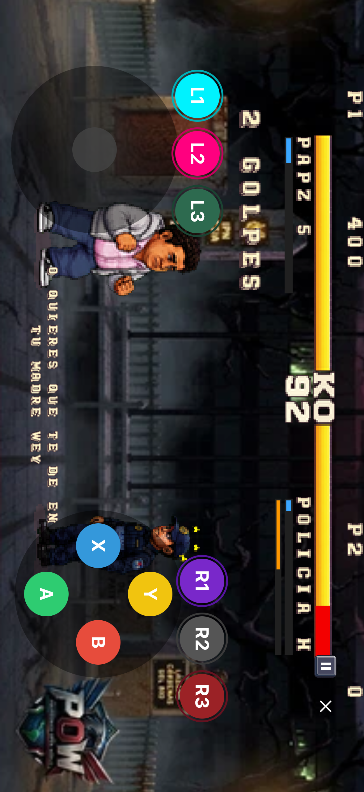

2 GOLPES claramente visible sobre Paparazzi 5 y el policía; estrellas amarillas sobre el policía, P1=400 y barra P2 reducida. CECyT 2 apocalíptico, ambos cuerpos legibles.

📸 Ver capturas 7–9 de 61 / View images 7–9

**Policía Granadero CDMX (Mujer) / Policía Granadero CDMX (Hombre) — Biblioteca Nacional IPN**

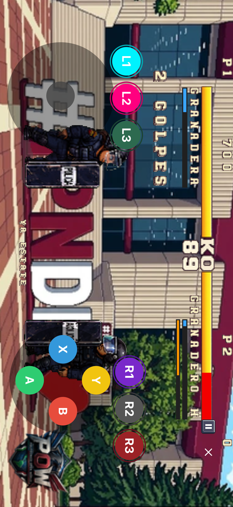

Granadera y Granadero H separados, cascos/visores y escudos reconocibles, contador 2 GOLPES legible sobre Biblioteca Nacional IPN de día; P1 700. Recomendada como portada para añadir la Granadera a la muestra pública.

**Policía CDMX / La Presidenta — Ciudad Universitaria UNAM**

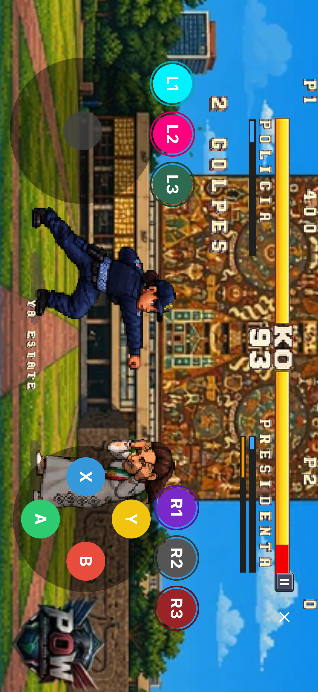

Policía con puño extendido y Presidenta con manos junto a la cara; 2 GOLPES claramente visible y P1=400, frente al mural de Ciudad Universitaria de día. Barra P2 reducida.

**El Charro Negro / La Planchada — FES Acatlán (Noche)**

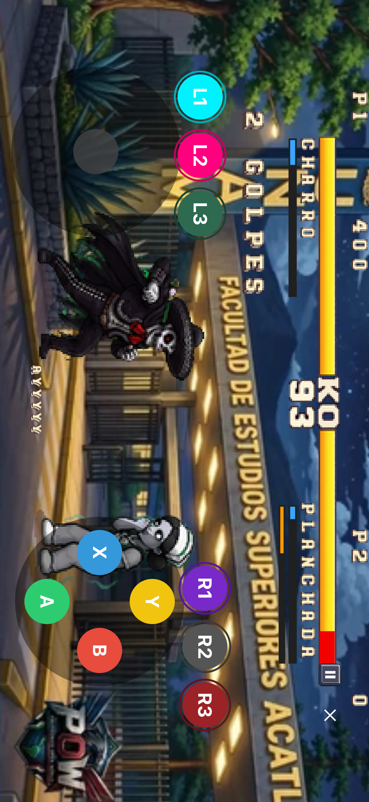

Charro avanzando con un brazo alzado ante Planchada, cuerpos separados y contador 2 GOLPES legible sobre FES Acatlán nocturno; P1 400.

📸 Ver capturas 10–12 de 61 / View images 10–12

**La Tzitzimime / Yoalli Ehécatl — UAM Azcapotzalco (Noche)**

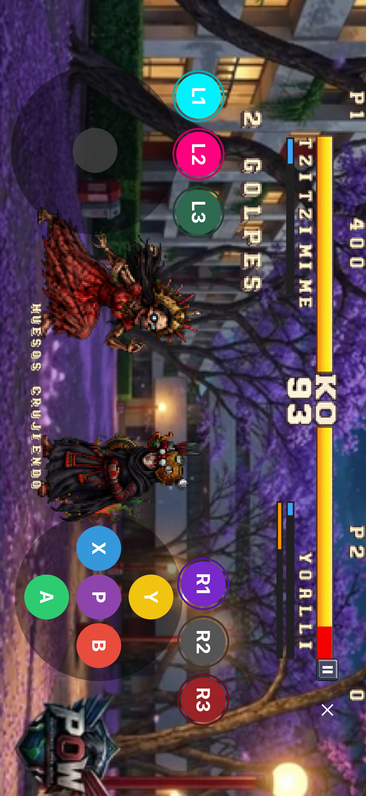

Tzitzimime y Yoalli separados con el contador 2 GOLPES legible sobre UAM Azcapotzalco nocturno; P1 400.

**La Llorona / El Charro Negro — Isla de las Muñecas**

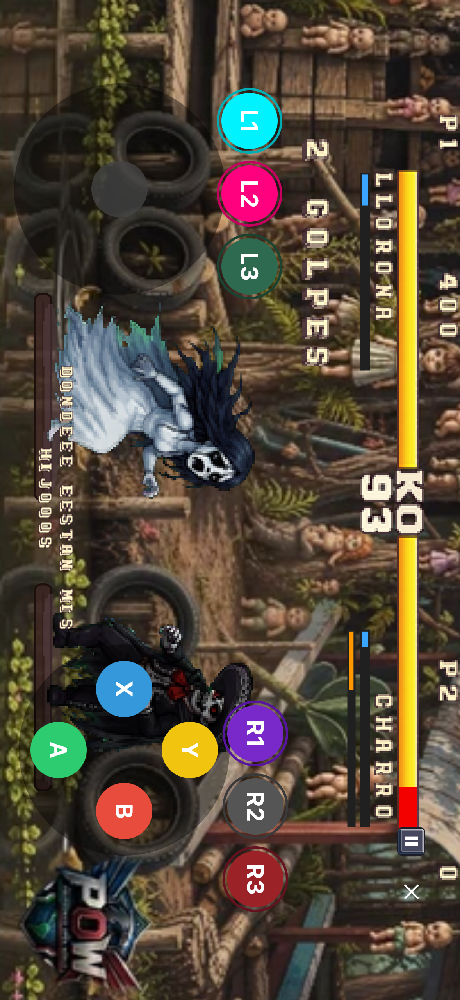

Llorona inclinada hacia Charro con contador 2 GOLPES, personajes reconocibles sobre la Isla de las Muñecas de día; P1 400.

**Estudiante / Estudianta — ESCOM**

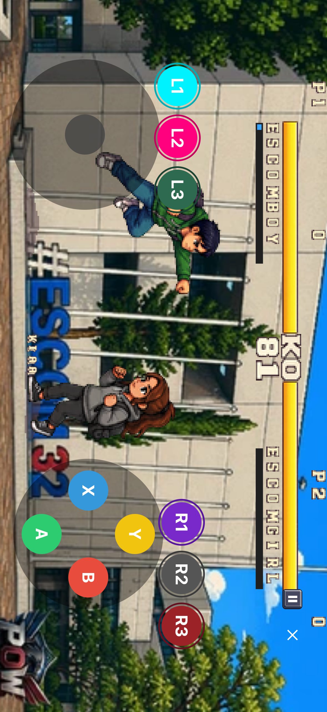

Estudiante en el aire con el puño extendido; Estudianta completa en el suelo, ESCOM de día y HUD completo. No se observa impacto ni reducción de vida.

📸 Ver capturas 13–15 de 61 / View images 13–15

**Estudiante / Estudianta — ESCOM (Noche 2)**

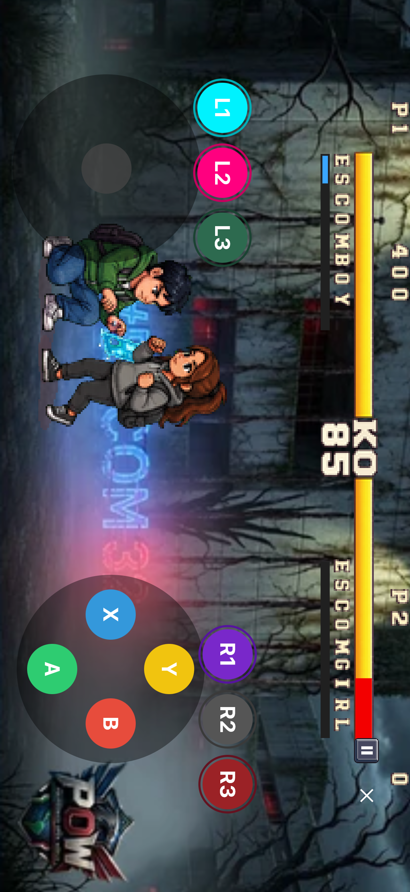

Estudiante agachado con efecto cian brillante ante las manos y rival completa, sobre ESCOM apocalíptico con niebla; P1 400 y barra P2 reducida.

**El Señor de la Tienda / Paparazzi 1 — Queso IPN**

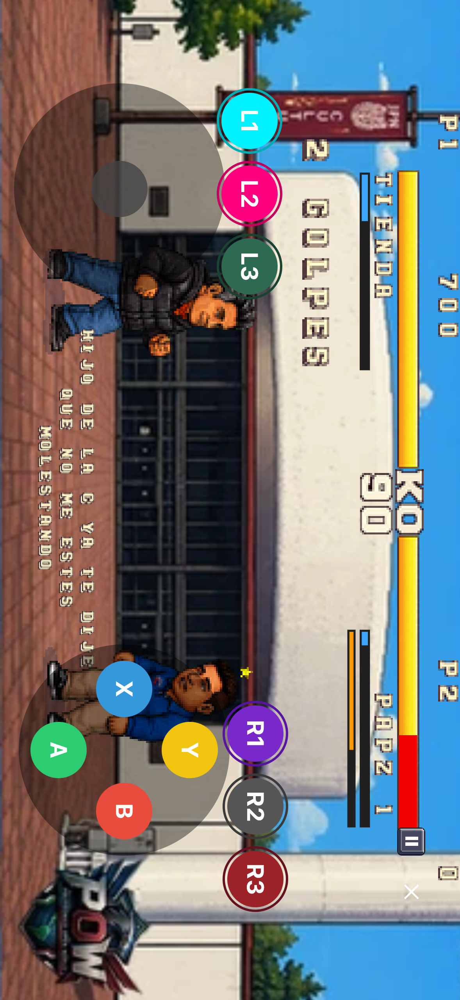

Señor de la Tienda y Paparazzi 1 separados, rostros reconocibles y contador 2 GOLPES ante Queso IPN de día; P1 700. La pareja corregida coincide con el runner.

**El Señor de la Tienda / Paparazzi 1 — Queso IPN (Noche)**

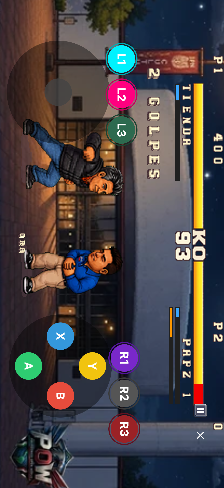

Señor de la Tienda en animación de ataque ante Paparazzi 1, ambos rostros claros, contador 2 GOLPES ante Queso IPN nocturno; P1 400. La pareja corregida coincide con el runner.

📸 Ver capturas 16–18 de 61 / View images 16–18

**Prankedy / Rey Grupero — ESIME Azcapotzalco**

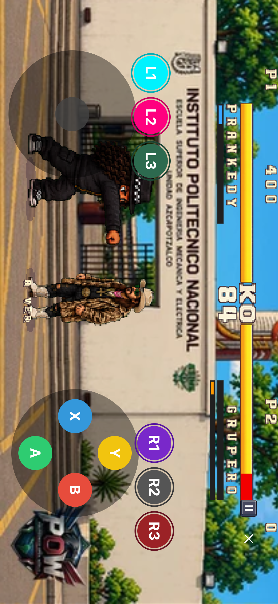

Prankedy extiende el puño hacia Rey Grupero; ambos personajes completos y legibles frente al muro de ESIME Azcapotzalco de día. P1=400, barra P2 reducida; no hay contador de combo en esta foto.

**Prankedy / Rey Grupero — ESIME Azcapotzalco (Noche)**

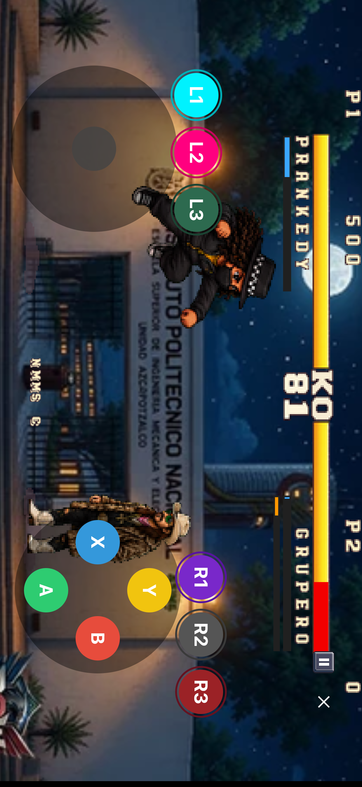

Prankedy está en el aire, con las piernas recogidas y un puño hacia delante; Rey Grupero permanece en el suelo. Luna, fachada iluminada de ESIME y HUD P1=500 visibles. No se demuestra impacto en esta foto.

**Robot Estudiantx / Alexis Syntaxis — CECyT 9 (Noche)**

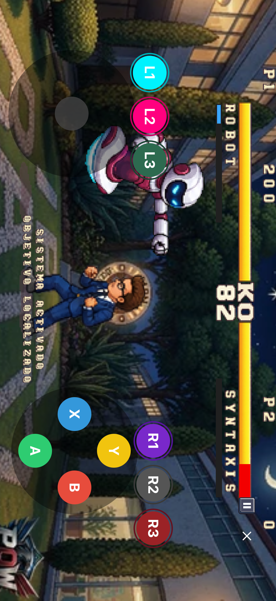

Robot en pose aérea con un brazo extendido y Alexis Syntaxis completo en el suelo, visor y rostro reconocibles ante CECyT 9 nocturno; P1 200. La imagen no prueba un impacto aéreo.

📸 Ver capturas 19–21 de 61 / View images 19–21

**Robot Estudiantx / Alexis Syntaxis — CECyT 9 (Noche 2)**

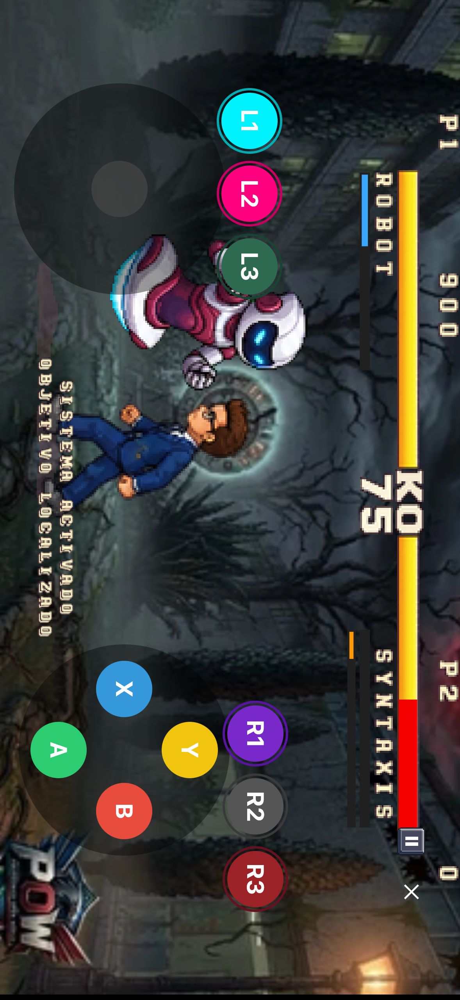

Robot elevado sobre el suelo con brazo alzado, junto a Alexis inclinado, en CECyT 9 apocalíptico. P1=900 y barra P2 reducida; haz propulsor cian bajo el robot. La foto no muestra contador de combo.

**Paparazzi 5 / Policía CDMX (Hombre) — CECyT 2**

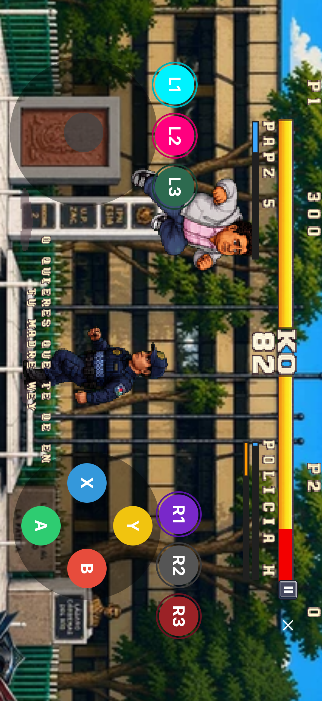

Paparazzi 5 elevado con el brazo extendido y Policía CDMX hombre completo en el suelo, rostros/HUD claros ante CECyT 2 de día; P1 300. La pose aérea no prueba golpe conectado.

**Paparazzi 5 / Policía CDMX (Hombre) — CECyT 2 (Noche)**

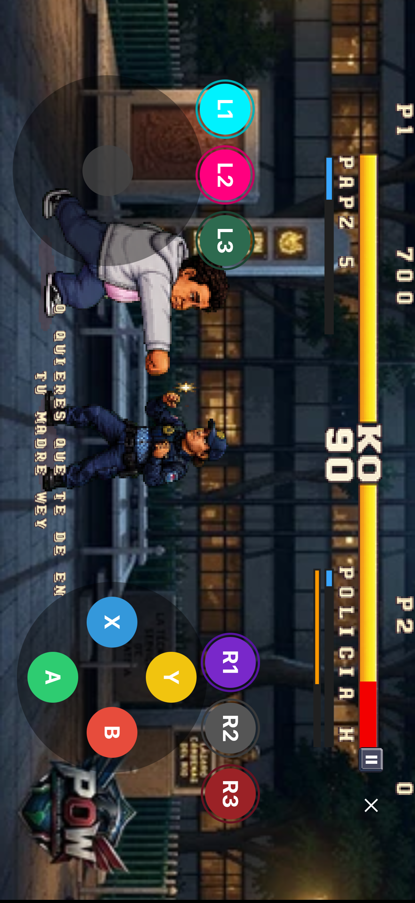

Paparazzi 5 extiende el puño; un pequeño destello amarillo aparece ante el policía de gorra. CECyT 2 nocturno, HUD PAPZ 5/POLICIA H y P1=700; barra P2 reducida. No hay contador de combo en este frame.

📸 Ver capturas 22–24 de 61 / View images 22–24

**Policía Granadero CDMX (Mujer) / Policía Granadero CDMX (Hombre) — Biblioteca Nacional IPN (Noche)**

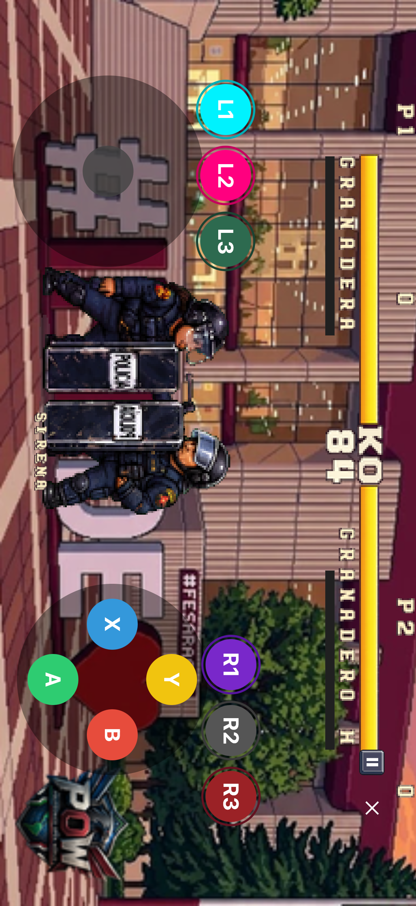

Granadera con el brazo extendido sosteniendo un objeto tipo bastón y Granadero H cercano con escudo, identidades y HUD reconocibles sobre Biblioteca Nacional IPN nocturna; P1 0. No se atribuye un clip de audio al gesto ni al subtítulo.

**Policía Granadero CDMX (Mujer) / Policía Granadero CDMX (Hombre) — Biblioteca Nacional IPN (Noche 2)**

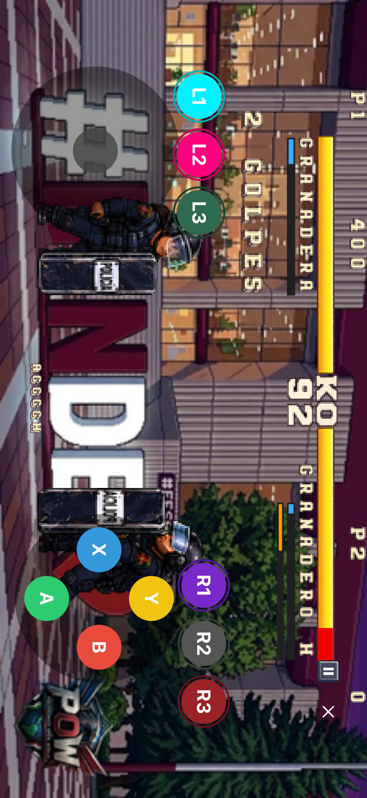

Granadera y Granadero H separados, rostros/visores reconocibles y contador 2 GOLPES legible sobre Biblioteca Nacional IPN apocalíptica; P1 400.

**Policía CDMX / La Presidenta — CU UNAM (Noche)**

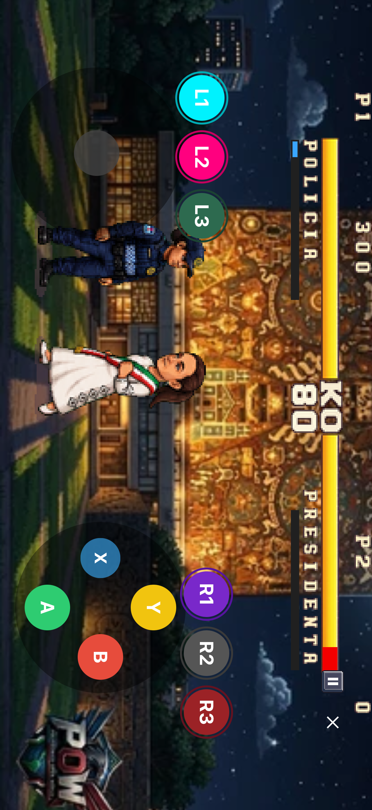

Policía y Presidenta se encaran con cuerpos y caras legibles, frente al mural iluminado de Ciudad Universitaria de noche; HUD POLICIA/PRESIDENTA y P1=300. Esta foto no muestra impacto, combo ni salto.

📸 Ver capturas 25–27 de 61 / View images 25–27

**Policía CDMX / La Presidenta — CU UNAM (Noche 2)**

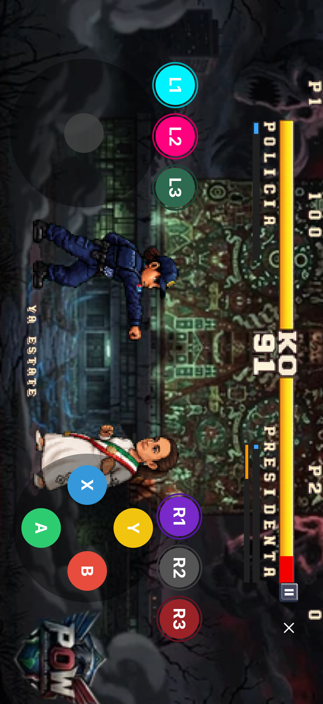

Policía CDMX con el puño extendido y Presidenta separada, ambos rostros reconocibles; CU UNAM apocalíptico, P1 100 y barra P2 reducida.

**El Charro Negro / La Planchada — FES Acatlán**

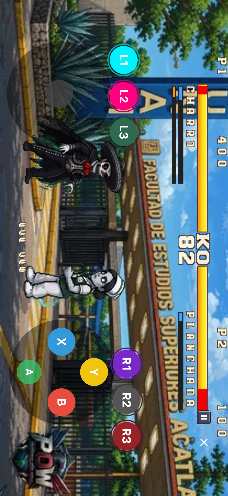

Charro y Planchada completos y separados frente a FES Acatlán de día; ambos rostros legibles, P1 400. Esta toma evita el pequeño borde de otras acciones.

**El Charro Negro / La Planchada — FES Acatlán (Noche 2)**

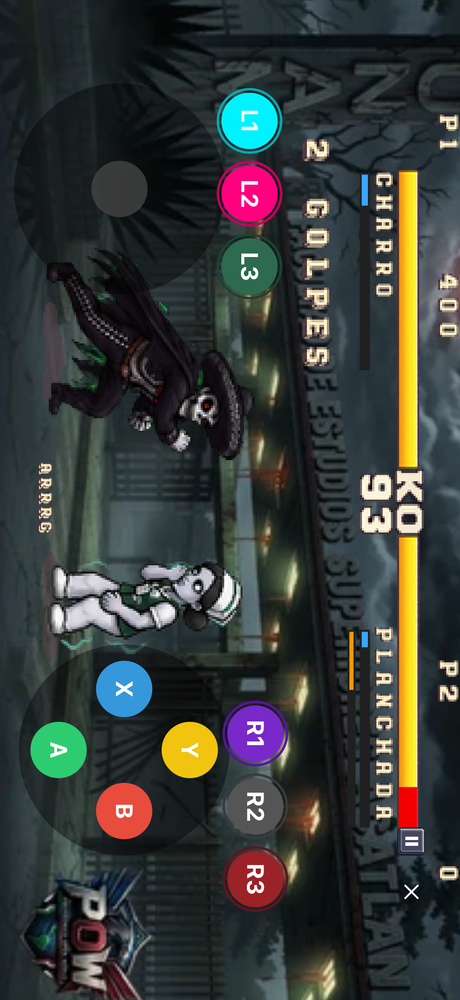

Charro inclinado hacia delante y Planchada separada con el contador 2 GOLPES sobre FES Acatlán apocalíptico; P1 400.

📸 Ver capturas 28–30 de 61 / View images 28–30

**La Tzitzimime / Yoalli Ehécatl — UAM Azcapotzalco**

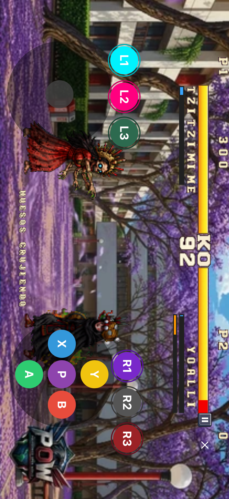

Tzitzimime con los brazos extendidos ante Yoalli, ambos cuerpos y rostros reconocibles, jacarandas de UAM Azcapotzalco de día; P1 300.

**La Tzitzimime / Yoalli Ehécatl — UAM Azcapotzalco (Noche 2)**

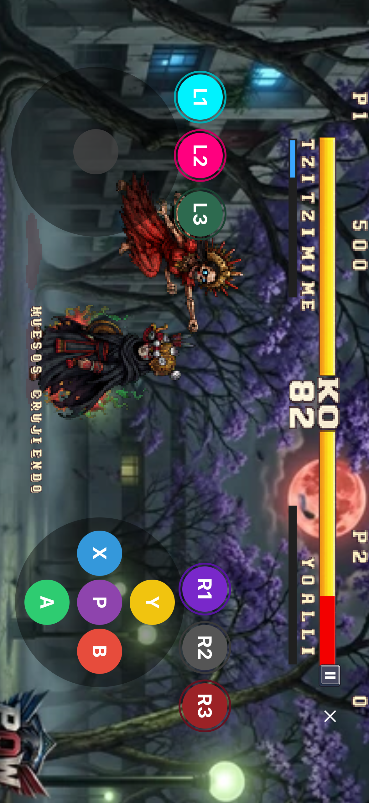

Tzitzimime elevada y Yoalli completo en el suelo, rostros reconocibles, luna roja y remolino de UAM Azcapotzalco apocalíptico; P1 500. La pose aérea no prueba impacto. La franja previa no aparece en este original.

**La Llorona / El Charro Negro — Isla de las Muñecas (Noche)**

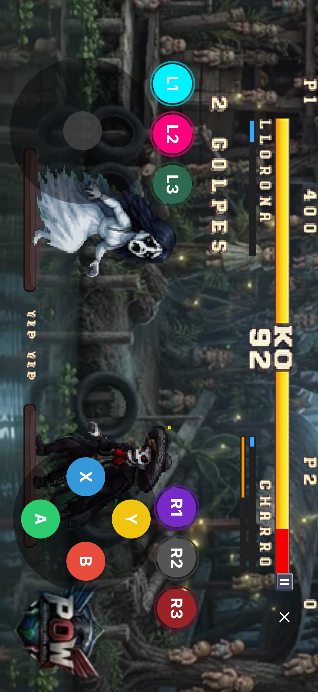

Llorona y Charro separados con contador 2 GOLPES claro, muñecas y reflejos nocturnos del escenario visibles; P1 400.

📸 Ver capturas 31–33 de 61 / View images 31–33

**La Llorona / El Charro Negro — Isla de las Muñecas (Noche 2)**

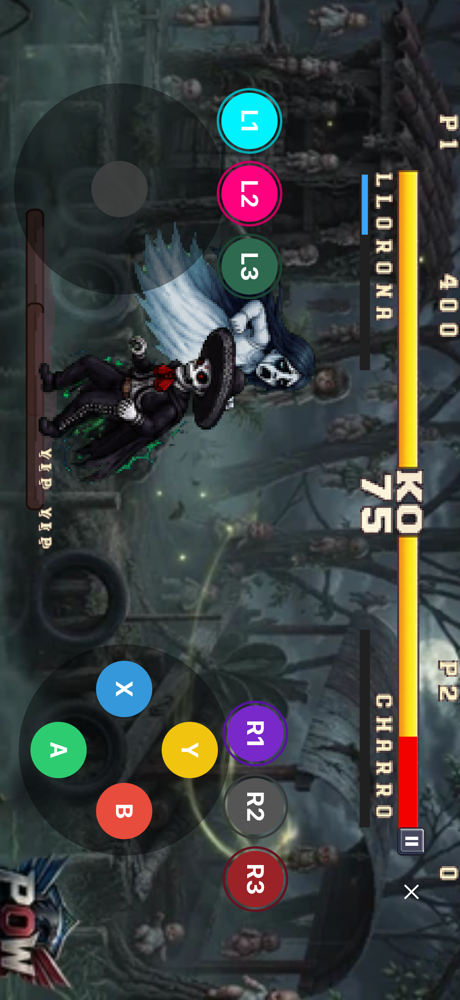

Llorona elevada por encima del Charro, ambos rostros visibles y HUD completo sobre la Isla de las Muñecas apocalíptica; P1 400. La pose aérea no prueba impacto.

**Yoalli Ehécatl / La Presidenta — Mictlán**

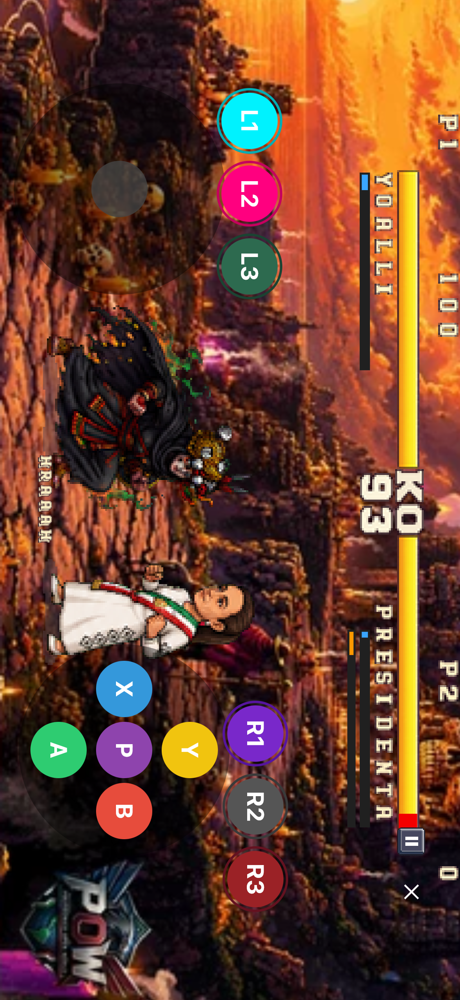

Yoalli inclinado y Presidenta separada, ambos rostros reconocibles, paisaje naranja y velas de Mictlán visibles; P1 100.

**Yoalli Ehécatl / La Presidenta — Mictlán (Noche)**

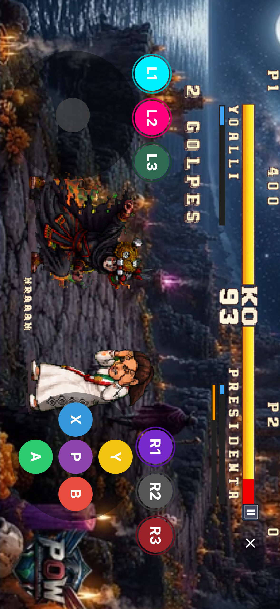

Yoalli en animación de ataque y Presidenta en reacción con las manos junto al rostro, contador 2 GOLPES sobre Mictlán nocturno; P1 400.

📸 Ver capturas 34–36 de 61 / View images 34–36

**Yoalli Ehécatl / La Presidenta — Mictlán (Noche 2)**

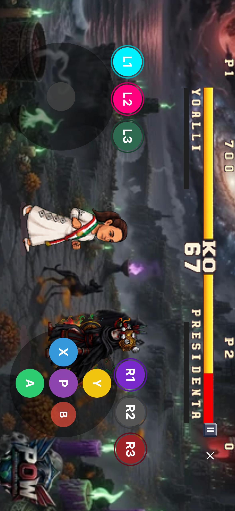

Yoalli elevado a la derecha y Presidenta a la izquierda, ambos reconocibles ante Mictlán apocalíptico y luna roja; P1 700. El cruce de posiciones no cambia las identidades P1/P2 del HUD.

**El Charro Negro / Rey Grupero — Campos de Agave Jalisco**

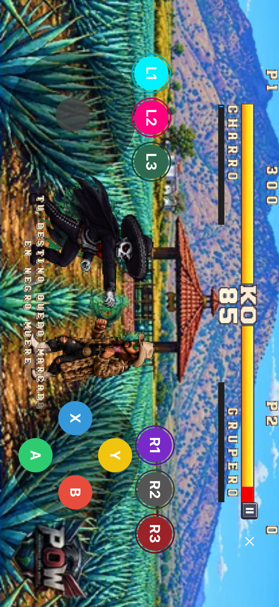

Charro con el brazo extendido y pequeñas partículas verdes cerca del puño ante Rey Grupero, ambos rostros visibles, campos de agave de día; P1 300. No prueba especial conectado.

**El Charro Negro / Rey Grupero — Campos de Agave Jalisco (Noche)**

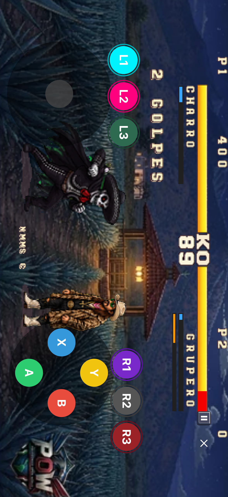

Charro avanzando ante Rey Grupero con contador 2 GOLPES legible, agaves y kiosco iluminado nocturno; P1 400.

📸 Ver capturas 37–39 de 61 / View images 37–39

**El Charro Negro / Rey Grupero — Campos de Agave Jalisco (Noche 2)**

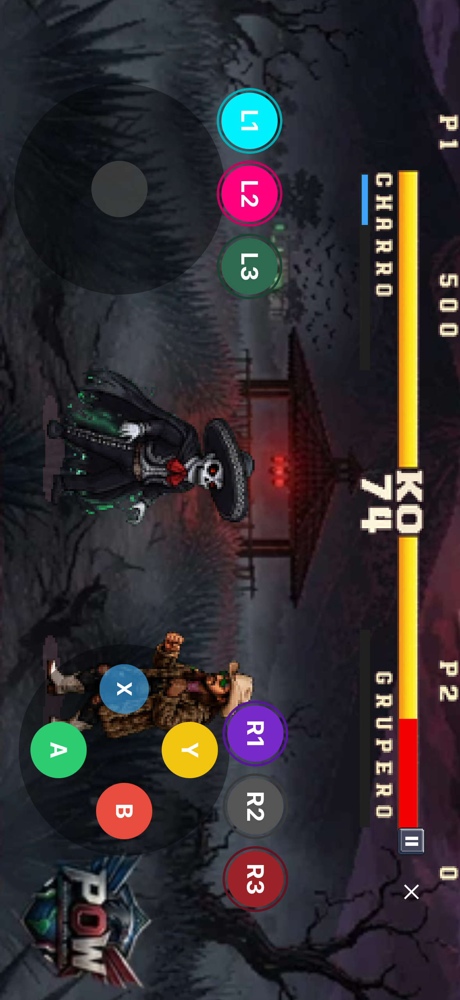

Charro a la izquierda y Rey Grupero en guardia a la derecha, rostros separados y HUD completo frente al agave apocalíptico; P1 500.

**Alexis Syntaxis / Robot Estudiantx — Facultad de Medicina**

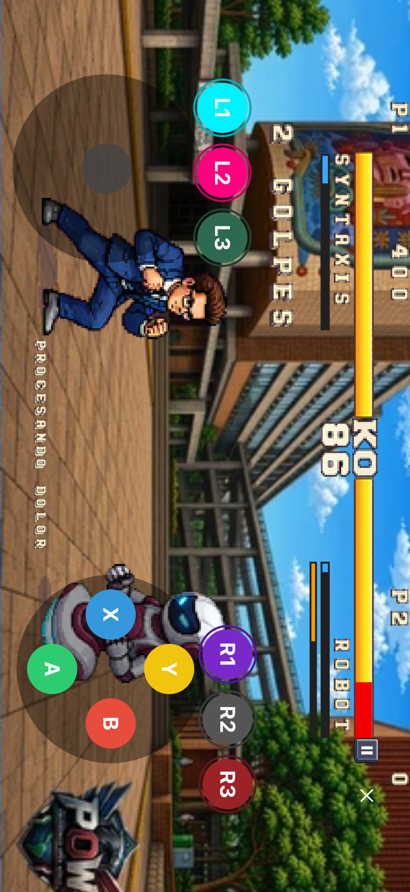

Alexis Syntaxis y Robot separados con contador 2 GOLPES sobre Facultad de Medicina de día; rostro y visor legibles, P1 400.

**Alexis Syntaxis / Robot Estudiantx — Facultad de Medicina (Noche)**

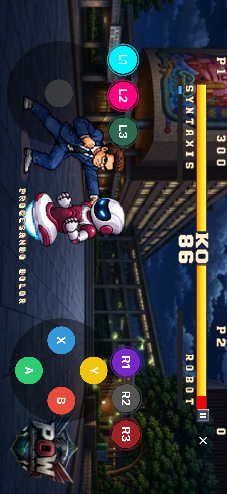

Alexis Syntaxis con el puño extendido hacia Robot, rostro y visor legibles sobre Facultad de Medicina nocturna; P1 300. Se prefirió esta toma sin banda a la de partículas musicales.

📸 Ver capturas 40–42 de 61 / View images 40–42

**Alexis Syntaxis / Robot Estudiantx — Facultad de Medicina (Noche 2)**

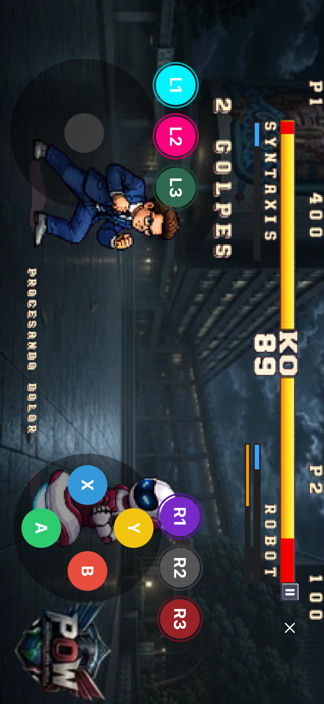

Alexis Syntaxis y Robot separados con contador 2 GOLPES legible sobre Facultad de Medicina apocalíptica; P1 400.

**Rey Grupero / Prankedy — FES Aragón**

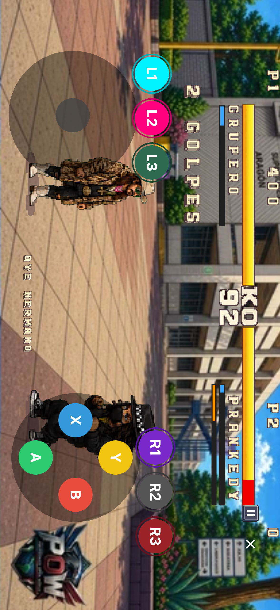

Rey Grupero y Prankedy separados, rostros reconocibles y contador 2 GOLPES legible ante FES Aragón de día; P1 400. La franja previa no aparece en este original.

**Rey Grupero / Prankedy — FES Aragón (Noche)**

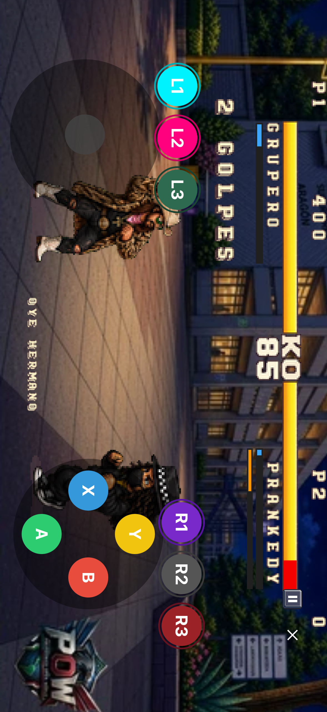

Rey Grupero y Prankedy separados, HUD GRUPERO/PRANKEDY, contador 2 GOLPES visible y P1 400 ante FES Aragón nocturna.

📸 Ver capturas 43–45 de 61 / View images 43–45

**Rey Grupero / Prankedy — FES Aragón (Noche 2)**

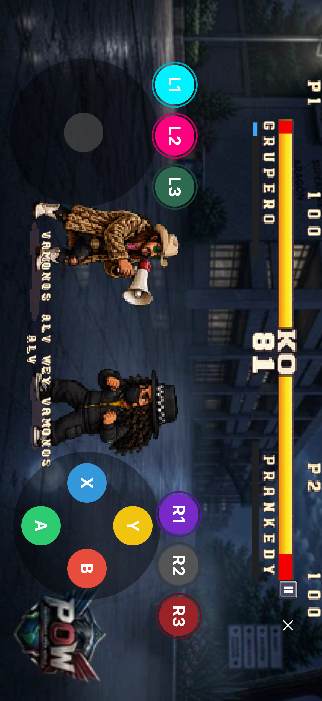

Rey Grupero sostiene un megáfono frente a Prankedy; ambos rostros se distinguen, FES Aragón apocalíptica con niebla, P1 100/P2 100.

**La Tzitzimime / Estudianta — Pirámide del Sol**

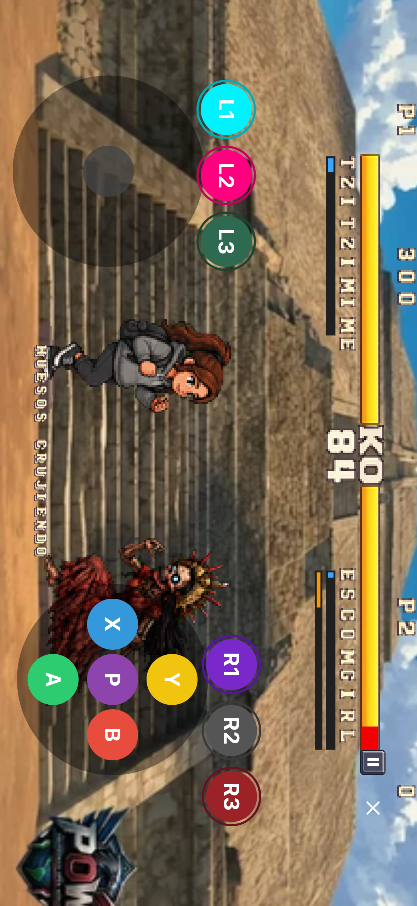

Estudianta a la izquierda con rodilla levantada y La Tzitzimime a la derecha, ambas legibles ante Pirámide del Sol de día. HUD TZITZIMIME/ESCOMGIRL y P1 300; la posición izquierda no se identifica como P1.

**La Tzitzimime / Estudianta — Pirámide del Sol (Noche)**

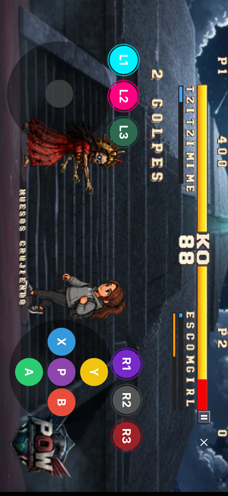

La Tzitzimime extiende varios brazos hacia Estudianta, contador 2 GOLPES visible y P1 400 ante Pirámide del Sol nocturna.

📸 Ver capturas 46–48 de 61 / View images 46–48

**La Tzitzimime / Estudianta — Pirámide del Sol (Noche 2)**

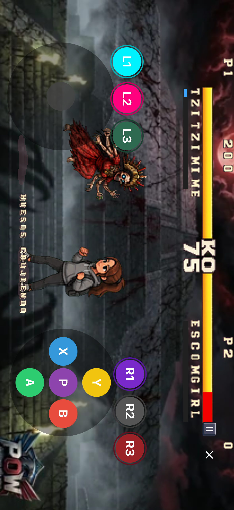

La Tzitzimime aparece suspendida en el aire con vestido rojo y varios brazos, Estudianta en guardia y Pirámide del Sol apocalíptica bajo luna roja; P1 200.

**Policía CDMX / Paparazzi 5 — UAM Cuajimalpa**

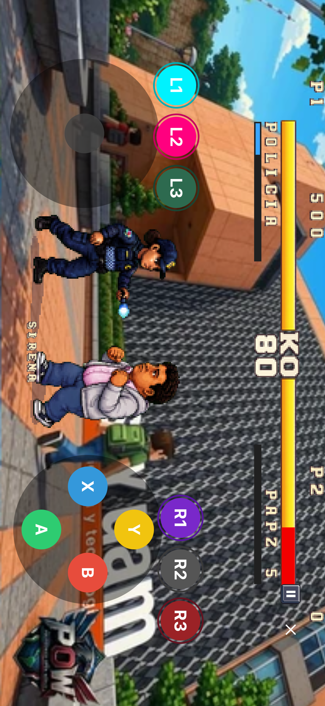

Policía CDMX extiende el brazo con un pequeño efecto cian luminoso delante de la mano frente a Paparazzi 5; UAM Cuajimalpa de día con peatones animados de fondo, P1 500.

**Policía CDMX / Paparazzi 5 — UAM Cuajimalpa (Noche)**

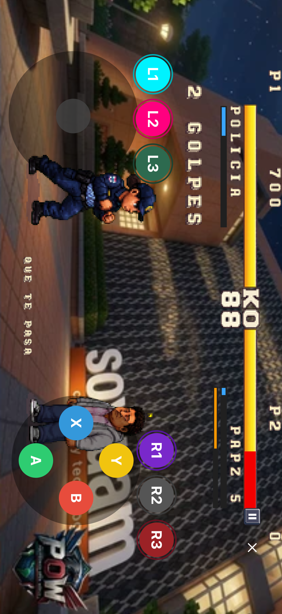

Policía CDMX y Paparazzi 5 separados, rostros/HUD reconocibles y contador 2 GOLPES ante UAM Cuajimalpa nocturna; P1 700.

📸 Ver capturas 49–51 de 61 / View images 49–51

**Policía CDMX / Paparazzi 5 — UAM Cuajimalpa (Noche 2)**

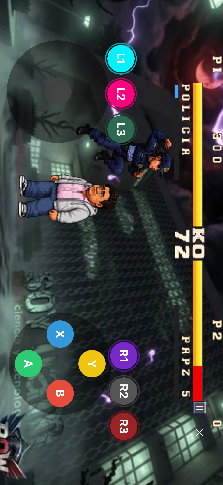

Policía CDMX en el aire con rodilla levantada sobre Paparazzi 5; UAM Cuajimalpa apocalíptica y efectos púrpuras propios del fondo, P1 300.

**La Presidenta / Policía Granadero CDMX (Hombre) — Zócalo**

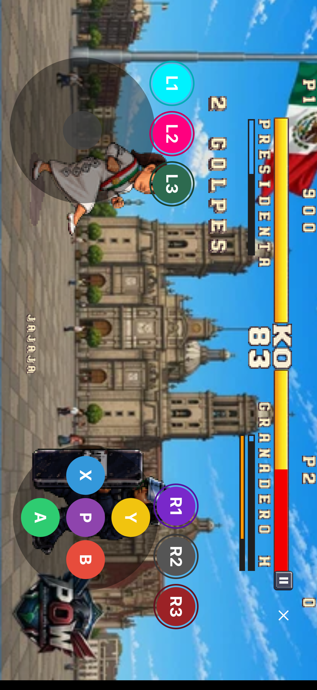

La Presidenta levanta una pierna frente al Granadero Hombre con escudo; contador 2 GOLPES visible, P1 900 y Catedral/Zócalo de día.

**La Presidenta / Policía Granadero CDMX (Hombre) — Zócalo (Noche)**

La Presidenta extiende una mano abierta hacia el escudo del Granadero Hombre, ambos rostros legibles y Zócalo nocturno iluminado; P1 500/P2 100.

📸 Ver capturas 52–54 de 61 / View images 52–54

**La Presidenta / Policía Granadero CDMX (Hombre) — Zócalo (Noche 2)**

La Presidenta suspendida en el aire frente al Granadero Hombre, Zócalo apocalíptico con aves y luna roja; P1 300. La escena llega hasta los dos bordes.

**Robot Estudiantx / Alexis Syntaxis — Planetario IPN**

Robot Estudiantx con brazo extendido y chispa de impacto ante el rostro de Alexis Syntaxis; Planetario IPN de día, HUD ROBOT/SYNTAXIS y P1 300.

**Robot Estudiantx / Alexis Syntaxis — Planetario (Noche)**

Haz cian corto visible desde el visor del Robot frente a Alexis Syntaxis; Planetario nocturno iluminado y P1 100.

📸 Ver capturas 55–57 de 61 / View images 55–57

**Robot Estudiantx / Alexis Syntaxis — Planetario (Noche 2)**

Robot con esfera/descarga cian brillante delante de los brazos y Alexis Syntaxis legible; Planetario apocalíptico y P1 500.

**La Planchada / La Llorona — ESM IPN**

La Planchada y La Llorona reconocibles frente a la Escuela Superior de Medicina de día; contador 2 GOLPES visible y P1 500.

**La Planchada / La Llorona — ESM IPN (Noche)**

La Planchada con resplandor verde visible entre sus manos frente a La Llorona; ESM nocturna iluminada y P1 300.

📸 Ver capturas 58–60 de 61 / View images 58–60

**La Planchada / La Llorona — ESM IPN (Noche tenebrosa)**

La Planchada claramente en el aire con puño extendido sobre La Llorona, ambos rostros legibles; ESM de noche tenebrosa y P1 700.

**Estudiante / Robot Estudiantx — CET 1**

Estudiante en pose de golpe de brazo frente al Robot, contador 2 GOLPES visible, CET 1 de día y P1 700.

**Estudiante / Robot Estudiantx — CET 1 (Noche)**

Estudiante claramente en el aire con rodillas flexionadas ante el Robot; CET 1 nocturno con cielo estrellado y P1 600.

📸 Ver capturas 61–61 de 61 / View images 61–61

**Estudiante / Robot Estudiantx — CET 1 (Noche tenebrosa)**

Estudiante con brazo alzado y otro adelantado frente al Robot, contador 2 GOLPES visible, CET 1 de noche tenebrosa y P1 400.

## Procedencia / Provenance

Fuente `bfd2148f` (PR #188) con ajustes locales de orientación horizontal y zona segura.
Las tomas iniciales preceden a los arreglos del paneo del fondo y de la lista de proyectiles;
las repeticiones posteriores se identifican con flags en sus metadatos. Los defectos se documentan y verifican
por separado en el [informe de QA](../../PolitecnicoOpenWorld/README%20for%20IAS/SF/QA_IPHONE_PR188_2026-11-15.md).

Cada PNG conserva los bytes originales de `XCUIScreen.main.screenshot()`, con SHA-256:
sin recorte, reescalado, retoque ni montaje. No se alteraron vida, medidores, poses o motor
para preparar las fotos. Los contactos derivados se usaron únicamente para revisión.
Los metadatos registran pareja observada en HUD/rostros, selección del mapa y acción visible.

Each PNG preserves original native screenshot bytes and SHA-256. No cropping, resizing,
retouching, compositing or staged engine state. Earlier captures predate the background and projectile fixes;
retakes are identified in metadata. Review contact sheets are not gallery originals.

## Conservación / Preservation

El [README principal](../../README.md#pow-iphone-gallery-complete) incorpora los 60 fondos y la captura extra de 4 GOLPES.
[hero-selection.json](hero-selection.json) fija las diez imágenes destacadas y la extra; no limita la matriz completa.
Al regenerar, se conservan las 61 imágenes originales en el README principal: las 3 primeras de hero-selection.json siempre visibles arriba y las demás en desplegables cerrados de hasta tres imágenes, con etiqueta lazy y proporción natural.

The [main README](../../README.md#pow-iphone-gallery-complete) embeds all 60 backgrounds and the extra four-hit screenshot.
The pinned hero selection preserves the featured images; it must not remove the other backgrounds.

Los enlaces publicados de las vistas previas y los archivos ZIP permanentes, con sus hashes, están en
[publication.json](publication.json). Published preview and permanent ZIP links, with their hashes, are recorded there.

## Todos los fondos / All backgrounds

Día / Noche / Noche 2 son las tres variantes del selector; algunos assets representan atardecer.
Los títulos e IDs exactos se conservan en [coverage-plan.json](coverage-plan.json).

| # | Lugar / Stage | Pareja / Pairing | Día / Day | Noche / Night | Noche 2 / Dark night |
|---|---|---|---|---|---|
| 01 | ESCOM | Estudiante / Estudianta | [Captura](01-escom-day.png) | [Captura](02-escom-night.png) | [Captura](03-escom-apocalypse.png) |
| 02 | Queso IPN | El Señor de la Tienda / Paparazzi 1 | [Captura](04-queso_ipn-day.png) | [Captura](05-queso_ipn-night.png) | [Captura](06-queso_ipn-apocalypse.png) |
| 03 | ESIME Azcapotzalco | Prankedy / Rey Grupero | [Captura](07-esime_azc-day.png) | [Captura](08-esime_azc-night.png) | [Captura](09-esime_azc-apocalypse.png) |
| 04 | CECyT 9 | Robot Estudiantx / Alexis Syntaxis | [Captura](10-cecyt_9-day.png) | [Captura](11-cecyt_9-night.png) | [Captura](12-cecyt_9-apocalypse.png) |
| 05 | CECyT 2 | Paparazzi 5 / Policía CDMX (Hombre) | [Captura](13-cecyt_2-day.png) | [Captura](14-cecyt_2-night.png) | [Captura](15-cecyt_2-apocalypse.png) |
| 06 | Biblioteca Nacional IPN | Policía Granadero CDMX (Mujer) / Policía Granadero CDMX (Hombre) | [Captura](16-biblioteca_ipn-day.png) | [Captura](17-biblioteca_ipn-night.png) | [Captura](18-biblioteca_ipn-apocalypse.png) |
| 07 | Ciudad Universitaria UNAM | Policía CDMX / La Presidenta | [Captura](19-unam_biblioteca_cu-day.png) | [Captura](20-unam_biblioteca_cu-night.png) | [Captura](21-unam_biblioteca_cu-apocalypse.png) |
| 08 | FES Acatlán | El Charro Negro / La Planchada | [Captura](22-fes_acatlan-day.png) | [Captura](23-fes_acatlan-night.png) | [Captura](24-fes_acatlan-apocalypse.png) |
| 09 | UAM Azcapotzalco | La Tzitzimime / Yoalli Ehécatl | [Captura](25-uam_azcapo-day.png) | [Captura](26-uam_azcapo-night.png) | [Captura](27-uam_azcapo-apocalypse.png) |
| 10 | Isla de las Muñecas | La Llorona / El Charro Negro | [Captura](28-islamunecas-day.png) | [Captura](29-islamunecas-night.png) | [Captura](30-islamunecas-apocalypse.png) |
| 11 | Mictlán | Yoalli Ehécatl / La Presidenta | [Captura](31-mictlan-day.png) | [Captura](32-mictlan-night.png) | [Captura](33-mictlan-apocalypse.png) |
| 12 | Campos de Agave Jalisco | El Charro Negro / Rey Grupero | [Captura](34-campos_agave_jalisco-day.png) | [Captura](35-campos_agave_jalisco-night.png) | [Captura](36-campos_agave_jalisco-apocalypse.png) |
| 13 | Facultad de Medicina | Alexis Syntaxis / Robot Estudiantx | [Captura](37-facultad_medicina-day.png) | [Captura](38-facultad_medicina-night.png) | [Captura](39-facultad_medicina-apocalypse.png) |
| 14 | FES Aragón | Rey Grupero / Prankedy | [Captura](40-fes_aragon-day.png) | [Captura](41-fes_aragon-night.png) | [Captura](42-fes_aragon-apocalypse.png) |
| 15 | Pirámide del Sol | La Tzitzimime / Estudianta | [Captura](43-piramidesol-day.png) | [Captura](44-piramidesol-night.png) | [Captura](45-piramidesol-apocalypse.png) |
| 16 | UAM Cuajimalpa | Policía CDMX / Paparazzi 5 | [Captura](46-uam_cuajimalpa-day.png) | [Captura](47-uam_cuajimalpa-night.png) | [Captura](48-uam_cuajimalpa-apocalypse.png) |
| 17 | Zócalo | La Presidenta / Policía Granadero CDMX (Hombre) | [Captura](49-zocalo-day.png) | [Captura](50-zocalo-night.png) | [Captura](51-zocalo-apocalypse.png) |
| 18 | Planetario IPN | Robot Estudiantx / Alexis Syntaxis | [Captura](52-planetario-day.png) | [Captura](53-planetario-night.png) | [Captura](54-planetario-apocalypse.png) |
| 19 | ESM IPN | La Planchada / La Llorona | [Captura](55-esm-day.png) | [Captura](56-esm-night.png) | [Captura](57-esm-apocalypse.png) |
| 20 | CET 1 | Estudiante / Robot Estudiantx | [Captura](58-cet1-day.png) | [Captura](59-cet1-night.png) | [Captura](60-cet1-apocalypse.png) |

## Alcance / Scope

Los contadores **2 GOLPES** se describen sólo cuando están visibles. Una pose o FX no prueba
que un especial haya conectado. Biblioteca incluye rotulación FES ARAGÓN en su propio asset;
la pareja y el mapa se contrastaron con las tarjetas seleccionadas, no sólo con nombres de archivo.

Las fotos documentan escenas y acciones; no certifican ausencia de bugs ni todos los movimientos.
La escucha de voces se registra por separado. Screenshots establish visible scenes and actions;
they do not certify every move or absence of bugs. Listening results are recorded separately.

[Informe de iPhone / iPhone QA report](../../PolitecnicoOpenWorld/README%20for%20IAS/SF/QA_IPHONE_PR188_2026-11-15.md)
