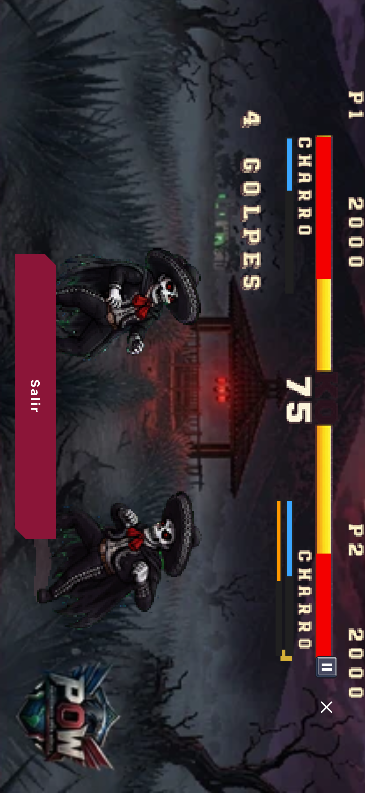
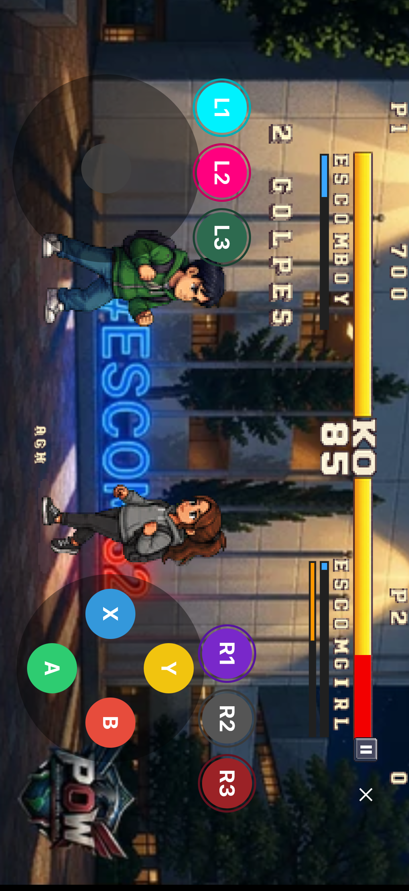
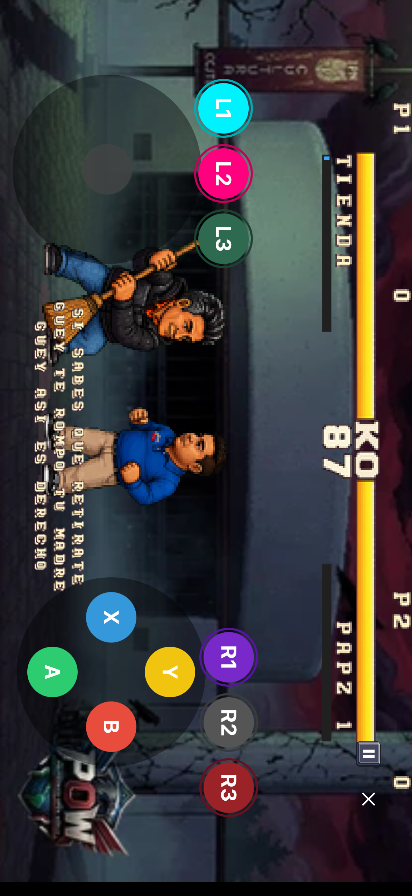

# iPhone 15 — página 1 de 21 / page 1 of 21

[Índice / Index](../README.md) · [Siguientes 3 / Next 3 →](02.md)

Esta página contiene únicamente las capturas indicadas. Las demás páginas se abren al elegir sus enlaces.
This page embeds only the screenshots shown below. Other pages open only when you choose their links.

## Charro contra Charro — 4 GOLPES / Four-hit combo

Dos Charros completos en combate con contador 4 GOLPES; sin notificaciones.

[PNG original / Original PNG](../charro-4-golpes.png)

## Estudiante / Estudianta — ESCOM (Noche)

Peleadores separados y legibles con el contador localizado 2 GOLPES claramente visible, P1 700 y reducción de la barra P2.

[PNG original / Original PNG](../02-escom-night.png)

## El Señor de la Tienda / Paparazzi 1 — Queso IPN (Noche 2)

El Señor de la Tienda sostiene una escoba con la cabeza de paja visible, frente a Paparazzi 1; Queso IPN apocalíptico y HUD TIENDA/PAPZ 1. No se observa golpe conectado en esta imagen.

[PNG original / Original PNG](../06-queso_ipn-apocalypse.png)

---

[Índice / Index](../README.md) · [Siguientes 3 / Next 3 →](02.md)
