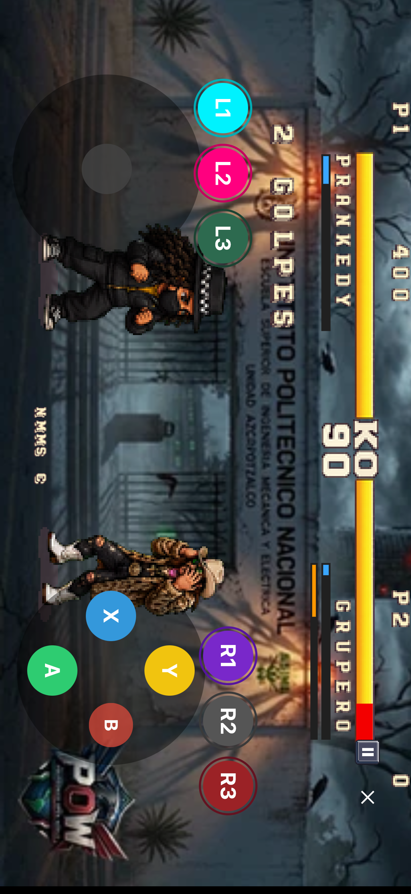
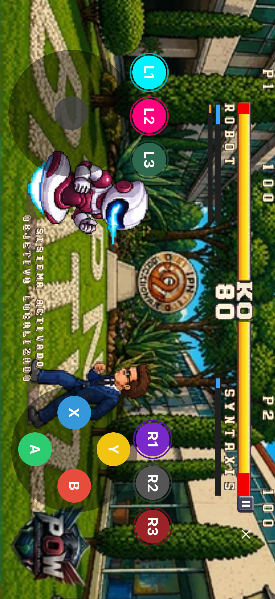
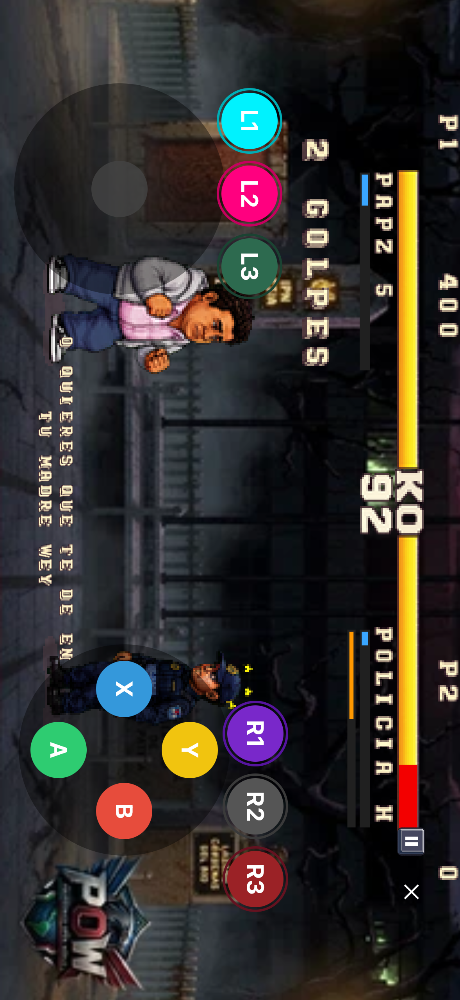

# iPhone 15 — página 2 de 21 / page 2 of 21

[← Anteriores 3 / Previous 3](01.md) · [Índice / Index](../README.md) · [Siguientes 3 / Next 3 →](03.md)

Esta página contiene únicamente las capturas indicadas. Las demás páginas se abren al elegir sus enlaces.
This page embeds only the screenshots shown below. Other pages open only when you choose their links.

## Prankedy / Rey Grupero — ESIME Azcapotzalco (Noche 2)

Contador 2 GOLPES claramente visible; Rey Grupero lleva las manos a la cara frente a Prankedy. ESIME apocalíptico con niebla y cuervos, P1=400 y barra P2 reducida.

[PNG original / Original PNG](../09-esime_azc-apocalypse.png)

## Robot Estudiantx / Alexis Syntaxis — CECyT 9

Robot muestra un haz cian saliendo del visor, frente a Alexis con traje azul y gafas, sobre CECyT 9 de día. P1=100 y P2=100; la foto no demuestra que el haz conecte.

[PNG original / Original PNG](../10-cecyt_9-day.png)

## Paparazzi 5 / Policía CDMX (Hombre) — CECyT 2 (Noche 2)

2 GOLPES claramente visible sobre Paparazzi 5 y el policía; estrellas amarillas sobre el policía, P1=400 y barra P2 reducida. CECyT 2 apocalíptico, ambos cuerpos legibles.

[PNG original / Original PNG](../15-cecyt_2-apocalypse.png)

---

[← Anteriores 3 / Previous 3](01.md) · [Índice / Index](../README.md) · [Siguientes 3 / Next 3 →](03.md)
