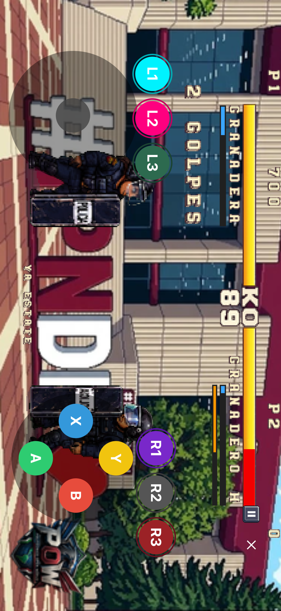
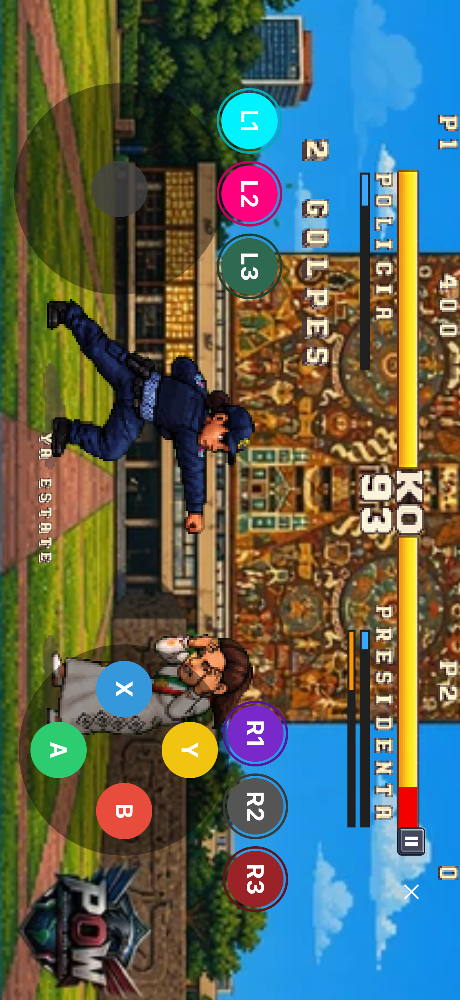
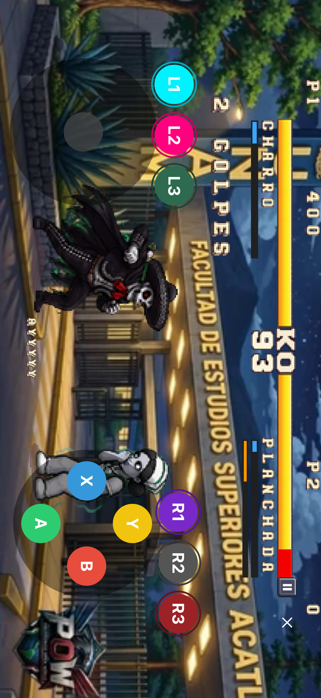

# iPhone 15 — página 3 de 21 / page 3 of 21

[← Anteriores 3 / Previous 3](02.md) · [Índice / Index](../README.md) · [Siguientes 3 / Next 3 →](04.md)

Esta página contiene únicamente las capturas indicadas. Las demás páginas se abren al elegir sus enlaces.
This page embeds only the screenshots shown below. Other pages open only when you choose their links.

## Policía Granadero CDMX (Mujer) / Policía Granadero CDMX (Hombre) — Biblioteca Nacional IPN

Granadera y Granadero H separados, cascos/visores y escudos reconocibles, contador 2 GOLPES legible sobre Biblioteca Nacional IPN de día; P1 700. Recomendada como portada para añadir la Granadera a la muestra pública.

[PNG original / Original PNG](../16-biblioteca_ipn-day.png)

## Policía CDMX / La Presidenta — Ciudad Universitaria UNAM

Policía con puño extendido y Presidenta con manos junto a la cara; 2 GOLPES claramente visible y P1=400, frente al mural de Ciudad Universitaria de día. Barra P2 reducida.

[PNG original / Original PNG](../19-unam_biblioteca_cu-day.png)

## El Charro Negro / La Planchada — FES Acatlán (Noche)

Charro avanzando con un brazo alzado ante Planchada, cuerpos separados y contador 2 GOLPES legible sobre FES Acatlán nocturno; P1 400.

[PNG original / Original PNG](../23-fes_acatlan-night.png)

---

[← Anteriores 3 / Previous 3](02.md) · [Índice / Index](../README.md) · [Siguientes 3 / Next 3 →](04.md)
