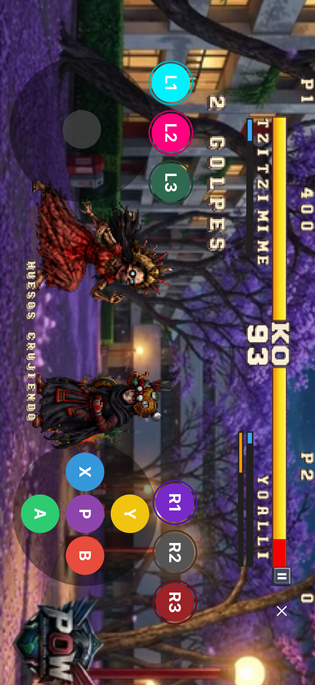
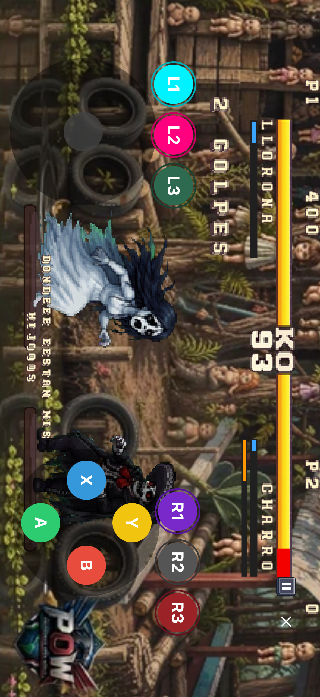
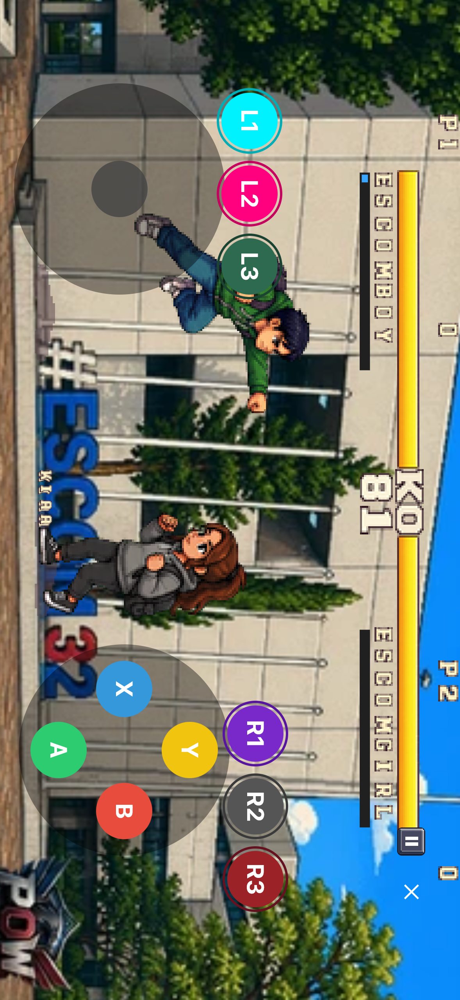

# iPhone 15 — página 4 de 21 / page 4 of 21

[← Anteriores 3 / Previous 3](03.md) · [Índice / Index](../README.md) · [Siguientes 3 / Next 3 →](05.md)

Esta página contiene únicamente las capturas indicadas. Las demás páginas se abren al elegir sus enlaces.
This page embeds only the screenshots shown below. Other pages open only when you choose their links.

## La Tzitzimime / Yoalli Ehécatl — UAM Azcapotzalco (Noche)

Tzitzimime y Yoalli separados con el contador 2 GOLPES legible sobre UAM Azcapotzalco nocturno; P1 400.

[PNG original / Original PNG](../26-uam_azcapo-night.png)

## La Llorona / El Charro Negro — Isla de las Muñecas

Llorona inclinada hacia Charro con contador 2 GOLPES, personajes reconocibles sobre la Isla de las Muñecas de día; P1 400.

[PNG original / Original PNG](../28-islamunecas-day.png)

## Estudiante / Estudianta — ESCOM

Estudiante en el aire con el puño extendido; Estudianta completa en el suelo, ESCOM de día y HUD completo. No se observa impacto ni reducción de vida.

[PNG original / Original PNG](../01-escom-day.png)

---

[← Anteriores 3 / Previous 3](03.md) · [Índice / Index](../README.md) · [Siguientes 3 / Next 3 →](05.md)
