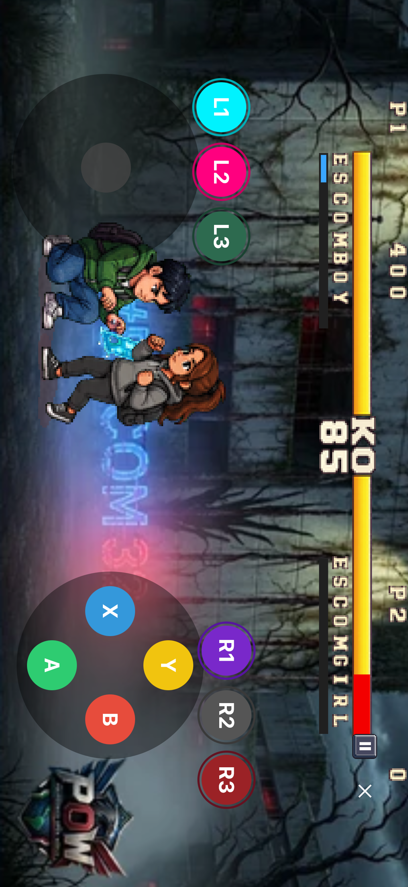
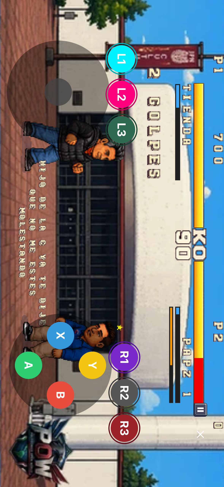
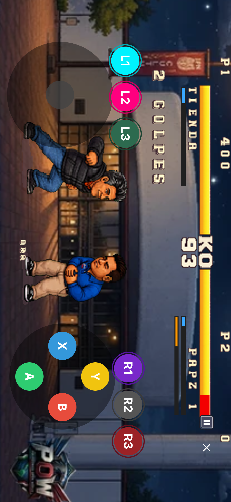

# iPhone 15 — página 5 de 21 / page 5 of 21

[← Anteriores 3 / Previous 3](04.md) · [Índice / Index](../README.md) · [Siguientes 3 / Next 3 →](06.md)

Esta página contiene únicamente las capturas indicadas. Las demás páginas se abren al elegir sus enlaces.
This page embeds only the screenshots shown below. Other pages open only when you choose their links.

## Estudiante / Estudianta — ESCOM (Noche 2)

Estudiante agachado con efecto cian brillante ante las manos y rival completa, sobre ESCOM apocalíptico con niebla; P1 400 y barra P2 reducida.

[PNG original / Original PNG](../03-escom-apocalypse.png)

## El Señor de la Tienda / Paparazzi 1 — Queso IPN

Señor de la Tienda y Paparazzi 1 separados, rostros reconocibles y contador 2 GOLPES ante Queso IPN de día; P1 700. La pareja corregida coincide con el runner.

[PNG original / Original PNG](../04-queso_ipn-day.png)

## El Señor de la Tienda / Paparazzi 1 — Queso IPN (Noche)

Señor de la Tienda en animación de ataque ante Paparazzi 1, ambos rostros claros, contador 2 GOLPES ante Queso IPN nocturno; P1 400. La pareja corregida coincide con el runner.

[PNG original / Original PNG](../05-queso_ipn-night.png)

---

[← Anteriores 3 / Previous 3](04.md) · [Índice / Index](../README.md) · [Siguientes 3 / Next 3 →](06.md)
