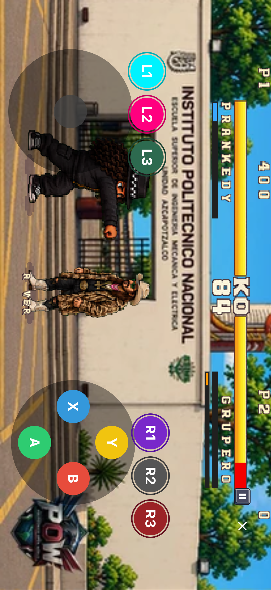
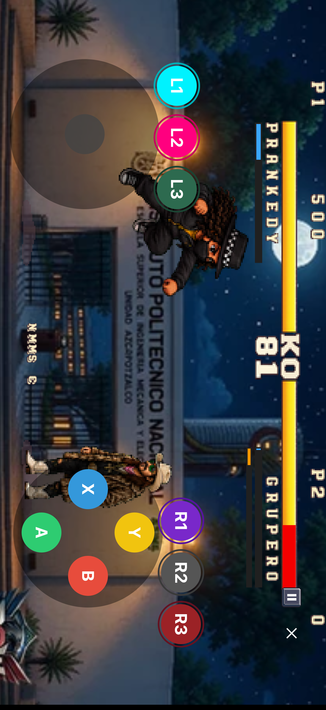
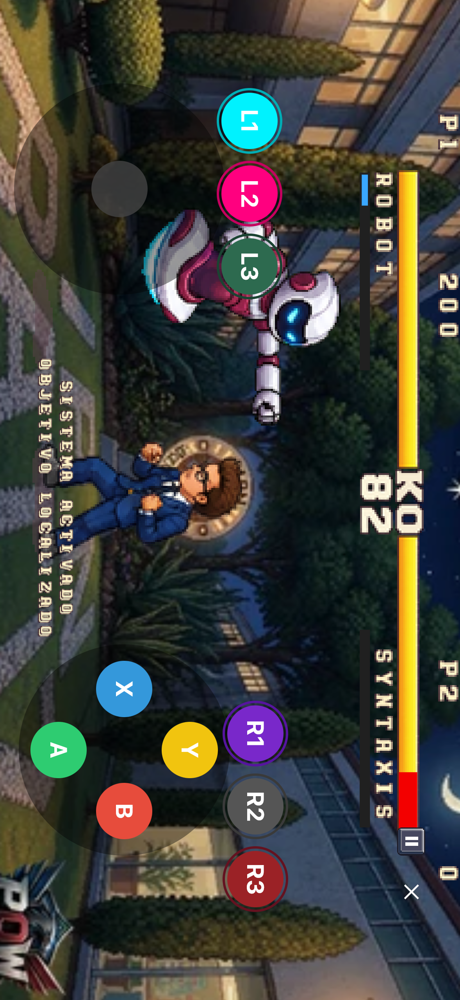

# iPhone 15 — página 6 de 21 / page 6 of 21

[← Anteriores 3 / Previous 3](05.md) · [Índice / Index](../README.md) · [Siguientes 3 / Next 3 →](07.md)

Esta página contiene únicamente las capturas indicadas. Las demás páginas se abren al elegir sus enlaces.
This page embeds only the screenshots shown below. Other pages open only when you choose their links.

## Prankedy / Rey Grupero — ESIME Azcapotzalco

Prankedy extiende el puño hacia Rey Grupero; ambos personajes completos y legibles frente al muro de ESIME Azcapotzalco de día. P1=400, barra P2 reducida; no hay contador de combo en esta foto.

[PNG original / Original PNG](../07-esime_azc-day.png)

## Prankedy / Rey Grupero — ESIME Azcapotzalco (Noche)

Prankedy está en el aire, con las piernas recogidas y un puño hacia delante; Rey Grupero permanece en el suelo. Luna, fachada iluminada de ESIME y HUD P1=500 visibles. No se demuestra impacto en esta foto.

[PNG original / Original PNG](../08-esime_azc-night.png)

## Robot Estudiantx / Alexis Syntaxis — CECyT 9 (Noche)

Robot en pose aérea con un brazo extendido y Alexis Syntaxis completo en el suelo, visor y rostro reconocibles ante CECyT 9 nocturno; P1 200. La imagen no prueba un impacto aéreo.

[PNG original / Original PNG](../11-cecyt_9-night.png)

---

[← Anteriores 3 / Previous 3](05.md) · [Índice / Index](../README.md) · [Siguientes 3 / Next 3 →](07.md)
