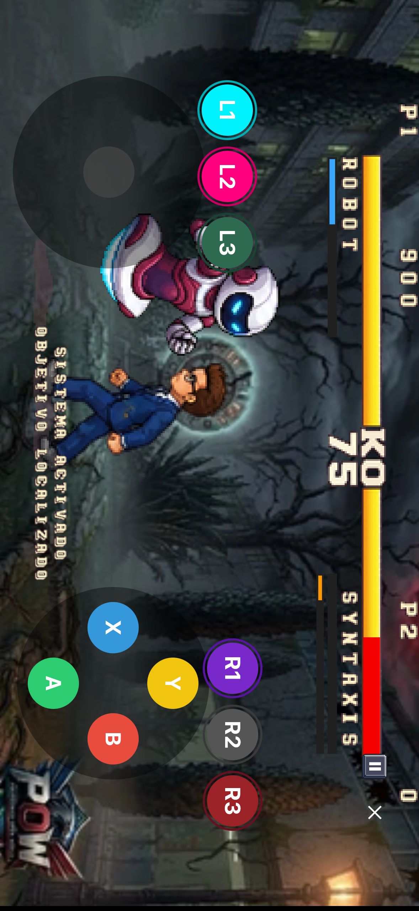
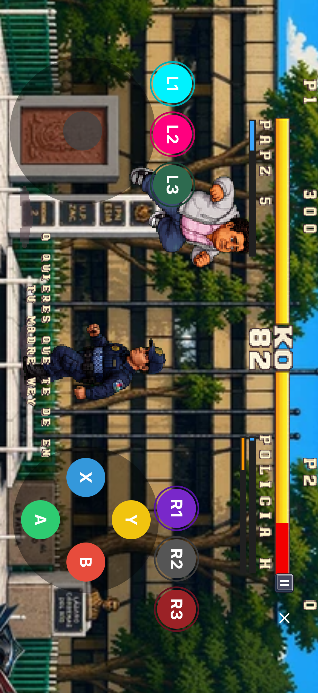
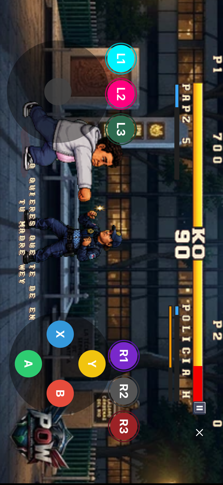

# iPhone 15 — página 7 de 21 / page 7 of 21

[← Anteriores 3 / Previous 3](06.md) · [Índice / Index](../README.md) · [Siguientes 3 / Next 3 →](08.md)

Esta página contiene únicamente las capturas indicadas. Las demás páginas se abren al elegir sus enlaces.
This page embeds only the screenshots shown below. Other pages open only when you choose their links.

## Robot Estudiantx / Alexis Syntaxis — CECyT 9 (Noche 2)

Robot elevado sobre el suelo con brazo alzado, junto a Alexis inclinado, en CECyT 9 apocalíptico. P1=900 y barra P2 reducida; haz propulsor cian bajo el robot. La foto no muestra contador de combo.

[PNG original / Original PNG](../12-cecyt_9-apocalypse.png)

## Paparazzi 5 / Policía CDMX (Hombre) — CECyT 2

Paparazzi 5 elevado con el brazo extendido y Policía CDMX hombre completo en el suelo, rostros/HUD claros ante CECyT 2 de día; P1 300. La pose aérea no prueba golpe conectado.

[PNG original / Original PNG](../13-cecyt_2-day.png)

## Paparazzi 5 / Policía CDMX (Hombre) — CECyT 2 (Noche)

Paparazzi 5 extiende el puño; un pequeño destello amarillo aparece ante el policía de gorra. CECyT 2 nocturno, HUD PAPZ 5/POLICIA H y P1=700; barra P2 reducida. No hay contador de combo en este frame.

[PNG original / Original PNG](../14-cecyt_2-night.png)

---

[← Anteriores 3 / Previous 3](06.md) · [Índice / Index](../README.md) · [Siguientes 3 / Next 3 →](08.md)
