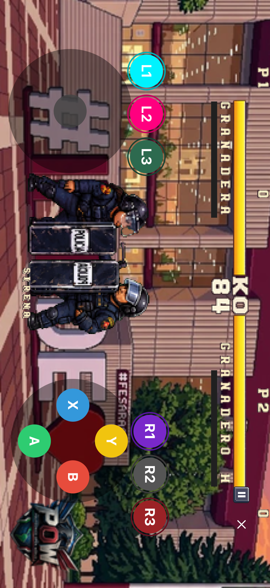
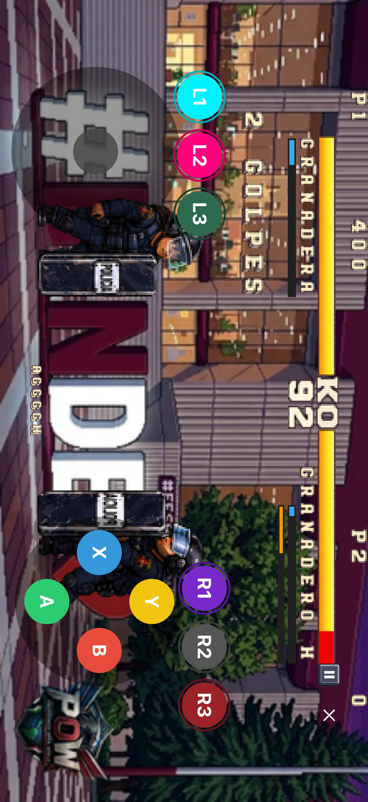
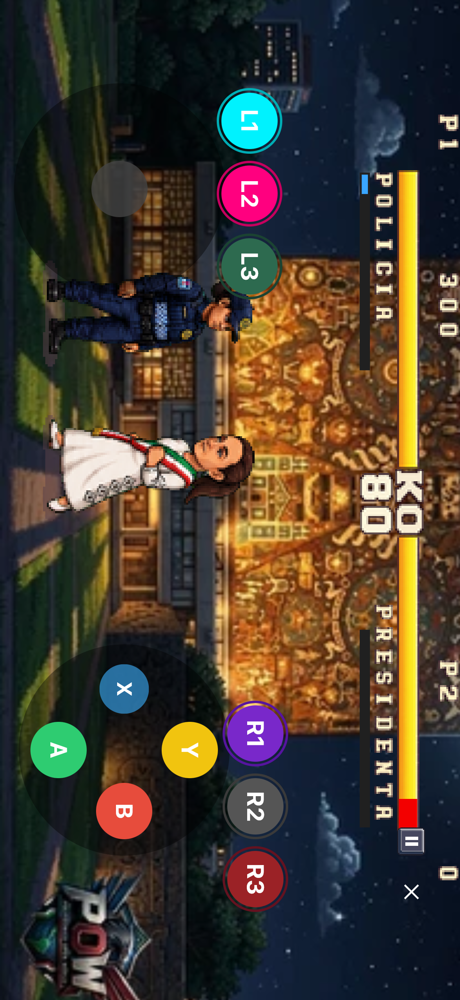

# iPhone 15 — página 8 de 21 / page 8 of 21

[← Anteriores 3 / Previous 3](07.md) · [Índice / Index](../README.md) · [Siguientes 3 / Next 3 →](09.md)

Esta página contiene únicamente las capturas indicadas. Las demás páginas se abren al elegir sus enlaces.
This page embeds only the screenshots shown below. Other pages open only when you choose their links.

## Policía Granadero CDMX (Mujer) / Policía Granadero CDMX (Hombre) — Biblioteca Nacional IPN (Noche)

Granadera con el brazo extendido sosteniendo un objeto tipo bastón y Granadero H cercano con escudo, identidades y HUD reconocibles sobre Biblioteca Nacional IPN nocturna; P1 0. No se atribuye un clip de audio al gesto ni al subtítulo.

[PNG original / Original PNG](../17-biblioteca_ipn-night.png)

## Policía Granadero CDMX (Mujer) / Policía Granadero CDMX (Hombre) — Biblioteca Nacional IPN (Noche 2)

Granadera y Granadero H separados, rostros/visores reconocibles y contador 2 GOLPES legible sobre Biblioteca Nacional IPN apocalíptica; P1 400.

[PNG original / Original PNG](../18-biblioteca_ipn-apocalypse.png)

## Policía CDMX / La Presidenta — CU UNAM (Noche)

Policía y Presidenta se encaran con cuerpos y caras legibles, frente al mural iluminado de Ciudad Universitaria de noche; HUD POLICIA/PRESIDENTA y P1=300. Esta foto no muestra impacto, combo ni salto.

[PNG original / Original PNG](../20-unam_biblioteca_cu-night.png)

---

[← Anteriores 3 / Previous 3](07.md) · [Índice / Index](../README.md) · [Siguientes 3 / Next 3 →](09.md)
