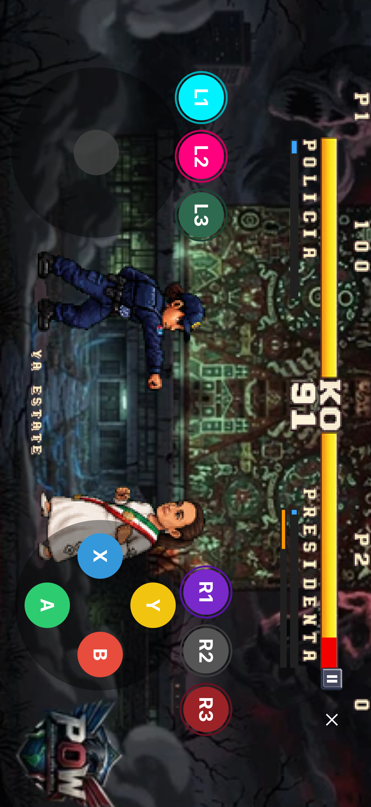
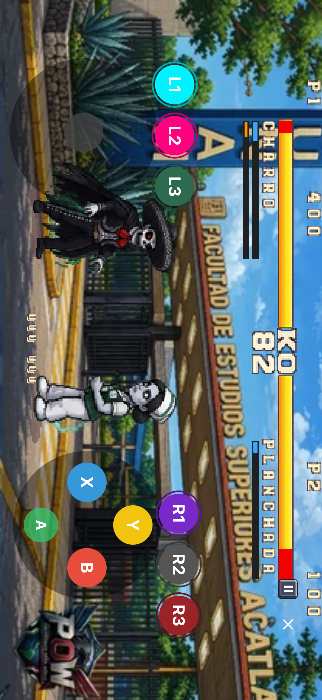
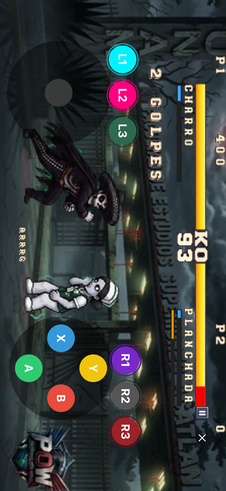

# iPhone 15 — página 9 de 21 / page 9 of 21

[← Anteriores 3 / Previous 3](08.md) · [Índice / Index](../README.md) · [Siguientes 3 / Next 3 →](10.md)

Esta página contiene únicamente las capturas indicadas. Las demás páginas se abren al elegir sus enlaces.
This page embeds only the screenshots shown below. Other pages open only when you choose their links.

## Policía CDMX / La Presidenta — CU UNAM (Noche 2)

Policía CDMX con el puño extendido y Presidenta separada, ambos rostros reconocibles; CU UNAM apocalíptico, P1 100 y barra P2 reducida.

[PNG original / Original PNG](../21-unam_biblioteca_cu-apocalypse.png)

## El Charro Negro / La Planchada — FES Acatlán

Charro y Planchada completos y separados frente a FES Acatlán de día; ambos rostros legibles, P1 400. Esta toma evita el pequeño borde de otras acciones.

[PNG original / Original PNG](../22-fes_acatlan-day.png)

## El Charro Negro / La Planchada — FES Acatlán (Noche 2)

Charro inclinado hacia delante y Planchada separada con el contador 2 GOLPES sobre FES Acatlán apocalíptico; P1 400.

[PNG original / Original PNG](../24-fes_acatlan-apocalypse.png)

---

[← Anteriores 3 / Previous 3](08.md) · [Índice / Index](../README.md) · [Siguientes 3 / Next 3 →](10.md)
