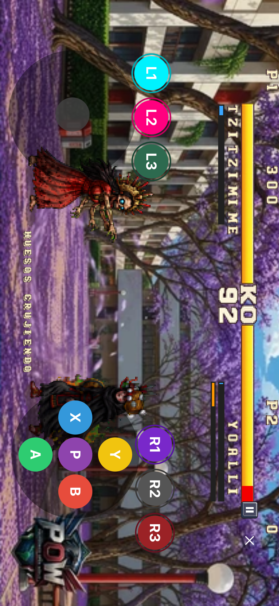
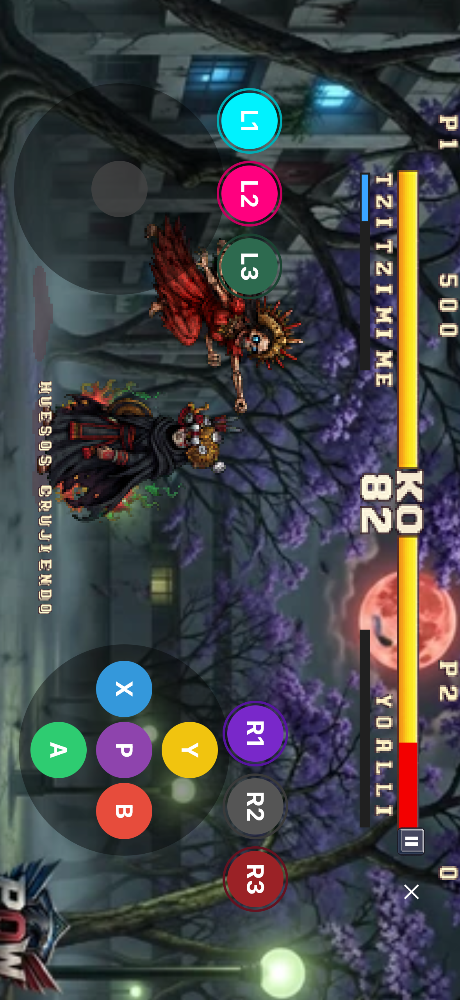
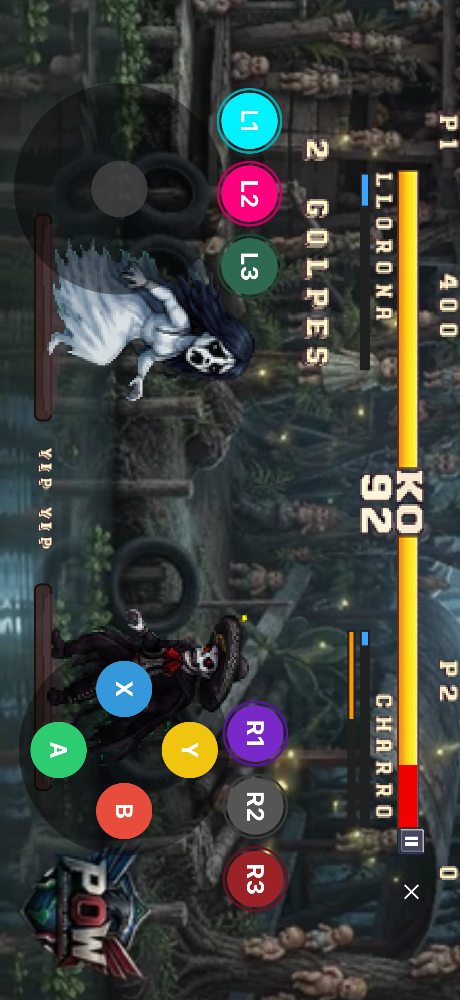

# iPhone 15 — página 10 de 21 / page 10 of 21

[← Anteriores 3 / Previous 3](09.md) · [Índice / Index](../README.md) · [Siguientes 3 / Next 3 →](11.md)

Esta página contiene únicamente las capturas indicadas. Las demás páginas se abren al elegir sus enlaces.
This page embeds only the screenshots shown below. Other pages open only when you choose their links.

## La Tzitzimime / Yoalli Ehécatl — UAM Azcapotzalco

Tzitzimime con los brazos extendidos ante Yoalli, ambos cuerpos y rostros reconocibles, jacarandas de UAM Azcapotzalco de día; P1 300.

[PNG original / Original PNG](../25-uam_azcapo-day.png)

## La Tzitzimime / Yoalli Ehécatl — UAM Azcapotzalco (Noche 2)

Tzitzimime elevada y Yoalli completo en el suelo, rostros reconocibles, luna roja y remolino de UAM Azcapotzalco apocalíptico; P1 500. La pose aérea no prueba impacto. La franja previa no aparece en este original.

[PNG original / Original PNG](../27-uam_azcapo-apocalypse.png)

## La Llorona / El Charro Negro — Isla de las Muñecas (Noche)

Llorona y Charro separados con contador 2 GOLPES claro, muñecas y reflejos nocturnos del escenario visibles; P1 400.

[PNG original / Original PNG](../29-islamunecas-night.png)

---

[← Anteriores 3 / Previous 3](09.md) · [Índice / Index](../README.md) · [Siguientes 3 / Next 3 →](11.md)
