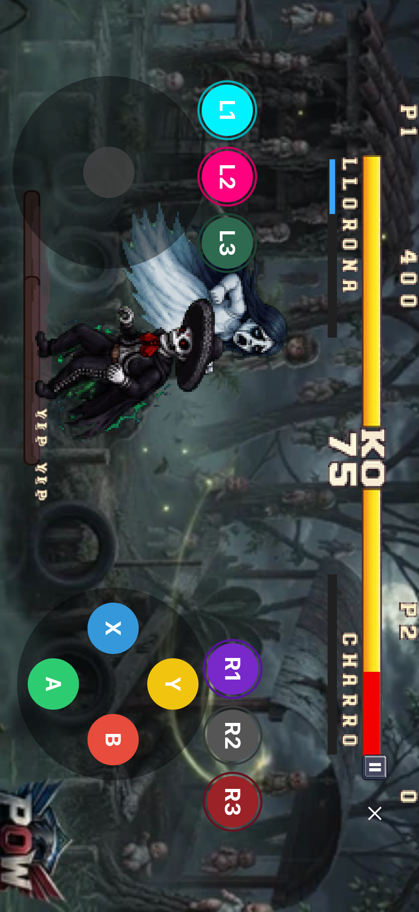
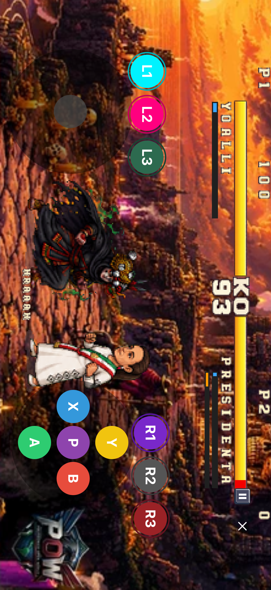
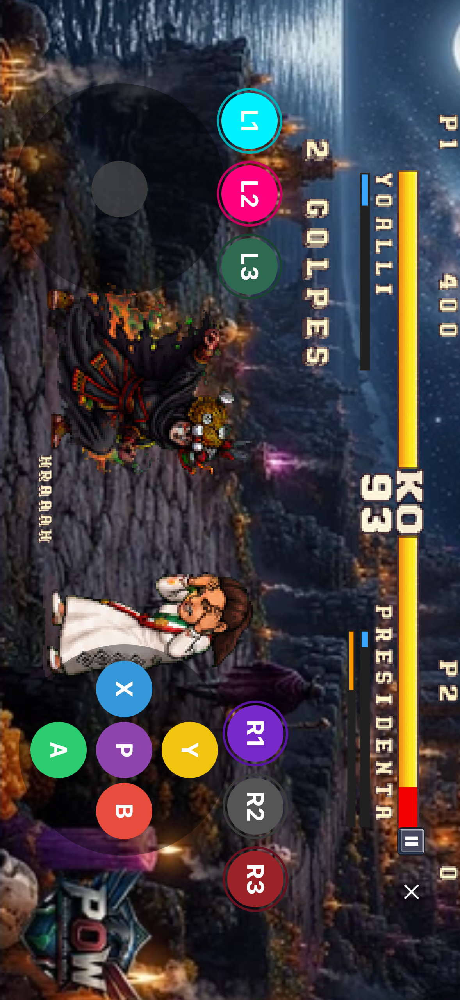

# iPhone 15 — página 11 de 21 / page 11 of 21

[← Anteriores 3 / Previous 3](10.md) · [Índice / Index](../README.md) · [Siguientes 3 / Next 3 →](12.md)

Esta página contiene únicamente las capturas indicadas. Las demás páginas se abren al elegir sus enlaces.
This page embeds only the screenshots shown below. Other pages open only when you choose their links.

## La Llorona / El Charro Negro — Isla de las Muñecas (Noche 2)

Llorona elevada por encima del Charro, ambos rostros visibles y HUD completo sobre la Isla de las Muñecas apocalíptica; P1 400. La pose aérea no prueba impacto.

[PNG original / Original PNG](../30-islamunecas-apocalypse.png)

## Yoalli Ehécatl / La Presidenta — Mictlán

Yoalli inclinado y Presidenta separada, ambos rostros reconocibles, paisaje naranja y velas de Mictlán visibles; P1 100.

[PNG original / Original PNG](../31-mictlan-day.png)

## Yoalli Ehécatl / La Presidenta — Mictlán (Noche)

Yoalli en animación de ataque y Presidenta en reacción con las manos junto al rostro, contador 2 GOLPES sobre Mictlán nocturno; P1 400.

[PNG original / Original PNG](../32-mictlan-night.png)

---

[← Anteriores 3 / Previous 3](10.md) · [Índice / Index](../README.md) · [Siguientes 3 / Next 3 →](12.md)
