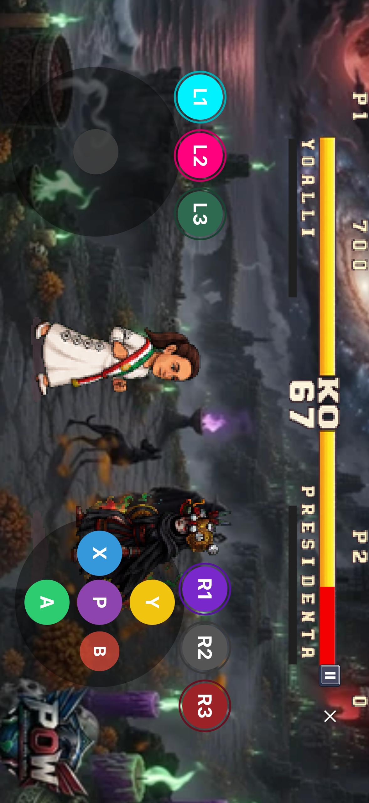
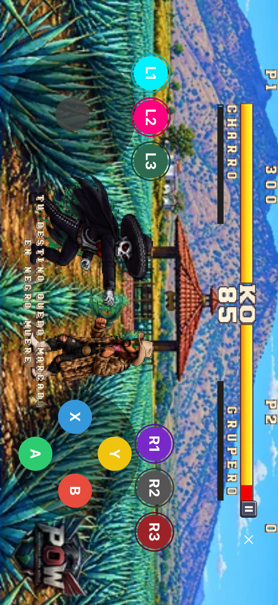
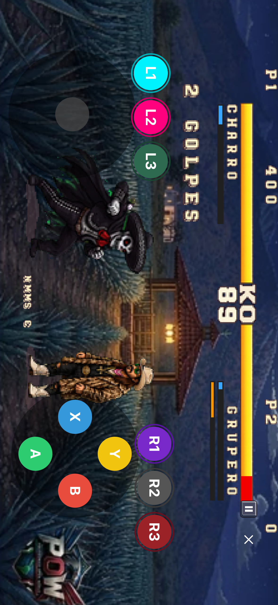

# iPhone 15 — página 12 de 21 / page 12 of 21

[← Anteriores 3 / Previous 3](11.md) · [Índice / Index](../README.md) · [Siguientes 3 / Next 3 →](13.md)

Esta página contiene únicamente las capturas indicadas. Las demás páginas se abren al elegir sus enlaces.
This page embeds only the screenshots shown below. Other pages open only when you choose their links.

## Yoalli Ehécatl / La Presidenta — Mictlán (Noche 2)

Yoalli elevado a la derecha y Presidenta a la izquierda, ambos reconocibles ante Mictlán apocalíptico y luna roja; P1 700. El cruce de posiciones no cambia las identidades P1/P2 del HUD.

[PNG original / Original PNG](../33-mictlan-apocalypse.png)

## El Charro Negro / Rey Grupero — Campos de Agave Jalisco

Charro con el brazo extendido y pequeñas partículas verdes cerca del puño ante Rey Grupero, ambos rostros visibles, campos de agave de día; P1 300. No prueba especial conectado.

[PNG original / Original PNG](../34-campos_agave_jalisco-day.png)

## El Charro Negro / Rey Grupero — Campos de Agave Jalisco (Noche)

Charro avanzando ante Rey Grupero con contador 2 GOLPES legible, agaves y kiosco iluminado nocturno; P1 400.

[PNG original / Original PNG](../35-campos_agave_jalisco-night.png)

---

[← Anteriores 3 / Previous 3](11.md) · [Índice / Index](../README.md) · [Siguientes 3 / Next 3 →](13.md)
