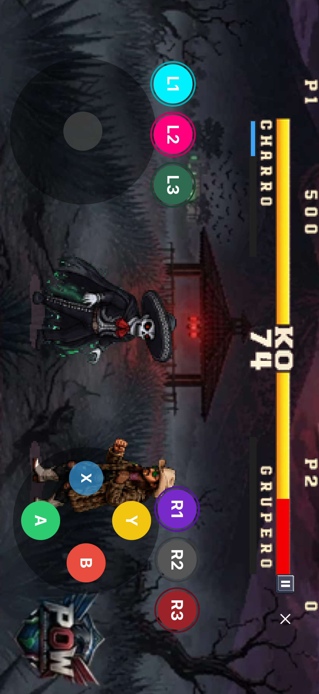
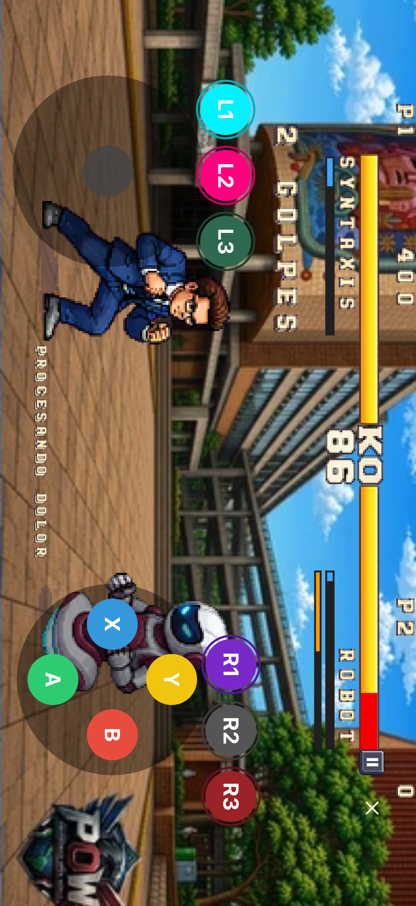
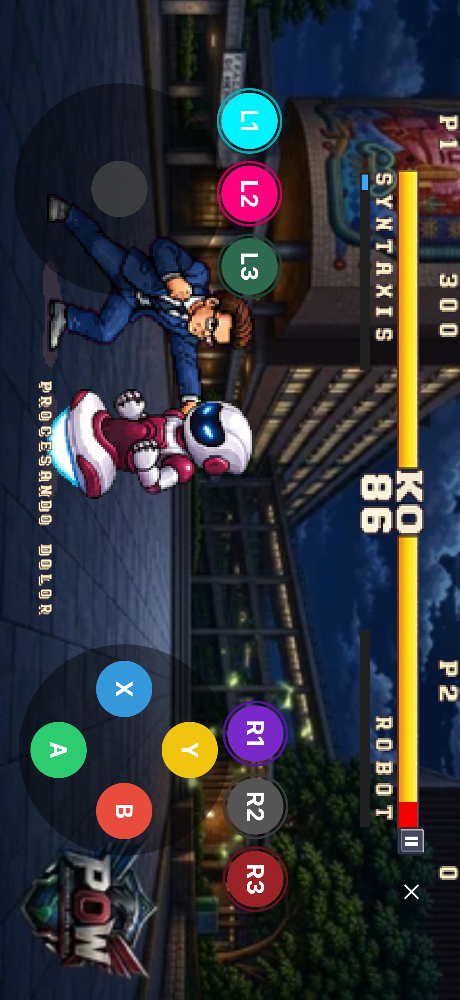

# iPhone 15 — página 13 de 21 / page 13 of 21

[← Anteriores 3 / Previous 3](12.md) · [Índice / Index](../README.md) · [Siguientes 3 / Next 3 →](14.md)

Esta página contiene únicamente las capturas indicadas. Las demás páginas se abren al elegir sus enlaces.
This page embeds only the screenshots shown below. Other pages open only when you choose their links.

## El Charro Negro / Rey Grupero — Campos de Agave Jalisco (Noche 2)

Charro a la izquierda y Rey Grupero en guardia a la derecha, rostros separados y HUD completo frente al agave apocalíptico; P1 500.

[PNG original / Original PNG](../36-campos_agave_jalisco-apocalypse.png)

## Alexis Syntaxis / Robot Estudiantx — Facultad de Medicina

Alexis Syntaxis y Robot separados con contador 2 GOLPES sobre Facultad de Medicina de día; rostro y visor legibles, P1 400.

[PNG original / Original PNG](../37-facultad_medicina-day.png)

## Alexis Syntaxis / Robot Estudiantx — Facultad de Medicina (Noche)

Alexis Syntaxis con el puño extendido hacia Robot, rostro y visor legibles sobre Facultad de Medicina nocturna; P1 300. Se prefirió esta toma sin banda a la de partículas musicales.

[PNG original / Original PNG](../38-facultad_medicina-night.png)

---

[← Anteriores 3 / Previous 3](12.md) · [Índice / Index](../README.md) · [Siguientes 3 / Next 3 →](14.md)
