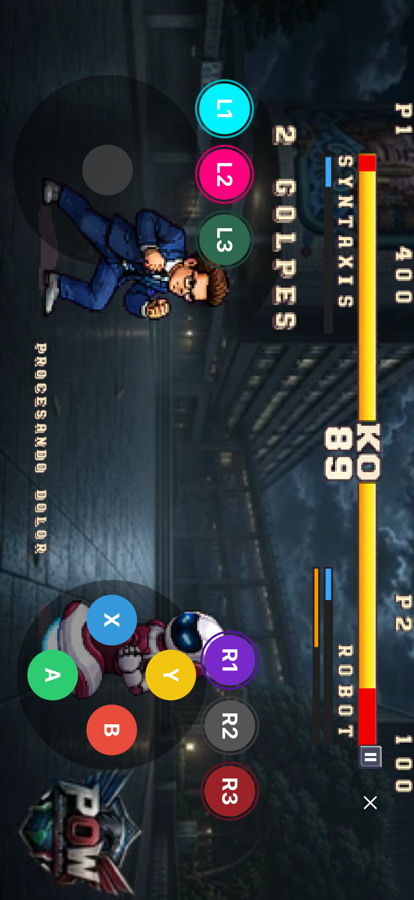
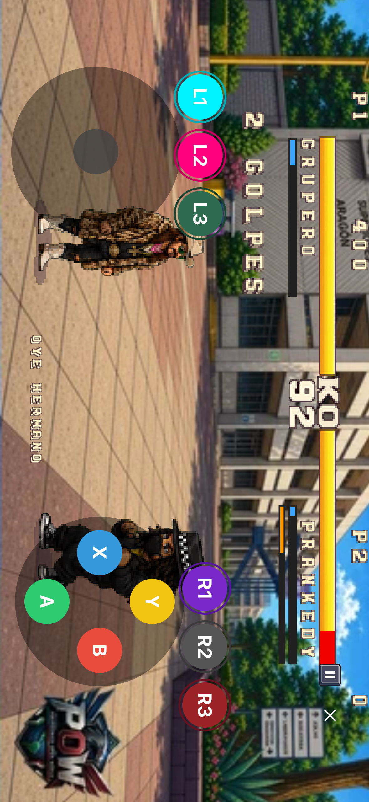
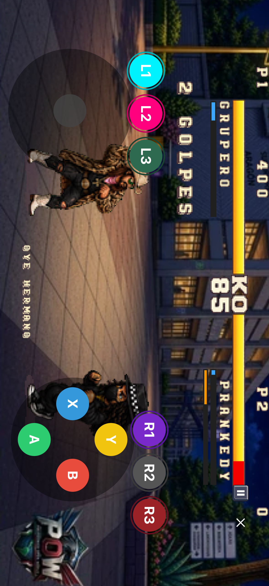

# iPhone 15 — página 14 de 21 / page 14 of 21

[← Anteriores 3 / Previous 3](13.md) · [Índice / Index](../README.md) · [Siguientes 3 / Next 3 →](15.md)

Esta página contiene únicamente las capturas indicadas. Las demás páginas se abren al elegir sus enlaces.
This page embeds only the screenshots shown below. Other pages open only when you choose their links.

## Alexis Syntaxis / Robot Estudiantx — Facultad de Medicina (Noche 2)

Alexis Syntaxis y Robot separados con contador 2 GOLPES legible sobre Facultad de Medicina apocalíptica; P1 400.

[PNG original / Original PNG](../39-facultad_medicina-apocalypse.png)

## Rey Grupero / Prankedy — FES Aragón

Rey Grupero y Prankedy separados, rostros reconocibles y contador 2 GOLPES legible ante FES Aragón de día; P1 400. La franja previa no aparece en este original.

[PNG original / Original PNG](../40-fes_aragon-day.png)

## Rey Grupero / Prankedy — FES Aragón (Noche)

Rey Grupero y Prankedy separados, HUD GRUPERO/PRANKEDY, contador 2 GOLPES visible y P1 400 ante FES Aragón nocturna.

[PNG original / Original PNG](../41-fes_aragon-night.png)

---

[← Anteriores 3 / Previous 3](13.md) · [Índice / Index](../README.md) · [Siguientes 3 / Next 3 →](15.md)
