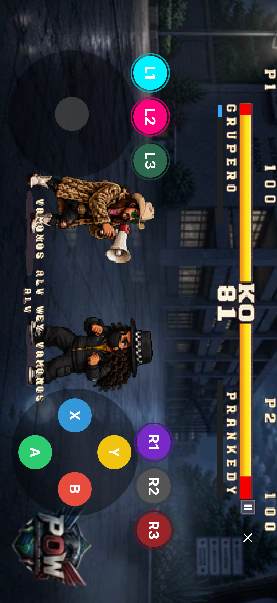
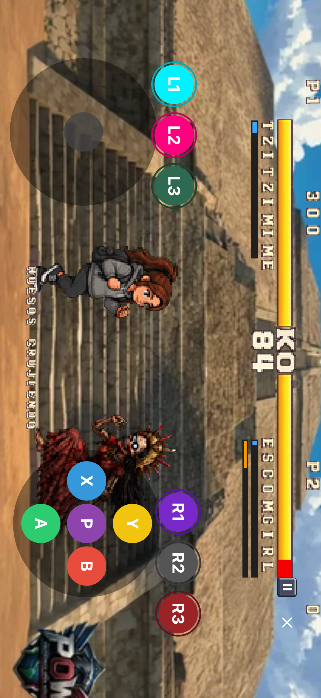
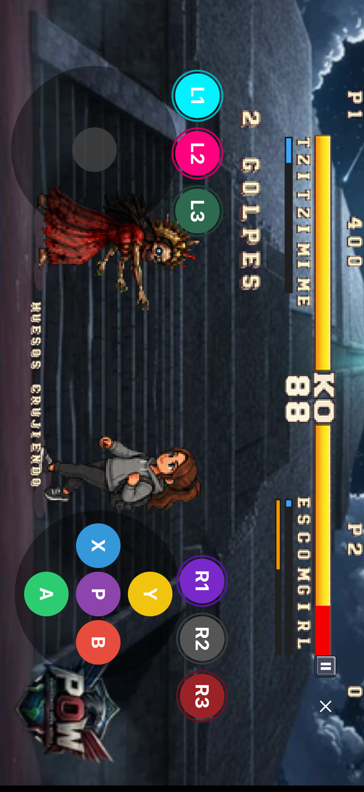

# iPhone 15 — página 15 de 21 / page 15 of 21

[← Anteriores 3 / Previous 3](14.md) · [Índice / Index](../README.md) · [Siguientes 3 / Next 3 →](16.md)

Esta página contiene únicamente las capturas indicadas. Las demás páginas se abren al elegir sus enlaces.
This page embeds only the screenshots shown below. Other pages open only when you choose their links.

## Rey Grupero / Prankedy — FES Aragón (Noche 2)

Rey Grupero sostiene un megáfono frente a Prankedy; ambos rostros se distinguen, FES Aragón apocalíptica con niebla, P1 100/P2 100.

[PNG original / Original PNG](../42-fes_aragon-apocalypse.png)

## La Tzitzimime / Estudianta — Pirámide del Sol

Estudianta a la izquierda con rodilla levantada y La Tzitzimime a la derecha, ambas legibles ante Pirámide del Sol de día. HUD TZITZIMIME/ESCOMGIRL y P1 300; la posición izquierda no se identifica como P1.

[PNG original / Original PNG](../43-piramidesol-day.png)

## La Tzitzimime / Estudianta — Pirámide del Sol (Noche)

La Tzitzimime extiende varios brazos hacia Estudianta, contador 2 GOLPES visible y P1 400 ante Pirámide del Sol nocturna.

[PNG original / Original PNG](../44-piramidesol-night.png)

---

[← Anteriores 3 / Previous 3](14.md) · [Índice / Index](../README.md) · [Siguientes 3 / Next 3 →](16.md)
