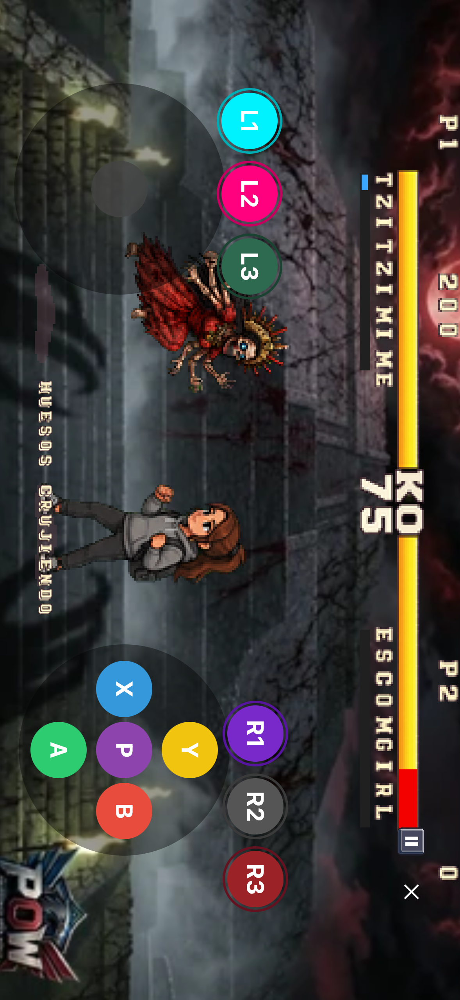
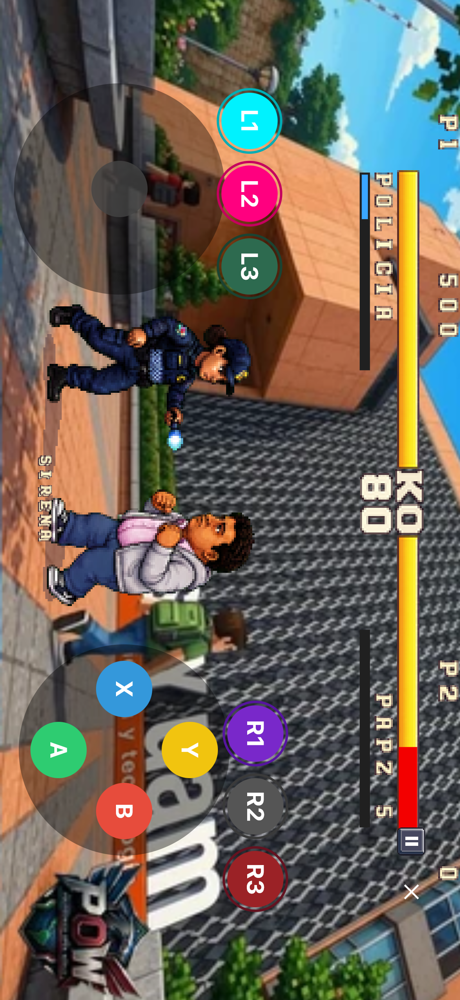
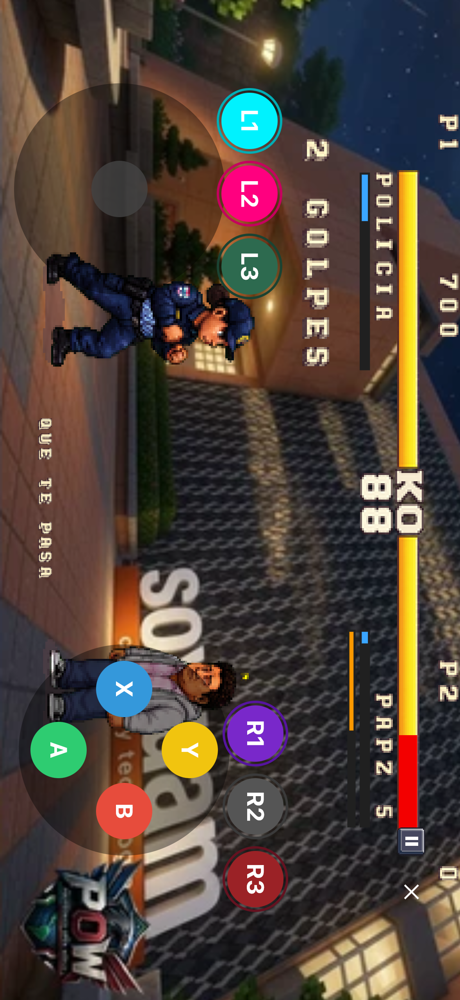

# iPhone 15 — página 16 de 21 / page 16 of 21

[← Anteriores 3 / Previous 3](15.md) · [Índice / Index](../README.md) · [Siguientes 3 / Next 3 →](17.md)

Esta página contiene únicamente las capturas indicadas. Las demás páginas se abren al elegir sus enlaces.
This page embeds only the screenshots shown below. Other pages open only when you choose their links.

## La Tzitzimime / Estudianta — Pirámide del Sol (Noche 2)

La Tzitzimime aparece suspendida en el aire con vestido rojo y varios brazos, Estudianta en guardia y Pirámide del Sol apocalíptica bajo luna roja; P1 200.

[PNG original / Original PNG](../45-piramidesol-apocalypse.png)

## Policía CDMX / Paparazzi 5 — UAM Cuajimalpa

Policía CDMX extiende el brazo con un pequeño efecto cian luminoso delante de la mano frente a Paparazzi 5; UAM Cuajimalpa de día con peatones animados de fondo, P1 500.

[PNG original / Original PNG](../46-uam_cuajimalpa-day.png)

## Policía CDMX / Paparazzi 5 — UAM Cuajimalpa (Noche)

Policía CDMX y Paparazzi 5 separados, rostros/HUD reconocibles y contador 2 GOLPES ante UAM Cuajimalpa nocturna; P1 700.

[PNG original / Original PNG](../47-uam_cuajimalpa-night.png)

---

[← Anteriores 3 / Previous 3](15.md) · [Índice / Index](../README.md) · [Siguientes 3 / Next 3 →](17.md)
