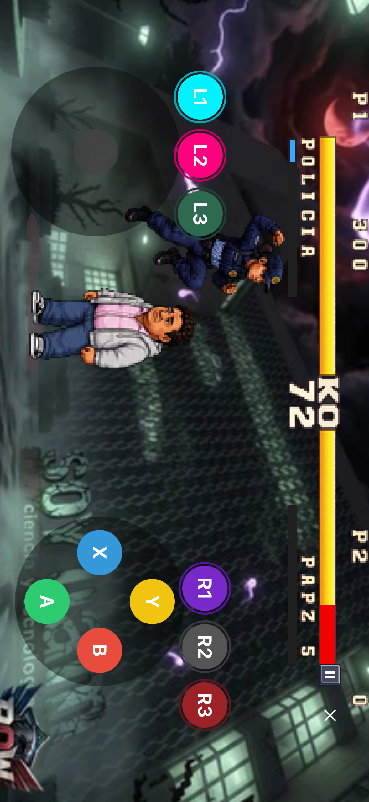
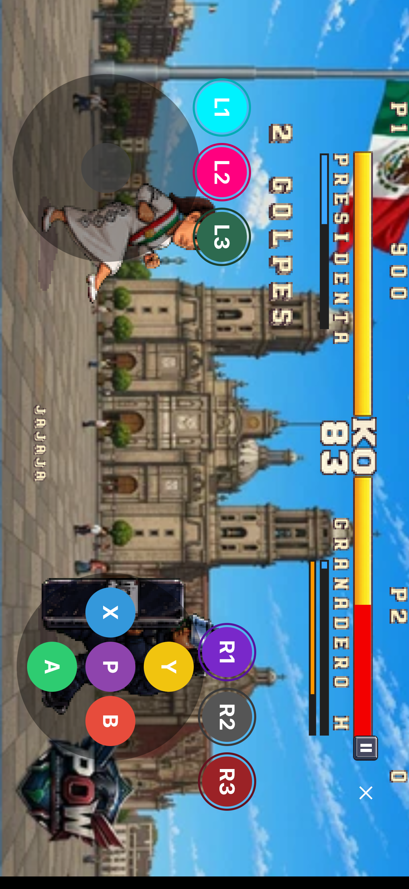
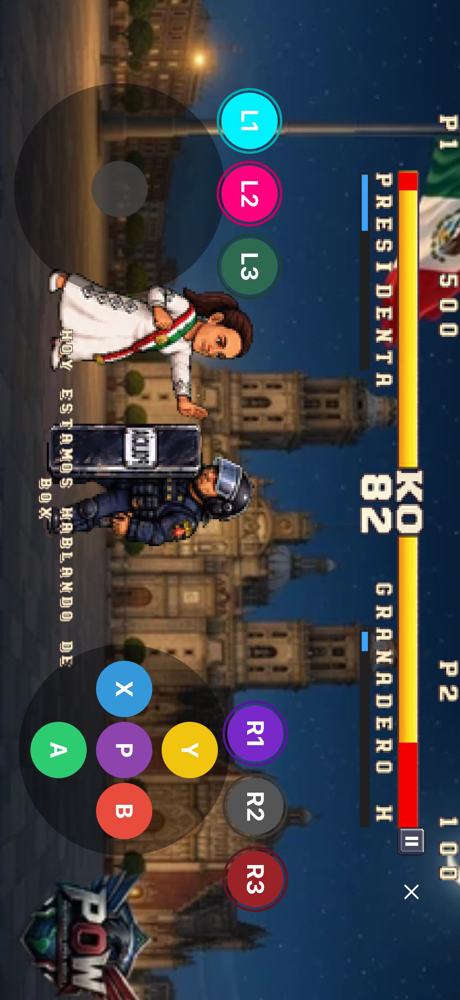

# iPhone 15 — página 17 de 21 / page 17 of 21

[← Anteriores 3 / Previous 3](16.md) · [Índice / Index](../README.md) · [Siguientes 3 / Next 3 →](18.md)

Esta página contiene únicamente las capturas indicadas. Las demás páginas se abren al elegir sus enlaces.
This page embeds only the screenshots shown below. Other pages open only when you choose their links.

## Policía CDMX / Paparazzi 5 — UAM Cuajimalpa (Noche 2)

Policía CDMX en el aire con rodilla levantada sobre Paparazzi 5; UAM Cuajimalpa apocalíptica y efectos púrpuras propios del fondo, P1 300.

[PNG original / Original PNG](../48-uam_cuajimalpa-apocalypse.png)

## La Presidenta / Policía Granadero CDMX (Hombre) — Zócalo

La Presidenta levanta una pierna frente al Granadero Hombre con escudo; contador 2 GOLPES visible, P1 900 y Catedral/Zócalo de día.

[PNG original / Original PNG](../49-zocalo-day.png)

## La Presidenta / Policía Granadero CDMX (Hombre) — Zócalo (Noche)

La Presidenta extiende una mano abierta hacia el escudo del Granadero Hombre, ambos rostros legibles y Zócalo nocturno iluminado; P1 500/P2 100.

[PNG original / Original PNG](../50-zocalo-night.png)

---

[← Anteriores 3 / Previous 3](16.md) · [Índice / Index](../README.md) · [Siguientes 3 / Next 3 →](18.md)
