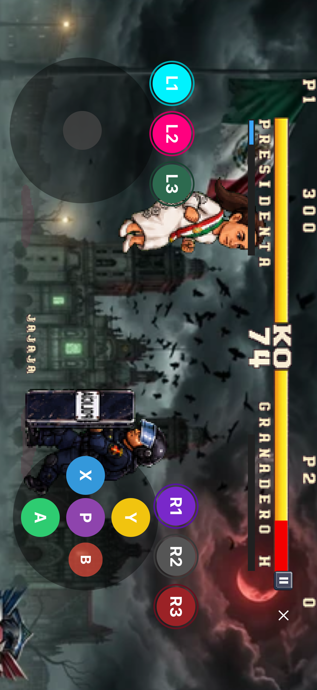
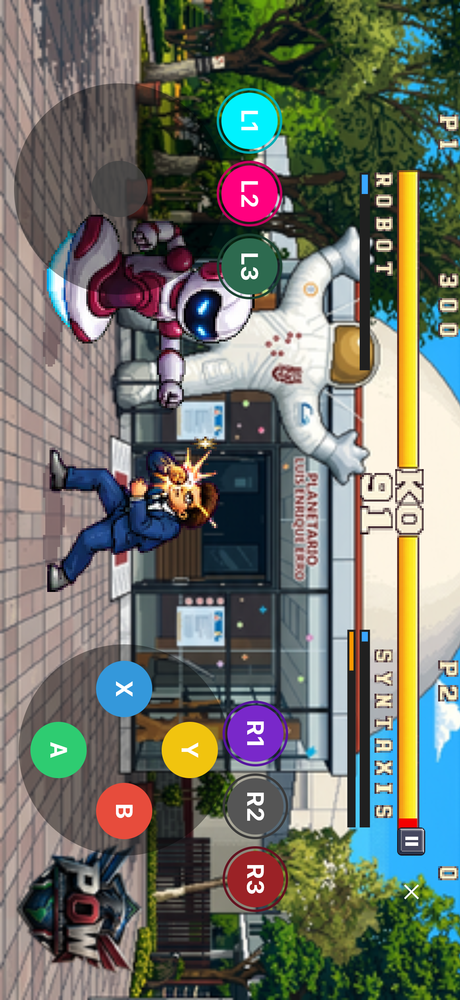
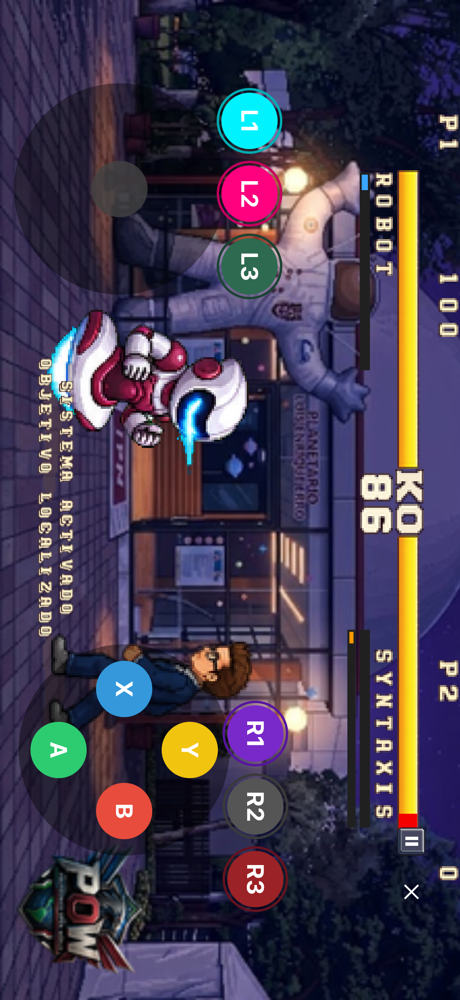

# iPhone 15 — página 18 de 21 / page 18 of 21

[← Anteriores 3 / Previous 3](17.md) · [Índice / Index](../README.md) · [Siguientes 3 / Next 3 →](19.md)

Esta página contiene únicamente las capturas indicadas. Las demás páginas se abren al elegir sus enlaces.
This page embeds only the screenshots shown below. Other pages open only when you choose their links.

## La Presidenta / Policía Granadero CDMX (Hombre) — Zócalo (Noche 2)

La Presidenta suspendida en el aire frente al Granadero Hombre, Zócalo apocalíptico con aves y luna roja; P1 300. La escena llega hasta los dos bordes.

[PNG original / Original PNG](../51-zocalo-apocalypse.png)

## Robot Estudiantx / Alexis Syntaxis — Planetario IPN

Robot Estudiantx con brazo extendido y chispa de impacto ante el rostro de Alexis Syntaxis; Planetario IPN de día, HUD ROBOT/SYNTAXIS y P1 300.

[PNG original / Original PNG](../52-planetario-day.png)

## Robot Estudiantx / Alexis Syntaxis — Planetario (Noche)

Haz cian corto visible desde el visor del Robot frente a Alexis Syntaxis; Planetario nocturno iluminado y P1 100.

[PNG original / Original PNG](../53-planetario-night.png)

---

[← Anteriores 3 / Previous 3](17.md) · [Índice / Index](../README.md) · [Siguientes 3 / Next 3 →](19.md)
